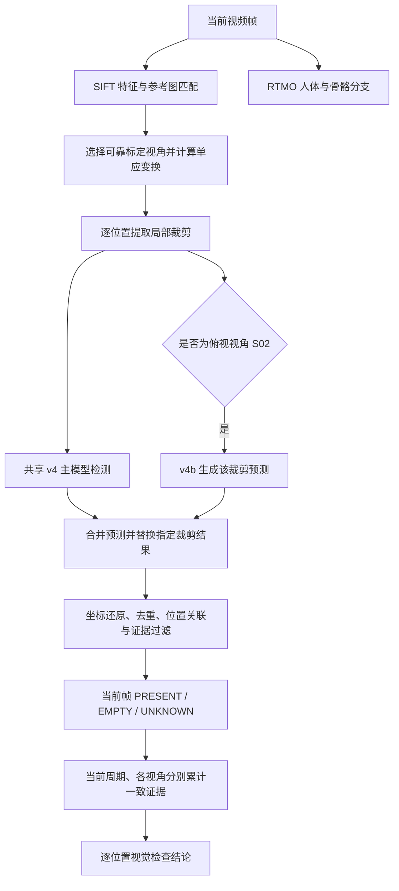
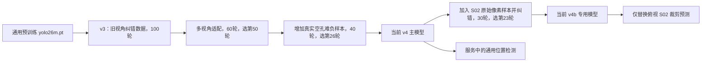

# 当前启用的 .pt 模型清单与训练流程核查

核查日期：2026-11-09，时区 Asia/Shanghai。项目目录：`D:/Project/AISOP`。

本文依据运行中的本机服务、数据库任务快照、当前配置、实际权重、训练代码、训练日志与数据文件整理。本文中的“当前启用”指服务业务配置选择的模型；“正在执行推理”需要另外的运行时证据。历史训练发生于 2026-10-17，本次没有重新训练或重新评测准确率。

## 1. 核查结论

**当前螺丝检测业务启用两份 `.pt` 权重：`screw-head-v4-yolo26m.pt` 主模型，以及只用于新俯视视角 S02 位置的 `screw-head-v4b-yolo26m.pt` 专用模型。** 二者都是基于 YOLO26m 微调的双类别目标检测器，识别 `screw_head` 和 `empty_hole`。

当前贴条任务使用 `sticker-actions-v1.joblib`；人体检测与姿态使用 RTMO-m 的 ONNX 模型。因此，不能把目录中的贴条 YOLO 权重、YOLO11 姿态权重都列为当前业务正在使用的 `.pt` 模型。

核查时 API 和 Worker 进程均存在，健康接口返回 `ready`；数据库没有 `RUNNING` 或 `QUEUED` 离线任务，实时姿态状态为 `not_loaded`。现有接口没有提供螺丝检测器的完整内存缓存枚举，故本文确认的是**当前服务启用的模型组合及其历史实际调用记录**，不声称两份权重在核查瞬间已经驻留显存或持续执行推理。

### 1.1 当前启用的 .pt 模型

| 项目 | 主模型 v4 | S02 专用模型 v4b |
|---|---|---|
| 文件 | `models/screw-head-v4-yolo26m.pt` | `models/screw-head-v4b-yolo26m.pt` |
| 业务版本 | 两者共同组成 `screw-video-v4.1-multiview` | 同左 |
| 模型结构 | YOLO26m，检测任务，2 类 | YOLO26m，检测任务，2 类 |
| 参数量 | 21,775,972 | 21,775,972 |
| 文件大小 | 43,983,129 字节 | 43,981,785 字节 |
| 类别 0 | `screw_head`，可见螺丝头 | 相同 |
| 类别 1 | `empty_hole`，可见空孔 | 相同 |
| 配置位置 | `config/screw-inspection.json` 的 `model` | 同文件 `calibrations[0].target_models.S02` |
| 使用范围 | 原视角及新俯视视角的通用局部检测 | `overhead-v4` 视角的 S02 裁剪预测 |
| 直接训练来源 | `training-hardneg/weights/best.pt` | `training-native/weights/best.pt` |
| 最佳 epoch，按 CSV 的 1 起始编号 | 26 / 实际训练 40 轮 | 23 / 实际训练 30 轮 |
| 权重记录的保存时间 | 2026-10-17 15:46:45 +08:00 | 2026-10-17 15:59:15 +08:00 |

两份文件的 SHA-256 均已重新计算，并与对应训练目录的 `best.pt` 及成功任务快照核对一致：

```text
主模型 v4
b0212b49d2ebde8d901d9b0cb833bbc0ec89035c872cec3a62a32b8805681e1d

S02 专用模型 v4b
eeb0ed8da075cf99c0182b72dd230d13c3537d61cd6ee191ba82865d9f7cbe31
```

### 1.2 “当前使用”的证据链

| 证据 | 本次实际读取结果 | 能证明什么 |
|---|---|---|
| Windows 进程与监听端口 | API 监听 `127.0.0.1:8000`，实际监听 PID 8952；Worker 实际 Python 子进程 PID 8664 | 服务进程存在；PID 是本次快照，重启后会变化 |
| `GET /api/v1/health` | `status=ready`；分析能力为螺丝与贴条检测；实时后端 `rtmo`，状态 `not_loaded` | 服务可响应及其当前姿态后端 |
| `GET /api/v1/screw-model` | 版本 `screw-video-v4.1-multiview`，`ready=true` | 当前配置被服务读取；`ready` 本身不等于模型已经加载 |
| 活跃配置 | 主模型 v4；俯视 S02 映射到 v4b | 新建螺丝任务的模型选择 |
| 模型加载代码 | 多视角共享主模型；位置专用模型替换对应裁剪预测 | 两份权重的具体分工 |
| 最新成功螺丝任务 | `05d3c8c4-f3de-4285-b06e-25ee5051daa5`，创建于 2026-10-28 18:35:39 +08:00 | 历史任务实际采用该组合，而非仅存在于配置 |
| 该任务快照与 manifest | 两份 `.pt` 路径及 SHA-256 与当前文件一致 | 历史成功任务与当前权重的对应关系 |
| 数据库任务状态 | 成功 45、取消 14、失败 1；没有排队或运行中的离线任务 | 不能将“服务启动”写成“此刻有离线任务正在推理” |
| 自定义模型注册表与场景 | `model_registry`、`scene_tasks` 均为空；`GET /api/v1/scenes` 返回空列表 | 没有另外发布的自定义场景 `.pt` 模型 |

数据库以只读方式打开。最新任务的结果位于 `.runtime/local-data/runs/05d3c8c4-f3de-4285-b06e-25ee5051daa5-1/`。配置文件原始字节 SHA-256 为 `711c95f5be5dd4c90e66d21b2ae81eb02e9ac9c897b9c7e667e03eb3dad2f8b7`。

## 2. 其他模型文件为什么不属于上述清单

### 2.1 当前业务同时使用的非 .pt 模型

| 业务 | 当前模型 | 状态与训练边界 |
|---|---|---|
| 贴条动作检测 | `models/sticker-actions-v1.joblib` | 当前配置 `mode=action`；按位置训练的传统机器学习分类器，详见第 10 节 |
| 人体与 17 点骨骼 | `rtmo-m_16xb16-600e_body7-640x640-39e78cc4_20231211.onnx` | API 明确返回实时、离线后端均为 `rtmo`；历史任务中记录该 ONNX 资产 |

RTMO 历史任务记录路径为 `C:/Users/86137/.cache/rtmlib/hub/checkpoints/rtmo-m_16xb16-600e_body7-640x640-39e78cc4_20231211.onnx`。项目通过 `algorithms/rtmlib_pose.py` 调用该预训练模型，本文没有发现本项目对它重新训练的证据。文件名中的训练信息不能代替完整训练日志。

### 2.2 本地 .pt 文件库存与用途

本次在 `models/` 发现 15 个 `.pt` 文件，在 `weights/` 发现 1 个。下表逐一列出；这不是 16 个同时运行的模型。

| 文件 | 本次判定 |
|---|---|
| `models/screw-head-v4-yolo26m.pt` | 当前启用的主模型 |
| `models/screw-head-v4b-yolo26m.pt` | 当前启用的新俯视 S02 专用模型 |
| `models/screw-head-v3-yolo26m.pt` | v4 的初始化来源、历史版本 |
| `models/screw-head-v2s.pt` | YOLO11s 历史螺丝模型与对照 |
| `models/screw-head-v1.pt` | YOLO11n 历史螺丝模型与对照 |
| `models/yolo26m.pt` | v3 的通用预训练初始化权重 |
| `models/yolo11s.pt` | 历史训练初始化权重 |
| `models/yolo11n.pt` | 历史训练初始化及可选通用目标测试资源；未纳入当前螺丝/贴条主链 |
| `models/yolo11s-pose.pt` | 本地启动脚本指定的 YOLO 姿态资源；当前实际后端是 RTMO，不等于该文件正在被调用 |
| `models/yolo11n-pose.pt` | 备用/测试姿态资源 |
| `models/sticker-patches-v1.pt` | 历史贴条外观检测版本 |
| `models/sticker-patches-v2.pt` | 历史贴条外观检测版本 |
| `models/sticker-patches-v3.pt` | 历史贴条外观检测版本 |
| `models/sticker-patches-v4.pt` | 历史贴条外观检测版本 |
| `models/sticker-patches-v5.pt` | `sticker-inspection-candidate.json` 指向的候选外观模型；当前正式配置使用 `.joblib` |
| `weights/yolo26n.pt` | 本地保留资源；未发现当前业务配置选择它 |

`outputs/` 中还保留各轮 `best.pt`、`last.pt`，以及灯具研究的 `training-concat/best.pt`、`training-relation/best.pt`。训练副本不是额外部署模型；灯具研究权重没有进入当前服务主链。本文重点详细追溯当前启用两份 `.pt` 的完整训练链路，不把未启用研究模型的实验结果混入当前系统效果。

## 3. 模型解决什么问题，系统怎样调用它

### 3.1 模型的学习目标

输入是螺丝位置附近的局部图像，监督信号是框与类别。模型学习“哪里有可见螺丝头、哪里有可见空孔”，而非直接学习工序顺序、扭矩或整件产品是否合格。

`S01`、`S02` 等位置编号来自参考图标定和几何映射，**不是网络输出的类别**。v4b 仍然输出相同的两个视觉类别；它没有变成第三类“S02”。

空孔属于需要标框的目标类别。它与没有任何标注目标的背景图不同；也不能将遮挡、模糊或未检出直接标成空孔。

### 3.2 当前推理链路



当前代码的关键细节如下：

1. `MultiViewScrewDetector` 构造原视角和 `overhead-v4` 视角，复用同一个 v4 模型对象。
2. 先在 960×540 图像上执行 SIFT 配准，根据组件内点支持选择视角；定位失败时返回 `UNKNOWN`。
3. 以参考坐标中的 80×80 区域为单位提取裁剪。高分辨率输入最高保留 2 倍细节，即可得到 160×160 裁剪，再送入 `imgsz=320` 的检测器。它不是将整幅 4K 图直接缩成 320×320 后寻找小螺丝。
4. 主模型先预测各位置裁剪。新俯视视角的 S02 裁剪再由 v4b 预测并替换该裁剪结果，不进行两个模型分数的简单平均；替换后仍经过统一去重和位置关联。
5. 当前基础置信阈值为 0.45；空孔需达到 0.65；新俯视 S03 在初次未知时可按配置降到 0.30 重试。这些属于推理规则，不是训练标签或训练损失权重。
6. 原视角标定 12 处，新俯视视角标定 11 处，两者均包含预装件。位置编号以各自视角配置为准。
7. 当前 `ScrewObservationHistory` 在同一检测周期内累计已确认状态，默认至少两次一致观察，候选证据间隔上限 2 秒、窗口 4 秒；不同视角的记录隔离。`sequence` 目前用于显示/覆盖顺序，不要求实际安装按该顺序发生。

当前帧检测框和周期历史确认是两个层次：历史已确认并不表示当前被遮挡位置仍然可见。上述几何定位、状态过滤、周期累计均由代码实现，不是保存在 `.pt` 中的神经时序网络。

## 4. 结构与训练方法概览

### 4.1 实际结构

重新加载两份启用权重后，得到相同结构：`DetectionModel`，YOLO26 的 `m` 缩放配置，3 通道输入，2 类输出，步长为 8、16、32。结构包含 Conv、C3k2、SPPF、C2PSA，以及上采样、拼接和多尺度 Detect 头。

对于 320×320 输入，三个步长对应 40×40、20×20、10×10 的特征尺度。骨干提取局部纹理与形状，特征融合层结合不同尺度，检测头回归框并给出两类分数。具体参数量以实际权重重载结果 21,775,972 为准，而非用通用型号介绍中的参数量替代。

检查点保留 one-to-many 和 one-to-one 两套头，`reg_max=1`。当前安装实现构造的损失类为 `E2ELoss`；当前重载后的推理头选择属性 `end2end=false`。训练是否双头与推理时选哪套头是两个不同问题，不能仅凭 YAML 的 `end2end=true` 就断言当前服务是免 NMS 推理。

### 4.2 整体训练路线



该过程属于**预训练初始化、监督微调、错误样本复核、定向增量数据补训、开发集回归后限定部署范围**。

v1 使用 YOLO11n、v2 使用 YOLO11s，它们提供历史对照与数据纠错基础；v3 的权重初始化直接来自 `models/yolo26m.pt`，并不是从 v2 权重接着训练。后续 v4、v4b 才沿 YOLO26m 权重链继续微调。

`yolo26m.pt` 内保存的数据参数指向 `coco.yaml`，可确认其作为通用预训练初始化的用途。本地没有完整的上游预训练原始日志、数据快照及训练执行环境，因此不能声称已复现上游从零训练全过程。以下可完整追溯的是项目内的微调流程。

## 5. 数据来源、标注方法与划分

### 5.1 两段实际视频

| 来源 | 作用 | 已核对信息 |
|---|---|---|
| `VID_20261017_103101.mp4` | 原视角、初始数据与纠错后的 v3 数据 | 3840×2160；约 30.041 FPS；1612 帧；约 53.66 秒 |
| `lv_0_20261017141529.mp4` | 新俯视视角标定、适配与 S02 定向补训 | 历史报告记录 3840×2160、约 90.87 秒；来源哈希见下 |

新视角源视频 SHA-256：`7394cd339e94bf14ee6984855c88a9f3ad20b491df535b8520fece2ea43f9253`。

训练脚本中的源视频路径仍指向历史机器的 `C:/Users/Administrator/Downloads/`。当前项目位于另一用户环境；复现前应定位原文件并核对哈希，不能假定历史绝对路径仍然有效。

### 5.2 原视角标注与纠错

原始准备脚本 `tools/train-screw-detector.py` 的流程是：

1. 取已完成安装的参考帧，将参考坐标统一到 1920×1080，复核各螺丝点及真实空孔点。
2. 在工件区域提取 SIFT 特征，使用匹配与 RANSAC 单应变换把样本帧对齐到参考图。
3. 在各参考点附近进行模板匹配，传播候选位置。初始脚本对螺丝头与空孔分别使用 0.67、0.80 的模板匹配门槛。
4. 提取 80×80 局部裁剪，标注裁剪内全部可确认目标；如果应该出现的邻近位置没有可靠标签，就排除整个裁剪，避免把漏标目标作为背景训练。
5. 保存 YOLO 格式标签、来源时间、源帧编号、位置编号与传播方式，并生成可视化审查图。

随后 `tools/train-screw-refinement.py` 处理早期标签错误：排除早期模糊 S03 裁剪，修正部分 S09、S01 在安装前被传播成螺丝头的错误，并加入经过复核的真实空孔/目标裁剪。`label-audit.json` 共保存 95 条纠错或新增复核记录；它们不等于 95 个独立缺陷产品。

原视角最终形成 237 / 17 / 42 张 train / val / test 裁剪，是 v3 使用的数据。时间块原则为：训练约 5–26 秒、32–36 秒、41–46 秒；验证约 28–30 秒、38–39 秒；测试约 49–51.1 秒。最终样本还受到抽帧、配准成功、模板门槛、标签完整性和纠错过滤影响，不能由时间范围直接推算图像数量。

这不是按操作者、工件或拍摄会话隔离的外部测试。参考图也参与了验证/测试区域的辅助标注，因此所有相关分数均属于已知视频内部开发评估。

### 5.3 新俯视视角数据

`tools/adapt-screw-video.py` 为新视角标定 11 个必查位置，其中 S04、S07 为预装件；另选择 5 个真实空孔点作为视觉负例。顶部连接件附近始终未使用的孔不列为必装螺丝。

新样本准备包含：

1. 继承旧视角纠错后的 train / val / test，文件名加 `old-` 前缀。
2. 依据复核得到的可用时间、位置和 SIFT 配准，在参考坐标中传播候选目标。
3. 螺丝头与空孔模板门槛分别为 0.80、0.88；排除遮挡、模糊和标签不完整区域。
4. 仍以 80×80 局部区域训练；该阶段螺丝框名义边长 16 像素、空孔框 14 像素，并转换为归一化 YOLO 标签。
5. 脚本将 77 秒及以后划为测试候选，64/70/74 秒划为验证候选，其余选中时刻划为训练候选。经过有效性过滤，实际新验证样本仅来自 74 秒，实际新测试来自 77–79.5 秒。

新增有效裁剪为训练 99 张、验证 12 张、测试 48 张。混合后首轮适配数据为 **336 / 29 / 90** 张。

安装时间用于离线辅助标注，不作为运行时“到某一秒就宣布完成”的条件。后续 S02 纠错也表明：时间与模板只能辅助生成标签，仍需要检查实际视觉证据。

### 5.4 空孔难负样本

对新视频 22 秒、28 秒的 S01、S02、S09、S10、S11 进行安装前空孔复核。每个位置沿横向取 -6、0、+6 三个偏移，共生成：

```text
2 个时间点 × 5 个位置 × 3 个裁剪偏移 = 30 张裁剪
```

这些样本全部加入训练集，类别为 `empty_hole`，不是随机噪声图或“没有标注就是负样本”。裁剪内附近的其他明确空孔也一起标注。数据规模变为 **366 / 29 / 90**。

该步骤针对螺丝头与空孔外观相似引发的混淆。它增强了已知条件下对空孔的监督，但没有新增独立的真实漏装成品测试集。

### 5.5 S02 原始像素补训与标签修正

S02 后期仍有证据不足，因此进一步使用约 73–79.3 秒的实际源帧，而非仅用已缩小的画面：

1. 将原始图像通过单应变换直接映射到局部坐标，减少先整帧缩小造成的细节损失。
2. 对同一位置使用 -8、0、+8 横向偏移，分别保留 1 倍和 2 倍像素尺度，生成 80×80、160×160 裁剪。
3. 以实际安装前后视觉复核为依据，将 75.75 秒前的 S02 标为空孔，之后可确认的样本标为螺丝头；模板与可用帧过滤决定最终保留样本。
4. 最终增加 120 张训练裁剪，其中空孔 42 张、螺丝头 78 张。它们来自 20 个源时间点的派生裁剪，不是 120 个独立生产样本。
5. `S02-label-corrections.json` 另记录 `new-72-S02.jpg`、`new-73-S02.jpg` 两张已存在样本由螺丝头改为空孔。`label-corrections/initial-native/` 保留初版原生裁剪及标签。

由于晚期新视角样本进入训练，原先新视角验证/测试裁剪被移出并归档：验证 12 张，测试 48 张。归档文件时间为 74 秒及 77–79.5 秒，位于 `label-corrections/temporal-guard/`。最终数据为 **486 / 17 / 42**，验证、测试只剩旧视频。

这降低了晚期源帧同时进入训练与评估的直接冲突，但也意味着最终验证与测试集不再检验新视角的独立泛化效果。

### 5.6 本次重新统计的最终数据

| 分区 | 图像数 | 标签文件数 | 螺丝头框数 | 空孔框数 |
|---|---:|---:|---:|---:|
| train | 486 | 486 | 247 | 361 |
| val | 17 | 17 | 12 | 9 |
| test | 42 | 42 | 20 | 25 |

训练集来源构成为：旧视角 237 + 新视角 99 + 空孔难负样本 30 + S02 原生裁剪 120 = 486。

本次检查未发现标签行字段数量或归一化数值范围错误；按图片文件字节 SHA-256 比对，三个分区之间完全相同文件的交集均为 0。这仅排除字节完全相同的图片，不能排除相邻帧近重复、同一工件背景相关性或参考图带来的信息关联。

## 6. 各阶段实际训练记录

| 阶段 | 初始化权重 | train/val/test | 请求/实际轮数 | 最佳轮数 | 最佳验证 mAP50–95 |
|---|---|---|---|---:|---:|
| v3 基础螺丝微调 | `models/yolo26m.pt` | 237/17/42 | 100/100 | 91 | 0.89114 |
| 第一轮新视角适配 `training` | `models/screw-head-v3-yolo26m.pt` | 336/29/90 | 60/60 | 50 | 0.85350 |
| 空孔补训 `training-hardneg`，导出当前 v4 | 第一轮适配的 `best.pt` | 366/29/90 | 40/40 | 26 | 0.86626 |
| S02 补训 `training-native`，导出当前 v4b | 当前 v4 | 486/17/42 | 30/30 | 23 | 0.89503 |

最佳轮数由各轮 `results.csv` 的验证 `metrics/mAP50-95(B)` 最大值确定，并与导出权重内的验证指标交叉核对。四个阶段的训练、验证集合不全相同，因此纵向分数不构成严格的架构或数据增益消融实验。

三个适配阶段配置了 `patience=15`，但 CSV 显示均完成请求的全部轮数；不能写成实际已经提前停止。v3 配置 `patience=0`。

每轮训练都是读取前一阶段权重，再启动新的微调任务，参数为 `resume=false`。这表示继承模型参数，而非完整恢复前一训练任务的优化器、学习率进度与 epoch 状态。

### 6.1 导出身份核对

| 文件/阶段 | SHA-256 | 用途 |
|---|---|---|
| `models/screw-head-v3-yolo26m.pt` | `48f32a92156d0b65684fba9963e31d4e3794df5547c0bda0cb6a9ab801d4ab85` | 适配初始化 |
| `training/weights/best.pt` | `c22c62fb79aee2067d7d0e29fbe3b440cdcde0a9a68ffb96ba135a829808c17f` | 第一轮适配的历史中间模型 |
| `training-hardneg/weights/best.pt` | `b0212b49d2ebde8d901d9b0cb833bbc0ec89035c872cec3a62a32b8805681e1d` | 与当前 v4 完全相同 |
| `training-native/weights/best.pt` | `eeb0ed8da075cf99c0182b72dd230d13c3537d61cd6ee191ba82865d9f7cbe31` | 与当前 v4b 完全相同 |

这三个适配训练目录均位于 `outputs/screw-adaptation-v4-2026-10-17/`。

## 7. 超参数、损失与每轮训练过程

### 7.1 已保存的训练超参数

| 参数 | v3 | 三个适配/补训阶段 | 解释 |
|---|---|---|---|
| 输入尺寸 `imgsz` | 320 | 320 | 检测网络输入尺寸 |
| `batch` | 8 | 8 | 单次数据批次 |
| `device` / `workers` | 0 / 0 | 0 / 0 | GPU 0，数据加载 worker 数为 0 |
| 优化器 | AdamW | AdamW | 显式指定，不是 `auto` |
| 初始学习率 `lr0` | 0.0006 | 0.0003 | 继续微调采用更小初始学习率 |
| `lrf` / `cos_lr` | 0.01 / true | 0.01 / true | 余弦学习率调度与末端比例 |
| `weight_decay` | 0.0005 | 0.0005 | 参数衰减配置值 |
| `momentum` | 0.937 | 0.937 | 当前 AdamW 实现将其作为第一动量参数 |
| `warmup_epochs` | 3.0 | 3.0 | 热身配置，实际迭代数还由训练器确定 |
| `nbs` | 64 | 64 | 名义批量；当前训练器据此累计梯度，稳定阶段 `64/8=8` 次 |
| `seed` | 20261017 | 20261017 | 随机种子 |
| `deterministic` | true | true | 确定性配置；不保证不同软件/硬件下权重逐字节一致 |
| `amp` | true | true | 混合精度训练配置 |
| `freeze` | null | null | 没有显式冻结骨干层；不是只训练最后一层 |
| `resume` | false | false | 新建微调任务 |
| `box` / `cls` / `dfl` | 7.5 / 0.5 / 1.5 | 相同 | 此模型第三项实际为 L1，见下一节 |

### 7.2 数据增强

| 参数 | v3 | 三个适配阶段 |
|---|---:|---:|
| 旋转 `degrees` | 15 | 35 |
| 平移 `translate` | 0.15 | 0.12 |
| 尺度 `scale` | 0.25 | 0.25 |
| 水平翻转概率 `fliplr` | 0.50 | 0.50 |
| 垂直翻转概率 `flipud` | 0 | 0.25 |
| HSV 色调 / 饱和度 / 亮度 | 0.015 / 0.25 / 0.25 | 0.015 / 0.25 / 0.30 |
| Mosaic / MixUp / CutMix | 0 / 0 / 0 | 0 / 0 / 0 |
| `close_mosaic` | 0 | 0 |

这些增强用于训练图像，目的是让局部检测适应角度、位置和亮度变化。验证与测试不使用上述训练随机增强。通用 `args.yaml` 还包含分类、姿态等任务共享字段，不能把其中每个字段都解释成此次检测训练实际使用的技术。

### 7.3 实际损失：CIoU、分类 BCE 与 L1

本次读取本地安装的 Ultralytics 8.4.155 源码，并重载权重确认 `reg_max=1`。`BboxLoss` 在这种情况下不使用离散分布 DFL，而使用按输入尺寸归一化的框距离 L1。CSV 中对应字段也明确叫 `train/l1_loss`、`val/l1_loss`。

单个检测分支的加权目标可概括为：

```text
L_branch = 7.5 × L_CIoU + 0.5 × L_BCE + 1.5 × L_L1
```

- `L_CIoU`：约束预测框与目标框的几何匹配。
- `L_BCE`：约束类别 logits 与分配后的监督分数。
- `L_L1`：约束框的左、上、右、下距离回归；先按图像尺寸归一化。

源码对正样本进行目标分配和分数加权，对分数和进行归一化，再施加上述系数；实际反向传播还受批量聚合影响。该式是结构性解释，不是将 CSV 已加权的三项再次乘一遍权重。

双头训练由当前安装实现的 `E2ELoss` 组合：

```text
L_total = a(epoch) × L_one_to_many + [1 - a(epoch)] × L_one_to_one
```

当前实现中，one-to-many 的任务对齐分配 `topk=10`；one-to-one 分支为 `topk=7, topk2=1`，权重 `a` 从 0.8 向 0.1 衰减。one-to-one 分支使用分离梯度的骨干特征。上述细节来自本机当前依赖实现；历史日志没有单独封存该依赖完整源码，因此不能仅凭版本号保证历史环境中每一行内部实现都逐字节一致。

这两份 `.pt` 没有动作类别头、位置编号分类头或扭矩质量头。本次检测训练也没有使用姿态损失、时序交叉熵或工序顺序损失。

### 7.4 一轮训练与选模的顺序

1. 加载指定初始化权重，根据数据 YAML 确认 2 类检测任务。
2. 读取 train 图像与完整标签，执行训练增强、尺寸处理和批量组织。
3. 前向计算多尺度框和类别预测，分配监督目标并计算损失。
4. 按训练器的混合精度、梯度累计与优化器逻辑更新参数；当前实现还维护 EMA 参数。
5. 使用 val 分区评估。当前检测适应度权重为 `[0,0,0,1]`，即按验证 mAP50–95 选择最佳模型。
6. 保存 `results.csv`、`args.yaml`、`best.pt`、`last.pt` 等产物。
7. 训练结束后复制 `best.pt` 到导出路径，再对 test 分区执行 `val(split='test')`，保存独立的测试指标 JSON。
8. 模型进入整帧/整段视频开发回归；通过组合流程门槛后才修改业务配置。

部署选择的是验证最优的 `best.pt`，不是最后一轮 `last.pt`。导出检查点中 `epoch=-1`、`best_fitness=null` 是优化器等训练状态剥离后的保存结果，不能据此判断“没有训练”；实际轮数应读取 CSV，身份应核对哈希。

### 7.5 训练环境与耗时口径

历史日志记录 Ultralytics 8.4.155、Python 3.12.7、PyTorch 2.8.0+cu128、NVIDIA GeForce RTX 5070 Ti，报告显存 16275 MiB。训练汇总中 v3、首轮适配、难负补训、原生补训分别约为 277.45、224.95、181.14、159.86 秒。

这些计时由脚本包围训练、导出和测试评估得到，不是只包含反向传播的纯训练时间。本次核查的本地 PyTorch 已为 2.14.1+cu130；历史环境与当前环境不同，需要复现时单独记录。

## 8. 指标如何解释，为什么采用双模型组合

### 8.1 保存的裁剪测试结果

以下均为历史 JSON 中的测试结果，本次没有重新执行推理评测。

| 模型/阶段 | 测试裁剪 | Precision | Recall | mAP50 | mAP50–95 |
|---|---|---:|---:|---:|---:|
| v3 | 旧视频 42 张 | 0.996923 | 0.980000 | 0.975000 | 0.802911 |
| 第一轮适配中间模型 | 两段已知视频 90 张 | 0.997286 | 0.992063 | 0.990000 | 0.801359 |
| 当前主模型 v4 | 当时的两段已知视频 90 张 | 0.998336 | 0.992063 | 0.990000 | 0.806578 |
| 当前 S02 专用模型 v4b | 调整后旧视频 42 张 | 0.993478 | 0.980000 | 0.975000 | 0.810456 |

Precision、Recall 反映该评测设置下的检测精确率与召回；mAP50 和 mAP50–95 分别采用单一或多组框 IoU 门槛。它们不是整件产品判定准确率，也不是“每颗现场螺丝正确率”。两类检测汇总值同样不能直接当作真实漏装成品召回率。

必须注意：

1. v4 与 v4b 的测试分区不同，不能用表中数值直接计算“v4b 比 v4 提升/下降多少”。
2. v4 的 90 张历史测试裁剪已不等于当前文件夹中的 42 张；在当前数据 YAML 上重跑 v4 测试，不会复现原来的同一评估集合。
3. 两段视频都参与过开发、标定或训练，分数只支持这些已知条件下的开发表现。
4. v4b 的测试结果是将 v4b 作为检测器评估旧视频裁剪，不是“v4 主模型＋S02 专用替换＋定位＋状态规则”整体系统的精度。

### 8.2 为什么 v4b 不替换全部位置

历史 `comparison-global-native-rejected.json` 保存了全局替换失败的对照：用原生补训模型处理全部位置时，旧视频已复核可见螺丝由 49/49 降到 47/49，部分新视角清晰帧门槛也未通过，因此 `accepted=false`。

最终采用 v4 处理通用位置，只对新俯视 S02 使用 v4b。组合方案的 `comparison.json` 记录旧视频 49/49、该复核集合确定错误 0 个，并通过旧视角不退步、新视角清晰帧、安装前空孔、空白/离场等开发门槛。

这说明此次选择依据包含实际业务回归，而不是只按一项裁剪 mAP 排序。专用模型得到更针对性的样本后，可能对其他位置产生退步，限定适用范围是本次部署逻辑的重要组成部分。

### 8.3 开发回放与当前业务逻辑的区别

历史整段新视频报告记录 4 FPS、364 个采样帧，最终 11 处均有螺丝证据；历史所选帧核心处理 P95 约 167.4 ms。这些是当时已知视频与代码条件下的记录，本次没有复测。

当前代码的周期累计逻辑已经明确使用 `ScrewObservationHistory`。旧报告中的“末次可核对工件附近连续片段”等描述不能直接作为当前程序行为说明。权重相同不代表规则代码、证据累计或性能表现一直相同，复现系统级结果还需要冻结代码版本和配置。

## 9. 已确认的限制与复现注意点

| 项目 | 事实 | 对结论的影响 |
|---|---|---|
| 样本独立性 | 两段已知视频，含大量相邻时间与同位置裁剪 | 裁剪数量不能当作独立工件数量 |
| 标注来源 | 助手视觉复核加 SIFT/模板传播，出现过并修正标签错误 | 不能等同于独立人工双人复核真值 |
| 参考图参与 | 参考图用于标定与标签传播 | 内部评估带有参考辅助条件 |
| 最终验证/测试范围 | v4b 仅剩旧视频 17/42 张 | 不能据此确认新视角泛化 |
| 缺陷证据 | 真实空孔包含未安装阶段及非必装孔；部分回归另有明确标注的合成控制 | 没有独立真实漏装成品召回率证据 |
| 质量语义 | 模型识别可见螺丝头 | 不能证明扭矩、深度、紧固力或螺纹质量 |
| 数据目录可变 | 三个适配阶段使用同一 YAML 路径，样本与标签中途修改 | 仅保存 `args.yaml` 不足以逐阶段复现 |
| 依赖变化 | 本次 PyTorch 与历史日志不同 | 需要固定环境后才讨论数值复现 |
| 实时状态 | 无运行中离线任务，业务检测缓存无完整枚举接口 | 不能证明核查瞬间模型显存驻留状态 |

### 9.1 记录中容易混淆的地方

- README 仍介绍 v3，而当前配置、API 与成功任务快照是 v4＋v4b；当前状态应以运行证据和配置为准。
- 当前螺丝配置的 `training_result` 指向 `training-result.json`，该文件最后一次写入的是 v4b 训练结果。主模型 v4 的对应记录为 `training-result-before-native.json`。
- 早期 `training-before-hardneg.json` 使用同一个 v4 导出文件名，但其哈希为 `c22c…`；当前 v4 的哈希为 `b021…`。文件名相同不代表权重相同。
- 最终数据规模 486/17/42 仅属于原生补训后的状态；首轮适配实际为 336/29/90，难负补训为 366/29/90。
- `dfl=1.5` 是保存参数的字段名，实际 `reg_max=1` 路径使用 L1；不能照搬其他 YOLO 版本的 DFL 描述。
- `ready=true` 只证明接口定义的资源就绪条件满足，不是 GPU 模型加载证明。

### 9.2 怎样可靠复现

要复现 v3，使用 `refinement/dataset/` 的对应数据与 `models/yolo26m.pt`，按 `tools/train-screw-next.py` 和该次 `args.yaml` 执行。

要复现 v4，必须恢复该阶段的 366/29/90 数据快照及当时标签版本，从第一轮适配 `best.pt` 初始化。不能直接对现在的 486/17/42 数据运行相同命令并称作 v4 原实验复现。

要复现 v4b，当前最终数据与 486/17/42 记录一致，可从经哈希确认的 v4 初始化，用 `training-native/args.yaml` 的 30 轮配置启动新输出目录。应同时核对样本哈希、纠错记录及依赖版本。

下面是保存到新目录的 v4b 训练示意，**本次没有执行**。它用于说明训练参数，不覆盖当前发布权重，也不代表不同环境下能得到完全相同的模型字节：

```python
from pathlib import Path
from ultralytics import YOLO

root = Path("D:/Project/AISOP")
model = YOLO(str(root / "models/screw-head-v4-yolo26m.pt"))
model.train(
    data=str(root / "outputs/screw-adaptation-v4-2026-10-17/dataset/dataset.yaml"),
    project=str(root / "outputs/reproduce-screw-v4b"),
    name="training-native", exist_ok=False,
    epochs=30, imgsz=320, batch=8, device=0, workers=0,
    optimizer="AdamW", lr0=0.0003, lrf=0.01, weight_decay=0.0005,
    momentum=0.937, warmup_epochs=3.0, nbs=64,
    seed=20261017, deterministic=True, amp=True,
    patience=15, cos_lr=True, resume=False,
    degrees=35, translate=0.12, scale=0.25,
    fliplr=0.5, flipud=0.25,
    mosaic=0, mixup=0, close_mosaic=0,
    hsv_h=0.015, hsv_s=0.25, hsv_v=0.30,
    plots=True, verbose=False,
)
```

完整复现还应保存四类材料：每阶段数据与标签清单及哈希；训练环境与代码版本；配置、逐轮指标和最佳权重；按产品/人员/会话隔离且不参与调参的评估集。最后一项属于后续完善工作，现有记录尚不能替代。

## 10. 补充：当前贴条任务的训练方式

当前贴条模型不在 `.pt` 范围内，但若只看 `sticker-patches-v5.pt` 会误判系统实际工作方式，因此补充其训练方法。

正式配置选择 `models/sticker-actions-v1.joblib`，版本 `sticker-action-v1`。训练入口为 `tools/train-sticker-actions.py`：

1. 使用 `lv_0_20261017162449.mp4`，在约 12–50 秒区间以 0.125 秒间隔采样，并定位、对齐工件。
2. 按 8 个目标位置提取局部图像，计算前景、HOG 与颜色相关手工特征。
3. 通过复核的接触时间区间辅助标为 `contact`；非接触且前景比例低于 0.12 标为 `clear`，其他标为 `other`。
4. 按采样索引 `index % 4 == 1` 留作测试，其余训练；派生增强保留在同一分区。该相邻帧交错划分具有时间相关性，只适合作为开发检查。
5. 对训练裁剪加入小幅平移和亮度增强，逐位置训练 `StandardScaler + SVC`。SVC 使用 RBF 核、`C=5`、`class_weight=balanced`、`probability=True`、随机种子 17。
6. 保存 8 个位置的分类器和元数据到 `.joblib`，由运行时的接触/清离证据与顺序规则形成贴条工序结果。

`sticker-patches-v1` 至 `v5` 是另外一条贴条外观检测实验路线；v5 仍由候选配置引用。当前正式动作模型不能用 v5 的 YOLO 训练成绩来解释。

## 11. 证据与文件索引

| 要核对的事实 | 主要证据文件 |
|---|---|
| 当前螺丝模型与 S02 映射 | [screw-inspection.json](D:/Project/AISOP/config/screw-inspection.json) |
| 当前贴条模型 | [sticker-inspection.json](D:/Project/AISOP/config/sticker-inspection.json) |
| 贴条候选模型 | [sticker-inspection-candidate.json](D:/Project/AISOP/config/sticker-inspection-candidate.json) |
| API 返回值与任务创建 | [backend/app.py](D:/Project/AISOP/backend/app.py) |
| Worker 加载及任务资产校验 | [backend/worker.py](D:/Project/AISOP/backend/worker.py) |
| 当前周期证据累计 | [algorithms/screws.py](D:/Project/AISOP/algorithms/screws.py) |
| 多视角共享模型 | [algorithms/screw_multiview.py](D:/Project/AISOP/algorithms/screw_multiview.py) |
| 局部裁剪、S02 替换与阈值 | [algorithms/screw_refined.py](D:/Project/AISOP/algorithms/screw_refined.py) |
| 原始标注生成 | [train-screw-detector.py](D:/Project/AISOP/tools/train-screw-detector.py) |
| 原视角标签纠错 | [train-screw-refinement.py](D:/Project/AISOP/tools/train-screw-refinement.py) |
| v3 训练 | [train-screw-next.py](D:/Project/AISOP/tools/train-screw-next.py) |
| 三阶段适配/补训 | [adapt-screw-video.py](D:/Project/AISOP/tools/adapt-screw-video.py) |
| 最终数据来源与阶段规模 | [dataset-provenance.json](D:/Project/AISOP/outputs/screw-adaptation-v4-2026-10-17/dataset-provenance.json) |
| 空孔难负样本 | [hard-negative-audit.json](D:/Project/AISOP/outputs/screw-adaptation-v4-2026-10-17/hard-negative-audit.json) |
| S02 原始像素样本 | [native-positive-audit.json](D:/Project/AISOP/outputs/screw-adaptation-v4-2026-10-17/native-positive-audit.json) |
| S02 已有标签修正 | [S02-label-corrections.json](D:/Project/AISOP/outputs/screw-adaptation-v4-2026-10-17/S02-label-corrections.json) |
| v3 测试结果 | [v3 training-result.json](D:/Project/AISOP/outputs/screw-inspection-2026-10-17/next-models/yolo26m/training-result.json) |
| 当前 v4 的测试结果 | [training-result-before-native.json](D:/Project/AISOP/outputs/screw-adaptation-v4-2026-10-17/training-result-before-native.json) |
| 当前 v4b 的测试结果 | [training-result.json](D:/Project/AISOP/outputs/screw-adaptation-v4-2026-10-17/training-result.json) |
| v4 逐轮指标与配置 | [results.csv](D:/Project/AISOP/outputs/screw-adaptation-v4-2026-10-17/training-hardneg/results.csv)、[args.yaml](D:/Project/AISOP/outputs/screw-adaptation-v4-2026-10-17/training-hardneg/args.yaml) |
| v4b 逐轮指标与配置 | [results.csv](D:/Project/AISOP/outputs/screw-adaptation-v4-2026-10-17/training-native/results.csv)、[args.yaml](D:/Project/AISOP/outputs/screw-adaptation-v4-2026-10-17/training-native/args.yaml) |
| v4b 全局替换失败对照 | [comparison-global-native-rejected.json](D:/Project/AISOP/outputs/screw-adaptation-v4-2026-10-17/comparison-global-native-rejected.json) |
| 最终组合开发回归 | [comparison.json](D:/Project/AISOP/outputs/screw-adaptation-v4-2026-10-17/comparison.json) |
| 发布检查与配置记录 | [activate-screw-adaptation.py](D:/Project/AISOP/tools/activate-screw-adaptation.py)、[activation.json](D:/Project/AISOP/outputs/screw-adaptation-v4-2026-10-17/activation.json) |
| 贴条动作训练 | [train-sticker-actions.py](D:/Project/AISOP/tools/train-sticker-actions.py) |
| 当前安装依赖的损失实现 | [loss.py](D:/Project/AISOP/.venv/Lib/site-packages/ultralytics/utils/loss.py) |
| 当前安装依赖的优化/保存实现 | [trainer.py](D:/Project/AISOP/.venv/Lib/site-packages/ultralytics/engine/trainer.py) |
| 当前安装依赖的检测适应度 | [metrics.py](D:/Project/AISOP/.venv/Lib/site-packages/ultralytics/utils/metrics.py) |

本次核查执行了服务状态读取、数据库只读查询、权重 CPU 重载与参数统计、SHA-256 校验、训练 CSV/JSON/YAML 对照、数据数量与标签范围检查及跨分区字节重复检查。本文没有重新训练模型、修改当前模型配置、替换权重或将历史指标标记为本次新测结果。
