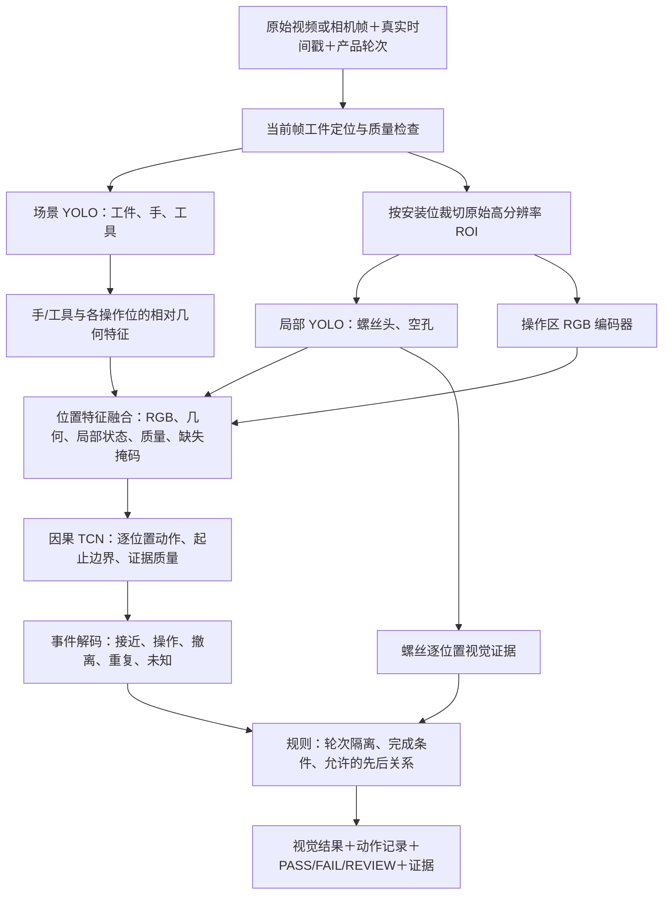

# 目标检测＋动作时序模型重训练详细方案

日期：2026-10-25。

设计条件：按用户提供的 **RTX 5070 Ti、16GB 显存**规划；**准确率优先，兼顾实时速度**。覆盖当前螺丝安装视觉检测和贴条动作检测。本文是待实施方案，没有启动训练、修改在线模型或切换判定规则；所有训练参数、性能及精度目标均为初始设计值，需通过验证集和目标硬件实测确定。

## 1. 推荐路线与任务范围

推荐采用 **场景目标检测＋高分辨率局部检测＋位置条件 RGB/几何特征＋因果 TCN＋显式工艺规则**。先分阶段训练，冻结检测器后训练时序模型；最后再评估局部联合微调。首轮不做全视频、全检测器、长时序网络同时端到端训练。

| 任务 | 目标检测负责 | 时序模型负责 | 最终判定范围 |
| --- | --- | --- | --- |
| 螺丝 | 工件、手、工具及工具端点；局部螺丝头、空孔证据 | 工具接近、位置相关操作候选、撤离、扶持/经过；分辨重复操作与遮挡 | 保留逐位置视觉安装确认；操作记录单列；不推断扭矩达标 |
| 贴条 | 工件、手、必要工具及操作区域定位 | 接近、贴放/按压候选、撤离、扶持/经过；定位动作位置与起止 | 保留对应位置动作完成及先两处三角、再六处方形的要求；不推断贴片实际存在或粘附强度 |

螺丝目前不要求固定安装顺序，新模型也不默认增加顺序约束。预装件不要求出现本轮拧紧动作。从成品开始的视频可以取得视觉安装证据，但不能因此生成安装动作记录。如果未来需要“每个操作位都必须观察到本轮安装”，应作为单独的流程验收模式配置。

贴条的黑色贴片与黑色零部件可能缺乏可用的外观差异，因此不将“必须检测到黑色贴片”设为动作完成的必要条件。

## 2. 整体架构



模型允许输出真实逆序、重复和同时发生的动作；工艺规则在识别后检查异常。训练和解码过程中不将“正常 SOP 顺序”硬编码为唯一可输出的序列。

### 2.1 三个视觉模块

**场景检测器。** 首选以本地已有的通用 `models/yolo26m.pt` 微调，输入长边从 960 起步。检测 `product`、`hand`、`screwdriver/tool`；不同手套作为数据属性覆盖，首轮合并为 hand，避免稀疏类别。用 `models/yolo11s.pt` 做速度对照。工具尖端是几何关联的重要证据，可增加可见端点关键点监督；尖端不可见时保持缺失掩码，不用工具框中心冒充尖端。

**螺丝局部检测器。** 从原始图像直接按标定位置裁切，再缩放至 320/384 输入，分类为 screw_head、empty_hole。遮挡不是空孔类别，局部质量与可观测性另行监督。比较当前 v4 权重热启动与通用 YOLO26m 热启动，判断旧视频过拟合影响；用统一局部模型作为主方案，S02 专用模型作为保留的对照。

**操作区 RGB 编码器。** 每个位置提取包含手、工具及接触区域的 224×224 ROI，用预训练 ResNet18 编码为 128 维特征。ROI 范围由工件坐标与实际接触范围决定，可覆盖安装位周围约 2–3 倍操作尺度。MobileNetV3 作为部署速度对照。首轮螺丝与贴条采用相同架构、分别训练权重；共享场景检测器，避免强行共享动作模型造成任务干扰。

### 2.2 定位与小目标分辨率

- 保留现有当前帧配准作为首轮定位基线，新增重投影误差、组件支持、模糊及遮挡诊断。无法可靠定位时，对应位置标为不可判断。
- 工件框只能限定范围，不能单独替代精确安装位定位。比较 SIFT、治具标记点、工件稳定关键点，按现场条件选择。
- 不先把整幅 4K 图缩至 640 再识别小螺丝；先从原始像素取 ROI。增加输入尺寸只有在原始图像保留细节时才有意义。
- 当前两套螺丝视角分别列出 12/11 个可见位置，同名 S01 等编号不能自动视为同一物理位置。数据中分别记录 `physical_target_id` 与 `view_target_id`，人工确认跨视角映射后才能融合。未映射时按视角隔离，不拼凑覆盖。
- 若要验收整件产品，应由产品清单定义应检物理位置；某机位少看见一个位置不能自动缩减整件验收范围。当前按视角限定的检测范围可继续作为单独模式。

## 3. 数据采集方案

### 3.1 首轮开发规模

建议每类任务先采集 **200–300 个完整产品周期**，覆盖 **6–10 名人员、至少 3 个采集日**。这是起步开发规模，不是足以证明低误放行率的验收样本量。以原始 1080p/4K、25–30 FPS 或更高帧率保存；动作短且运动模糊明显时优先提高快门与光照，再考虑 50–60 FPS。

| 数据类别 | 初始占比建议 | 螺丝场景 | 贴条场景 |
| --- | ---: | --- | --- |
| 正常完整周期 | 60–70% | 不同合法安装顺序、正常预装件、速度变化 | 正常三角→方形，双手、速度变化 |
| 真实缺陷/工序异常 | 15–20% | 真实缺螺丝、操作后仍为空孔、拆下后未复装 | 漏位置、方形先做、只做部分动作、返工 |
| 干扰及难负样本 | 15–20% | 工具经过、螺丝悬在孔上、反光、扶持、遮挡 | 扶持、扫过、短暂停留、静止成品、换手套 |

比例按验证集误差调整。实验性缺陷过程由现场人员按工艺允许方式组织；成品真实状态另行核实，不能用“正在安装前”的画面代替真实漏装成品。

另外独立采集离场、下一件入场、视频中断、摄像头抖动、强反光、黑/白/彩色手套、复杂袖口、左右手和两手同时接触等条件。双手同时涉及多个位置必须保留真实标注。

对于“扶持”与“贴放/按压”在单目画面中确实不可分的情况，标为不确定，必要时调整相机或增加传感证据，避免靠强行指定标签制造不可学习的任务。

### 3.2 采样与标注工作量

- 目标检测：每类任务先标注约 2,000–4,000 张多样化关键帧；操作开始/结束、遮挡和缺陷片段增加密度。人工检查传播标注，禁止跨越不可见区域直接传播状态。
- 动作时序：标完整周期中的操作区间、位置、起止边界、可判断区间和干扰动作，而不是给视频整体贴一个“正常”标签。
- 以完整动作事件和产品周期计数；同一事件裁出几百张图仍只是一个事件。
- 20% 左右的周期做双人独立标注与仲裁，优先复核动作结束、真实缺陷及易混淆干扰。

### 3.3 数据划分与防止泄漏

1. 先对原始周期分组，再抽帧、裁切、增强和生成时序特征。
2. 开发划分以 train/val/test 约 60/20/20 起步，按人员和采集 session 分组隔离。同一原视频、周期及其所有派生数据只能属于一个分区；同一人员跨多个 session 时保持在同一分区。
3. 按正常/异常、光照、已知视角做分层覆盖。新日期、新机位另设外部测试；不把多个互相冲突的隔离要求简单叠加成不可执行的划分。
4. 既有参与过开发、训练或调参的视频只用于 train 或历史回归，不作为新的独立测试。
5. 检测、RGB 编码器和时序模型使用同一份源数据划分。归一化、类别权重、阈值与模型选择只使用 train/val。
6. 多人员共享 session 时按关联分组整体划分，避免同一现场背景和周期跨集合泄漏。

## 4. 标注和特征数据契约

### 4.1 三层标注

| 层级 | 必需字段 | 主要用途 |
| --- | --- | --- |
| 周期层 | source_hash、operator_id、session_id、cycle_id、产品、视角、轮次起止、真实最终结果 | 隔离数据、核实产品归属与整件判定 |
| 帧/区域层 | 手/工具/工件框、可见工具端点、目标位、螺丝头/空孔、遮挡/模糊/配准质量 | 训练检测、质量门控、几何关联 |
| 事件层 | target、动作类型、开始/结束时间区间、是否可判断、是否返工、证据来源 | 训练时序、边界与事件评估 |

任务各使用五类相位作为首轮标签：

- 螺丝：idle、approach、drive_candidate、withdraw、support_or_pass。
- 贴条：idle、approach、place_press_candidate、withdraw、support_or_pass。

这里的 drive_candidate 表示可见工具在目标位置的操作证据，不表示实际旋转或扭矩已经验证。place_press_candidate 也不表示胶粘质量。无法判断的相位用监督掩码排除，不作为 idle。

### 4.2 起止与不确定性

动作开始采用可见操作进入的时间区间；结束记录最后操作帧到首次明确释放帧的时间区间。额外保存系统确认发布时刻。三者分别是 `start_interval`、`end_interval`、`confirmed_at`，不能用开始时间代替完成时间，也不能把两帧确认延迟当作真实动作持续时间。

以下是拟采用的原始标注格式示例，属于新增数据规范，不是现有 v1 训练器可直接读取的文件：

```json
{
  "schema_version": 2,
  "cycle_id": "sticker-op07-session03-cycle018",
  "operator_id": "op07",
  "session_id": "session03",
  "split": "train",
  "view_id": "camera_A",
  "source_sha256": "<raw-video-sha256>",
  "events": [{
    "event_id": "event004",
    "physical_target_id": "T01",
    "view_target_id": "T01",
    "action": "place_press_candidate",
    "start_interval_s": [12.10, 12.14],
    "end_interval_s": [13.02, 13.06],
    "scoreable": true,
    "is_rework": false
  }],
  "unobservable_intervals": [{
    "target": "R03",
    "start_s": 19.2,
    "end_s": 20.4,
    "reason": "occluded"
  }]
}
```

绝对录像时间仅用于离线标注与对齐；推理时输入当前帧与相对采样时间，不输入“这段已知视频到第几秒应该做什么”。

## 5. 检测与 RGB 编码器训练

### 5.1 首轮参数

| 模块 | 主候选 | 输入 | 初始 batch | 训练起点 |
| --- | --- | --- | --- | --- |
| 场景检测 | YOLO26m | 长边 960 | 4，实测后尝试 8 | 100–150 epochs，AdamW，lr 约 5e-4–1e-3 |
| 螺丝局部检测 | YOLO26m，统一各位置 | 320/384 | 16，实测后尝试 32 | 100–150 epochs，lr 约 3e-4–6e-4 |
| RGB 编码器 | 预训练 ResNet18＋128 维投影 | 224×224 | 64 | 30–60 epochs，骨干 lr 1e-4，头部 lr 1e-3 |

batch 按目标机器实测显存调节，训练留出约 2–3GB 余量；不足时降低 micro-batch，用梯度累积维持有效 batch。AMP 可用后启用，保存完整精度对照。以上是配置搜索起点，不能直接当作已经验证的最优超参数。

RGB 编码器先学习局部可见性与交互证据，如 clear、hand_present、tool_on_target、other/uncertain；单帧不强行承担完整动作语义。随后时序模型使用其表征学习接近、操作和撤离。

### 5.2 增强策略

- 使用符合现场范围的曝光、白平衡、轻度模糊、JPEG 压缩、小幅透视和位置扰动。
- 工件坐标、操作位、端点和 ROI 必须与几何增强一起变换。左右翻转仅在工艺允许、位置标签及左右语义同步重映射时使用。
- 小目标螺丝主实验关闭强 Mosaic/MixUp，并比较温和增强，避免把正常头/孔尺度与纹理破坏。
- 贴条增加手套、肤色、袖口和背景变化的真实样本，不能主要靠颜色随机化代替。
- 训练集内挖掘与补标难例；val/test 不回流训练。扩数据形成下一版本时，新测试集重新封存。

## 6. 检测如何接到时序模型

### 6.1 每帧、每位置的输入

对每个操作位构造：

1. 128 维操作 ROI RGB 表征。
2. 螺丝局部 screw_head/empty_hole 分数、状态及可见性；贴条没有可靠实物状态时使用缺失标记，不补造“已贴”。
3. 手中心/可见端点、工具尖端相对于操作位的 dx、dy、距离、夹角、速度和接近/离开趋势。
4. 手/工具与 ROI 的重叠度，以及多个候选对象的关联置信度。
5. 配准误差、局部清晰度、遮挡比例、检测分数、真实时间间隔 dt、观测年龄与缺失掩码。

坐标统一到工件或归一化操作位坐标系。速度按真实 dt 计算。首轮对每个目标保留最多两个相关手和一个相关工具节点；候选关联不稳定时显式记录不确定性。

**重要：** 时序训练主要使用冻结检测器和编码器产生的预测特征，不能主要用完美人工框/状态训练、再直接接到有噪声的部署检测器。人工真值特征仅用于诊断性能上限。必要时在 train 内做分组交叉拟合生成 OOF 特征，并加入实测漏检/抖动扰动，缓解训练检测特征过于理想的问题。

### 6.2 张量与输出

拟新增特征契约：

```text
rgb_features      [B, T, K, 128]
geometry         [B, T, K, D_geo]
local_state      [B, T, K, D_state]
quality          [B, T, K, D_quality]
masks / ages     [B, T, K, N_nodes]
timestamps       [B, T]
targets          [B, K, D_target]

action_logits    [B, T, K, 5]
boundary_logits  [B, T, K, 2]       # 开始与结束
quality_logits   [B, T, K, 2]       # 当前证据可用/不可用
```

K 为当前场景的操作位置数量，使用显式 target mask 处理不同数量。各位置动作独立分类，可同时有两只手在两个位置操作。位置关联使用几何及逐位置相关性，不能依赖“所有位置 softmax 只能选一个”的门控。

仓库现有位置头 `[B,T,K+2]` 和 `AssemblyPredictor` 的全局位置 argmax 需要调整；已有 action/boundary 逐位置结构可以保留。新增 RGB 契约也需要升级数据加载器，不能把新张量直接塞入旧 v1 NPZ。

## 7. 时序模型与训练配置

### 7.1 先建立单尺度，再增加双尺度

主候选为因果 TCN，仅读取当前及过去，不使用未来帧。所有位置共享时序编码参数，再输出逐位置动作与边界；螺丝、贴条先分别训练。

| 配置 | 单尺度基线 | 双尺度候选 |
| --- | --- | --- |
| 融合宽度 | 128 | 128 |
| 卷积核 | 3，每个残差块一个时序卷积 | 同左 |
| dilation | 1、2、4、8、16、32 | 短路 1、2、4；长路 1、2、4、8、16、32 |
| 感受野点数 | 127 | 短路 15，长路 127 |
| 15Hz 的历史跨度 | 8.4 秒 | 约 0.93 秒及 8.4 秒 |
| dropout | 0.1–0.2 | 同左 |

这里按每块一个时序卷积计算 `R = 1 + 2 × sum(dilation)`。增加块内卷积层数后必须重新计算感受野。上下文跨度不等于模型必须等待的发布延迟。

起始特征采样目标为 **15Hz**，原始视频保留更高帧率。约 0.2 秒的动作在 15Hz 下也仅有约 3 个采样点，应专项测短动作覆盖，并与 20Hz 比较。若部署实测只能达到 10Hz，应建立并验收对应采样配置；不能复制旧帧冒充 15Hz。训练可加入真实丢帧及 dt/掩码扰动，但需要单列各有效采样率指标。

### 7.2 窗口、采样与优化

- 使用 192 帧窗口；前 128 帧提供因果上下文，后 64 帧计算主要监督，窗口不能跨产品轮次。周期开始处按真实可用历史填充，并设置 padding mask。
- 缓存特征训练时，batch 从 16–32 个窗口起步；AdamW，lr 3e-4，weight decay 1e-4，梯度裁剪 1–5，100–150 epochs，early stopping patience 15–20。
- 窗口采样从事件附近约 50%、难负样本约 30%、随机背景约 20% 起步；完整验证视频维持原始分布。
- 动作损失采用训练集类别频数加权 CE，必要时对照 Focal Loss；稀有类权重需要限幅并检查背景误报。
- 边界使用带训练集正负权重的 BCE；对标注不确定的起止采用区间监督或容忍带，避免强迫不可知边界精确到单帧。容忍带仅在可观测且被标注为边界候选的区间内扩展，不跨越未知遮挡。
- 初始多任务损失为 `L_action + 0.5 L_boundary + 0.2 L_quality`。若另外训练局部状态头，可加独立的状态损失并做消融；检测器在冻结阶段保持自己的检测损失，不把它无条件混入时序损失。
- 用验证集事件 precision/recall、位置错误和整件误放行约束选择 checkpoint，同时观察各头损失；不只选最低加权总损失。

### 7.3 必须先通过的训练诊断

先选 3–5 个 train 周期，验证模型能够明显拟合操作、位置和边界。检查少数类召回、各输出头梯度、归一化、掩码与标签对齐。该小样本拟合只诊断实现，不作为泛化精度。

旧合成试训中操作预测和位置关联均曾失败，因此不能仅延长 epoch、降低阈值或直接采用旧权重。若小样本无法拟合，先排查输入与监督，再增加关系注意力等复杂模块。

## 8. 分阶段训练流程

| 阶段 | 工作 | 退出条件 |
| --- | --- | --- |
| P0 任务与数据冻结 | 确认位置清单、物理映射、动作定义、合格范围，冻结分组划分与标注规范 | 不同人员能一致判读标签；泄漏检查通过 |
| P1 检测训练 | 训练场景检测器和螺丝局部检测器，验证小目标、遮挡和工具端点 | 各位置状态/对象检测达到约定验证指标 |
| P2 表征与特征缓存 | 训练 RGB 交互证据编码器，冻结视觉模块，生成带版本的预测特征 | 视频时间、坐标、标签、质量与缺失掩码抽查正确 |
| P3 时序基线 | 小样本拟合检查，训练单尺度 TCN，再训练双尺度候选 | 完整验证视频事件精度优于单帧＋规则基线，关键误放行不退步 |
| P4 难例与校准 | train 内补难例，val 上校准模型分数、状态转移、时间窗口与拒识 | 阈值、采样率及解码参数冻结 |
| P5 封存测试与影子运行 | 用未参与选择的测试数据和独立采集批次评估，完整记录未知和失败 | 达成事先约定指标后形成待发布版本 |

后续联合微调只针对已证明有效的候选：解冻 RGB 编码器末段，以约 1e-5–3e-5 的低学习率训练短片段或带冻结历史前缀的序列；检测器先保持冻结。任何视觉模块变化后重新导出特征与版本，不能混用旧缓存。检测器也需要联合微调时再开展独立实验，避免首轮将所有错误来源耦合。

## 9. 事件解码与证据融合

### 9.1 逐位置事件

事件记录 cycle_id、physical_target_id、view_id、action、start/end 区间、confirmed_at、质量、模型版本及证据帧。明确区分开始、真实结束区间与发布确认时刻。

- 贴条：接近/接触证据→操作候选→明确撤离/释放→动作记录完成。单帧高分、UNKNOWN 或定位失败不直接充当动作释放。
- 螺丝：时序输出某位置可见操作候选；局部检测另行确认头/孔。存在可判断的安装前空孔与操作后螺丝头时，可记录“观察到安装转变”；缺少安装前证据时仅记录已观察到的操作和视觉状态。
- 扶持/经过、长时间遮挡、关联不稳定或边界含糊时保留未知。相同位置的返工保留为多个事件，不用一次永久 done 掩盖拆卸或返工。
- 候选确认设置有效时间窗口；定位丢失或超过最大观测间隔时重置未确认候选。已确认的本轮历史单独保存。
- 逐位置检查当前新鲜证据：该位置无当前可用观测时，历史 TCN 分数不能单独发布新动作、补造释放或绘制旧框；本轮已确认记录可以继续显示。某个位置有可用证据不代表其他位置也可用。

不要把多个网络分数直接相乘后称为“真实完成概率”。各分数在验证集校准，结合质量与任务规则形成可解释的判定。

### 9.2 先后关系

贴条按两处三角的**结束区间**与方形的**开始区间**核对。若前者最晚结束早于后者最早开始，顺序成立；明确反向则失败；区间相交且无法确定时待复核。规则可以复用 `process_rules.py` 中的三值时间关系，但视觉候选不能自动包装成已验证的设备 OK 记录。

螺丝维持当前不要求先后顺序的策略。合规范围与“操作是否完整观察”分别显示；扭矩需真实工具信号才能纳入验证。

### 9.3 轮次隔离

优先使用扫码、治具、明确开新轮次等可靠边界；仅靠视觉时，结合稳定离场/入场及产品关联，不把短暂手部遮挡当换件。cycle、模型/标定签名或产品身份变化时清空时序状态；各视角仅在物理位置映射明确时融合。

## 10. 对照实验设计

首轮至少完成 E0–E3，使用同一数据划分与同一规则规范；每次只改变需要评估的因素。

| 实验 | 配置 | 回答的问题 |
| --- | --- | --- |
| E0 | 当前线上权重与规则冻结回放 | 现有基线是什么 |
| E1 | 新检测＋RGB 单帧交互分类＋显式状态机 | 新数据和检测/外观改善贡献多少 |
| E2 | 同 E1 视觉特征＋单尺度因果 TCN | 加时序是否改善动作混淆和短事件 |
| E3 | 同 E2 特征＋双尺度 TCN | 短长时间尺度是否值得额外开销 |
| E4，可选 | 同 E3＋关系注意力/质量门控 | 位置关联与多手干扰能否改善 |
| E5，可选 | 同输入与相近预算的 GRU | 递归模型是否更合适 |

对最终时序候选做无 RGB、无几何、无质量/缺失掩码的消融；分别检查错序、漏动作、扶持经过、短动作和新人员。关键候选至少 3 个随机种子，报告差异和按人员/周期分组的区间估计。所有选择在 val 完成后再开封 test。

用真值框或真值动作替换某环节只用于诊断瓶颈，不计入正式部署指标；人工补框和未来帧信息也不进入线上测试输入。

## 11. 验收指标与统计要求

以下为建议协商的首轮目标，正式阈值应结合现场缺陷成本与可观测条件确认，不能作为训练前承诺。

| 层级 | 主指标 | 建议起始目标/要求 |
| --- | --- | --- |
| 目标检测 | 每类、每位置 recall/precision，漏检/错配；mAP50–95 辅助 | 关键可见目标召回以 ≥98% 为目标，同时约束误检与拒识 |
| 螺丝视觉状态 | 每位置 PRESENT/EMPTY/UNKNOWN 混淆，真实空孔误判为有头 | 单列真实缺陷与整件结果，不能只报裁剪 mAP |
| 动作事件 | 同 cycle、同物理位置、同动作的一对一匹配，tIoU@0.3/0.5/0.7 | 以 precision ≥98%、recall ≥95%、F1@0.5 ≥95% 为开发目标 |
| 时间边界 | 起止偏移、结束后确认延迟及其 P95 | 初始以结束后确认 P95 ≤0.5s 为目标，包含必要释放确认 |
| 整件/整周期 | NG 检出、误放行、正常误拒收与 REVIEW | 建议 NG 自动判 FAIL ≥95%；误放行上界按现场要求定义 |
| 可判定性 | 不可观察事件比例、当前可定位覆盖、REVIEW 比例 | 正常标定条件下 REVIEW 初始目标 ≤5%；困难条件单独报告 |
| 实时 | 实际新鲜采样率、请求完整耗时、推理耗时、丢帧、队列等待 | 15Hz 是设计目标，必须在目标 GPU 实测，不能用模型 FPS 代替 |

定义：`误放行 = PASS 的真实 NG 周期数 / 全部真实 NG 周期数`；`NG 自动检出 = FAIL 的真实 NG 周期数 / 全部真实 NG 周期数`。REVIEW 单独统计，不当作已经检出缺陷。人工真值不可判断的数据需说明原因与占比，不能通过大规模排除困难样本提高精度。

### 11.1 低误放行率需要多少独立 NG

若独立真实 NG 测试中观察到零次误放行，一侧 95% 二项置信上界为 `1 - 0.05^(1/n)`：

| 希望上界不超过 | 零误放行时所需独立 NG 数量 |
| --- | ---: |
| 1% | 299，实际建议至少 300 |
| 0.5% | 598 |
| 0.1% | 2,995 |

同一产品事件的重复帧、同一视频的重复播放和合成移植图不能当独立 NG。相关性强的重复操作也不能简单按上表累计，应按人员/批次分组分析。上述 200–300 周期起步数据通常不足以证明低至 1% 的现场误放行率，需要按目标扩充封存验收集。

## 12. RTX 5070 Ti 16GB 的训练与部署安排

### 12.1 环境

根据该 GPU 的官方支持组合选择 PyTorch、CUDA、驱动及 torchvision；CUDA 12.8 或更新且支持该卡的构建可作为起点。现有 worker Dockerfile 的 PyTorch/CUDA 组合只是候选基础，需在目标机实测 CUDA 前后向、YOLO 训练、ONNX 导出及部署推理后冻结依赖。记录驱动、框架版本、GPU 信息、随机种子和模型/数据哈希。

FP16/BF16、ONNX/TensorRT 均按兼容性与验证结果启用。量化到 INT8 放在浮点基线通过之后，以独立校准数据及小目标/边界精度决定是否保留。

### 12.2 资源策略

1. 单卡依次训练场景检测、局部检测、RGB 编码器和 TCN，避免多个训练进程争用显存。
2. 冻结视觉模块后缓存特征，时序结构与损失实验无需重复跑 YOLO。缓存包含 source、cycle、detector、encoder、preprocess、calibration 的版本与哈希。
3. 只解冻必要模块做后续微调；显存不足通过 micro-batch 和梯度累积解决，不先牺牲关键小目标分辨率。
4. 以首轮数百至一千张样本的实际吞吐、峰值显存及数据加载时间估算全量训练时间，不预先承诺未经测量的 GPU 小时数。

### 12.3 实时性能实施条件

- 先测 YOLO26m 场景检测、批量局部 ROI、RGB、TCN 组合的端到端延迟与吞吐，再确定 15Hz 是否达标及可接入路数。16GB 容量不等于自动获得某个 FPS。
- 局部 ROI 同模型合批；专用位置按模型路由，避免先通用推理再覆盖的重复计算。TCN 用逐层有界缓存，切轮次和长间隔重置。
- 将模型资源哈希改为版本/文件变化失效缓存；完整请求计时从 JPEG 解码及快照检查之前开始，避免只显示网络推理时间。
- 推理队列有界，忙时优先处理最新帧；丢帧和真实 dt 进入模型。单帧接口单次往返不足以达到目标频率时，需要调整采集与推理调度，不能以排队积压伪装实时。
- 当前浏览器实时接口限制约 1080p 像素。若远距离螺丝像素不足，应评估设备端原图裁 ROI＋低分辨率上下文流，或扩展高分辨率输入并配套限额与标定；仅更换 GPU 不会恢复上传时已经丢失的细节。
- 检测和回放编码分离，离线推理不被同步 VP80 编码拖慢。目标硬件重新计时，不沿用先前其他机器的耗时估算。

## 13. 与现有仓库的衔接

| 现有实现 | 可复用 | 需要新增/调整 |
| --- | --- | --- |
| `algorithms/screw_refined.py`、`screw_multiview.py` | 原图局部裁切、当前帧定位、多视角框架 | 几何质量输出、统一物理位置映射、模型路由与新权重适配 |
| `algorithms/sticker_actions.py` | 逐位置动作任务语义、当前帧显示与事件接口 | 用 RGB＋几何＋TCN 替代八个 SVC；重新定义释放及开始/结束字段 |
| `experiments/lamp_assembly/data.py`、`prepare_data.py` | 人员/session 隔离、哈希、掩码及 train-only 归一化 | v2 RGB/几何特征契约、真实视频标注转换与特征提取 |
| `experiments/lamp_assembly/models.py` | 因果块、逐位置动作/边界头 | 位置 RGB 融合、长/短感受野、逐位置关联，消除单目标位置门控 |
| `experiments/lamp_assembly/train.py` | 训练循环、优化器、checkpoint 结构 | 窗口采样、类别/边界权重、训练预算及按事件/整周期选型 |
| `experiments/lamp_assembly/evaluate.py` | 同周期/位置/动作匹配、tIoU、未知与覆盖统计 | 整件误放行/误拒收、分组区间、实时延迟与多采样率报告 |
| `algorithms/assembly_predictor.py` | 多流与周期隔离、过期观测处理 | 多位置同时发布、TCN 增量缓存、事件解码及新特征输入 |
| `algorithms/process_rules.py` | 三值时间关系思想与函数 | 接独立视觉事件层，保持与设备 verified OK/NG 的语义区分 |
| 两个专项 realtime 服务及离线 analyze | 任务编排、记录、证据、界面 | 共用新特征/时序运行时，快照缓存、全链路计时和版本化发布 |

现有合成研究权重没有足够真实任务证据，本次复用其工程结构，重新训练和验收；不能把合成训练通过或单元测试通过等同现场动作学习有效。

## 14. 建议排期与交付

在数据与标注人员可配合的条件下，以 **约 4 周形成首轮候选**作为工作量规划；大规模独立 NG 验收及影子运行的采集周期另计。

| 阶段 | 工作重点 | 交付 |
| --- | --- | --- |
| 第 1 周 | 定义任务与物理位置，采集起步数据，双人试标与分组划分 | 标注规范、数据 manifest、位置映射、验收口径 |
| 第 2 周 | 检测与 RGB 编码器训练，建立质量诊断与预测特征缓存 | 检测权重、单帧基线、版本化特征及误差报告 |
| 第 3 周 | 单尺度/双尺度 TCN、小样本诊断、难负样本和消融 | 事件模型、验证视频回放、消融与校准结果 |
| 第 4 周 | 封存测试、GPU 实测、实时离线一致性及影子接入 | 候选场景包、测试报告、性能报告、差异与回滚记录 |

最终候选包应包含：数据/标签规范与分区哈希、检测权重、RGB 编码器、TCN 权重与可选导出文件、标定与物理位置映射、归一化与阈值、规则、事件证据、独立测试报告、环境锁定文件和推理计时。发布切换属于后续实施阶段。

**首轮应先落地的数据与实验组合：每任务 200–300 个完整周期起步，YOLO26m 场景/螺丝局部检测，ResNet18 ROI 表征，逐位置单尺度因果 TCN 为基线，双尺度 TCN 为主对照。用独立事件及整件结果决定最终模型，而不是按模型大小选择。**
