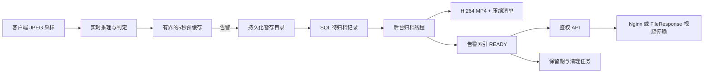

# 数据库与告警录像存储

更新日期：2026-11-06。本文对应当前实现；性能测量见 [数据库与取证存储验收记录](../history/database-storage-2026-11-06.md)。

2026-11-08 数据库升级至 v2，增加关系约束、事务迁移和只读预检；升级、备份与恢复流程见 [数据库架构升级指南](database-architecture.md)。

## 需求与实现范围

| 要求 | 实现 | 验证方式 |
| --- | --- | --- |
| 告警取证录像自动保存 | 连续实时检测返回 FAIL 时自动触发；结束轮次为 FAIL / REVIEW 时另存最终取证；离线分析异常结果登记现有 WebM 文件 | 实际 JPEG → MP4 → SQL → HTTP → 浏览器播放 |
| 存储周期 ≥30 天 | 从成功归档的数据库时间 `ready_at` 起，保存 `retain_until`；配置、数据库 CHECK 和清理条件均限制至少 2,592,000 秒 | 将清理时钟推进到第29天、第30天整点、第30天后1秒 |
| 数据库架构性能 | 结构化索引、短事务、按需投影、游标分页、批量删除、有界文件扫描、连接池上限 | 回归测试、SQL执行计划、合成数据性能基准 |
| 数据存储格式 | 元数据存 SQL；JPEG暂存；实时录像 H.264/MP4；取证清单 UTF-8 JSON+gzip；SHA-256校验 | 真正编码/解码、文件校验、Range下载 |

实时接口目前只接收用于推理的 JPEG 采样。保存的 MP4 是这些真实采样组成的录像，保留采样相对时间和检测缺口，未接收到的画面不能恢复。预缓存覆盖告警前最多5秒和触发帧，不包含独立的告警后连续录制；首帧即告警时可能只有单帧短片。若现场验收要求原摄像头全帧率、告警前后固定时长或全天连续录像，需要接入 RTSP/NVR/边缘连续录像源，再将其片段交给同一归档索引管理。

六工位人工流程仍保存其阶段截图与独立审计记录，未将人工截图包装成录像。自动检测的模型结论、人工记录和实际现场识别准确率需分别验收。

自动检测工位点击“结束并归档”时，先冻结最终判定，再将 FAIL / REVIEW 对应的末段采样持久化，最后归档检测结果。纯人体姿态观察不产生工序告警。保存失败返回 503，保留本轮缓存和冻结判定供重试；应及时重试，采集租约仍有有效期。重复结束或归档重试复用同一告警 ID。人工复核保留已有录像，不补造已释放采样的历史录像。

新实时录像的 `source_id` 保存检测流 ID；告警 ID 仍按账户、会话、检测流、类型和告警时间桶确定。检测历史同时查询流 ID 与旧版工位会话哈希，兼容旧录像，无需改写原始清单。只有曾经实际保存的录像可以恢复关联，修复前未落盘的片段无法补回。

## 架构与数据流



一次告警的确认顺序为：写入每个 JPEG 并同步文件 → 写入压缩清单 → 暂存目录原子重命名 → 插入 PENDING 索引 → 后台持租约领取 → 编码及同步视频 → 同一条受 token 保护的 UPDATE 发布 READY、校验值和保留截止时间 → 删除原始暂存。

视频编码和文件删除均在数据库事务外进行。数据库连接中断时，已完成原子重命名的暂存目录继续保留，后台按清单补建队列。COMMIT回执丢失时保留文件，按确定性告警ID确认，避免重试产生重复录像。未完成重命名的 `.part` 目录属于中断现场，当前保留供人工检查，不会被普通上传清理误删，也不能声称其已经归档。

## 存储格式与目录

| 数据 | 格式与位置 | 设计目的 |
| --- | --- | --- |
| 告警索引 | `alert_evidence`，id/owner/source/type/status/time等独立字段 | 避免历史列表扫描或解析完整结果文档 |
| 取证说明 | PostgreSQL `JSONB`；SQLite使用JSON | 仅保存简短判定、模型/配置标识、缺口等扩展属性 |
| 视频容量 | `BIGINT size_bytes` | 支持超过2GB的容量计数，不受32位整数字段限制 |
| 归档前采样 | `DATA_DIR/evidence-spool/<告警ID>/*.jpg` | 数据库故障时仍保留可恢复的落盘副本 |
| 实时录像 | `DATA_DIR/evidence/YYYY/MM/DD/<告警ID>/<token>/video.mp4` | 按UTC日期分目录，隔离每次归档尝试 |
| 取证清单 | 同目录 `manifest.json.gz`，UTF-8、紧凑JSON、gzip | 保存原始采样时间、逐帧SHA-256和取证元数据 |
| 离线分析录像 | 复用 `DATA_DIR/runs/<任务ID>-<token>/video.webm` | 不为同一异常录像再复制一份大文件 |

实时编码参数：`libx264`、`yuv420p`、CRF 23、`veryfast`、单编码线程、VFR、`+faststart`，不含音频。奇数像素尺寸补齐到偶数。正常采样按相邻时间间隔生成视频，最后一帧默认显示0.25秒；由于MP4时间基存在量化，准确采样时间以清单为准。

SHA-256用于检出文件变化；它不等于数字签名、可信时间戳或存储介质的不可改写认证。视频与清单应一起备份。老表的JSON类型和既有记录保持兼容，没有执行全表JSON→JSONB重写。

## 查询、索引与事务优化

- 历史列表在SQL层只投影公共字段、分析类型、场景和模型名称，不再将整份冻结的模型配置传回Python后解析；单任务轮询也只取状态所需字段。
- 增加 `owner/status/created_at/id` 索引、`owner/analysis_type/created_at/id` 与 `owner/scene_id/created_at/id` 表达式索引。过滤中的固定JSON路径以SQL常量编译，确保SQLite实际带参数查询也能匹配索引。
- 队列租约恢复增加 `status/lease_until` 索引，一次最多处理100个过期任务，避免大批恢复长期占锁。领取任务使用 PostgreSQL `FOR UPDATE SKIP LOCKED`；SQLite先 `BEGIN IMMEDIATE` 再读取和更新。
- 告警列表默认50条、最多100条，以 `(created_at,id)` 生成下一页游标，不查询全量总数。相同时间戳和翻页期间插入新记录不会造成已读取页重复。
- 普通清理按最多500条任务/媒体批量删除，媒体锁定后使用一次新语句快照复核引用。文件目录使用 `scandir`，每批最多400个文件身份，不加载全量历史ID集合。
- 执行视频传输时先鉴权。生产环境通过Nginx `internal`位置传输大文件，减少API线程占用；测试/开发保留FileResponse的Range支持。

索引升级采用幂等的增量建表/建索引。保留原有schema v1记录，反复初始化不会删表、改写已有数据。大型PostgreSQL表首次建索引可能阻塞写入，应在维护窗口执行初始化；本次并未实现在线 `CREATE INDEX CONCURRENTLY` 迁移器。

## 保留期和清理

`retain_until` 写入时不早于 `ready_at + 2592000`，READY记录还必须有录像路径、大小、校验值与时间。数据库CHECK可拒绝缺少这些字段或缩短到30天以内的READY记录。

清理必须同时满足：状态为READY或上次未完成删除的DELETING、未设置 `legal_hold`、已过记录截止时间、已过当前配置保留期。截止时间相等时仍保留，到期后才由周期任务清理。因此正常清理实际保存时长可能超过30天。

增大保留期同时保护现有录像以及删除失败等待重试的录像；降低配置也不会缩短已写入的截止时间。`legal_hold=true` 的记录不进入自动清理，当前作为数据库运维字段保留，没有提供前端锁定/解锁操作。

清理过程先将索引置为DELETING并提交，再删除文件，最后标记EXPIRED。删除失败时保留DELETING供重试，不会显示“已成功清理”。离线录像与原分析报告共用文件，任何尚未EXPIRED的录像引用都阻止普通任务清理提前删除该目录。FAILED/MISSING不伪装成保存成功，失败暂存也不会自动丢弃。

## 资源上限与运行方式

| 配置/资源 | 默认值 |
| --- | --- |
| `EVIDENCE_RETENTION_SECONDS` | 2,592,000秒，最低30天 |
| `RUN_RETENTION_SECONDS` | 2,592,000秒，环境配置最低30天 |
| `UPLOAD_RETENTION_SECONDS` | 604,800秒；有任务引用的上传继续保护 |
| `CLEANUP_INTERVAL_SECONDS` | 3,600秒 |
| 单流缓存 / 总缓存 | 8MiB / 每API进程64MiB，最多32个流 |
| 帧缓存限制 | 最多128帧、最多5秒，闲置300秒回收 |
| 相同级别告警合并 | 同流每30秒时间桶至多一份录像；最终判定独立保存 |
| 归档租约 / 编码超时 | 120秒 / 60秒 |
| 失败重试 | 最多3次自动尝试，间隔约30秒；之后可在页面重试 |
| PostgreSQL连接池 | `DB_POOL_SIZE=5`、`DB_MAX_OVERFLOW=5`、等待5秒、回收1800秒 |

连接池是每进程预算。例如API和Worker各一个进程时，配置上限合计为20个连接，还需预留管理、迁移和训练子进程连接。SQLite设置WAL，连接开启30秒busy timeout、`synchronous=FULL`与8MiB页缓存。

API启动归档线程，既有Worker继续清理普通任务和上传；API也维护告警保留期，不依赖GPU分析队列有新任务才归档。后台按分钟检查已落盘暂存，故障恢复后补建队列。没有告警的取证采样只更新有界缓存，不额外读写告警表。

实时检测状态和预缓存仍是进程内状态；若部署多个API进程，同一流需路由到同一进程。归档队列可由多个进程竞争领取，但不能据此宣称完整实时会话已经跨进程共享。

## 使用、接口与监控

首页顶部“告警录像”可查看归档状态、原因、保留截止时间、播放录像并重试FAILED条目。PENDING/PROCESSING等待归档，READY才可播放，MISSING说明当时没有可用采样。播放页展示SHA-256。

| 接口 | 行为 |
| --- | --- |
| `GET /api/v1/alerts?limit=50&cursor=...&analysis_type=screw` | 当前账户的有界分页列表 |
| `GET /api/v1/alerts/{id}` | 当前账户的取证详情 |
| `GET/HEAD /api/v1/alerts/{id}/video` | READY视频；未完成409，清理完成410，他人记录404 |
| `POST /api/v1/alerts/{id}/retry` | 重新归档FAILED记录；要求登录和CSRF |
| `GET /api/v1/metrics` → `evidenceStorage` | 状态计数、最老待处理时间、缓存用量、磁盘可用空间和最近错误 |

生产Nginx已增加 `/_protected-evidence/` 内部路径，外部不能直接访问。监控应关注FAILED/MISSING、待处理时间持续增大、磁盘剩余空间下降和UNAVAILABLE回执。磁盘已满时返回明确的存储失败状态，不通过删除未满30天的录像腾空间。

容量按实际事件规模估算：`日告警量 × 单片实际大小 × 保留天数`，另加未编码暂存、重试文件和备份。例如6路、每路500次/天、平均2MB、保存30天为约180GB；这是容量规划假设，不是基准视频压缩率推算或现场实测。应使用现场画面与告警密度测量平均/峰值大小。

## 部署与验证命令

先备份现有数据库及DATA_DIR，再在项目已配置的环境中执行：

```powershell
node tools/python.cjs -m pip install -r requirements-api.txt
node tools/python.cjs -m backend.init_db
npm run test:storage
npm run test:evidence-ui
npm run benchmark:storage -- --rows 50000
npm test
node tools/python.cjs -m backend.cleanup_cli --dry-run
```

完成初始化后重启API、Worker和Nginx使新代码/内部视频位置生效；Compose需重建API/Worker镜像。该代码变更和隔离验证没有修改或清理当前业务库与业务录像，也没有替用户重启主服务。

PostgreSQL真实事务/锁/JSONB验证需给专用测试库设置 `TEST_POSTGRES_URL`，随后执行 `node tools/python.cjs -m pytest tests/test_postgres.py -q`。测试只在随机独立schema内工作，最后删除该schema；不要使用业务库作为测试库。2026-11-06已补充本机专用PostgreSQL 16.6集群，执行 `npm run test:postgres` 自动配置子进程连接并运行实库测试，详见 [PostgreSQL测试指南](postgres-testing.md)。

本次保留期测试采用模拟时间推进，验证的是程序边界行为，不能代替30天实际运行、磁盘/备份恢复与现场连续摄像头验收。已有历史录像没有自动回填告警索引；新增告警从新代码启用后进入该链路。
