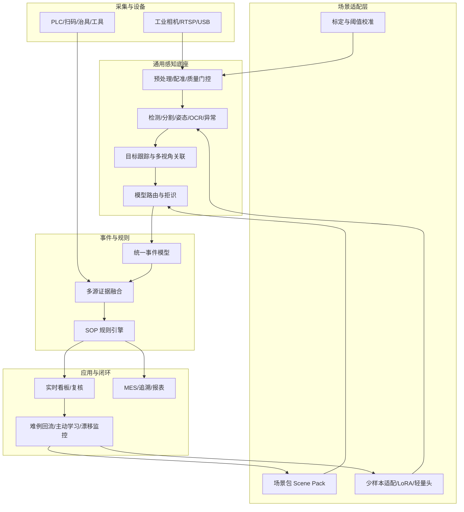

# 工厂多场景模型通用化方案

日期：2026-10-18
适用范围：AI-SOP 视觉检测平台、螺丝/贴条等现有任务，以及后续工厂多工位、多产品、多工艺扩展。

## 1. 结论

**能做到“平台级通用”，不能承诺“一个模型零样本通吃所有工厂场景”。**

建议对甲方的承诺写成三句话：

1. **平台通用**：采集、标定、感知、事件、规则、复核、追溯共用一套底座，不为每个工位复制一套系统。
2. **场景可配置**：新工位优先通过“场景包 + 标定 + 规则”上线，80% 的同类场景不改代码。
3. **模型分场景验收**：每个场景包绑定自己的模型、阈值、验证集和验收报告；关键缺陷按场景单独承诺召回率与误放行率。

不建议承诺“一个通用大模型直接覆盖所有场景并达到产线精度”。这类承诺在演示阶段容易成立，在正式验收阶段通常会被长尾缺陷、光照变化、遮挡、产品换型和误检成本击穿。

## 2. “通用化”到底指什么

甲方说的“通用性强”，通常不是要求一个模型认识所有零件，而是要求：

- 新工位不用重新开发一套软件；
- 新零件不用重新招一个算法团队；
- 新相机、新光照、新节拍能快速标定；
- 新工艺规则能配置，不用改代码；
- 多工厂、多产线能统一运维、统一升级、统一追溯；
- 出了新缺陷，有数据闭环能持续变好。

因此把通用化拆成四级，目标更清楚：

| 等级 | 含义 | 当前项目 | 目标 |
|---|---|---|---|
| G1 代码通用 | 同一套服务支持不同任务 | 螺丝/贴条仍是独立分支 | 插件化，新增任务不改主流程 |
| G2 配置通用 | 新场景靠配置和标定上线 | 部分配置化 | 场景包覆盖 80% 同类场景 |
| G3 模型复用 | 同族场景共享底座，少量样本适配 | 每个任务单独训练 | 同族场景 3–5 天完成适配 |
| G4 零样本 | 新场景不训练直接上线 | 仅适合演示/冷启动 | 不作为产线验收承诺 |

**目标定为：同族场景做到 G3，新工艺族做到 G2，G4 只用于冷启动、预标注和人工复核辅助。**

## 3. 为什么不能靠一个模型通吃

工厂场景的差异不只在“物体类别”，而在五个层面同时变化：

1. **视觉域差异**：相机型号、镜头、工位、光照、反光、背景、遮挡、产品颜色。
2. **任务定义差异**：有/无、数量、位置、到位、方向、动作顺序、尺寸、字符，判定逻辑完全不同。
3. **缺陷长尾**：真实漏装、错装、反装、松动、划伤、脏污的样本极少，且形态持续变化。
4. **误检代价不对称**：漏放行和误停线是两种成本，不能用同一个准确率概括。
5. **可追溯要求**：产线要能解释“为什么判合格/不合格”，纯端到端大模型很难给出稳定证据链。

通用大模型和开放词汇模型的价值在于**冷启动**：能快速把“螺丝、卡扣、端子、贴片”先找出来，减少第一轮标注成本。但到产线验收，仍然需要：

- 场景内监督数据；
- 阈值校准和拒识机制；
- 固定的模型版本与哈希；
- 独立验证集和验收报告；
- 与 PLC/MES/工具信号的融合。

所以正确路线不是“找一个更大的模型”，而是“**通用感知底座 + 场景适配 + 显式工艺规则 + 数据闭环**”。

## 4. 总体架构：一个底座 + N 个场景包



### 4.1 哪些东西必须通用

| 层 | 通用内容 | 不通用内容 |
|---|---|---|
| 采集 | 相机接入、解码、抽帧、时间戳、质量门控 | 每个工位的相机参数、ROI、曝光 |
| 感知 | 检测/分割/姿态/OCR/异常的基础模型与推理运行时 | 场景专用权重、类别、阈值 |
| 跟踪 | 多目标跟踪、轨迹生命周期、跨视角关联 | 工位内的目标编号与物理位置映射 |
| 事件 | 统一事件 schema、产品周期、证据链 | 每个工位的动作/步骤定义 |
| 规则 | 前置、计数、时长、分支、返工、三值判断 | 每个产品的 SOP 内容 |
| 运维 | 模型仓库、版本、灰度、回滚、监控 | 场景验收指标 |

### 4.2 场景族复用

不要按“工位”复用，要按“工艺族”复用。工厂里大多数视觉需求可以归到六族：

| 场景族 | 典型任务 | 可复用的能力 | 仍需现场适配 |
|---|---|---|---|
| 紧固族 | 螺丝有无、数量、顺序、工具到位 | 小目标检测、局部 ROI、时序事件 | 螺丝规格、位置、遮挡、工具 |
| 插接族 | 端子插入、锁止、线束方向 | 目标检测、手/工具跟踪、接触判断 | 连接器型号、锁止结构 |
| 贴附族 | 贴片、标签、胶条、按压 | 小目标检测、动作分段、位置配准 | 贴片外观、材质、工装 |
| 清洁族 | 吹净、擦拭、区域覆盖 | 工具检测、区域覆盖、时长规则 | 气枪、区域、供气信号 |
| 外观族 | 划伤、脏污、色差、变形 | 异常检测、分类、分割 | 缺陷定义、光照、样本 |
| 追溯族 | 字符、条码、二维码、装配关系 | OCR/条码、目标关联 | 码制、位置、清晰度 |

**同族复用模型和规则模板，跨族复用底座和事件模型。** 这是“通用性”最现实的落点。

## 5. 六类原子能力

把工厂需求拆成原子能力，新场景就是“选原子 + 配参数 + 定规则”，而不是每次写新算法。

| 原子能力 | 输出 | 首选方法 | 典型场景 |
|---|---|---|---|
| 存在/缺失 | 有/无/未知 | 小目标检测、分类、异常检测 | 螺丝、卡扣、贴片、端子 |
| 计数/位置 | 数量、位置、覆盖 | 检测 + 匈牙利匹配/ROI 映射 | 多螺丝、多孔位、多贴点 |
| 装配状态 | 到位/未到位/方向/锁止 | 检测 + 分割 + 关键点/关系 | 端子锁止、卡扣压入、方向 |
| 动作/顺序 | 动作类别、起止、先后 | 姿态/手物跟踪 + 时序模型/规则 | 拧紧、插接、按压、吹净 |
| 测量 | 尺寸、间隙、段差、角度 | 关键点/分割 + 像素标定 | 装配间隙、贴合偏移 |
| OCR/追溯 | 字符、条码、产品键 | OCR/条码 + 跟踪关联 | 产品追溯、批次、工单 |

建议再补一个“异常发现”能力，用于缺陷类型未知或长尾严重的场景：

- 方法：PatchCore / EfficientAD / 特征重建；
- 定位：只做候选和复核，不直接判合格；
- 价值：客户说不清缺陷类型时，先跑起来，再逐步沉淀分类模型。

## 6. 模型策略：模型仓库 + 路由，而不是单模型

### 6.1 四层模型

| 层 | 作用 | 候选 | 是否直接判产线合格 |
|---|---|---|---|
| L0 基础模型 | 冷启动、开放词汇、预标注 | Grounding DINO / YOLO-World / SAM2 / CLIP/DINOv2 | 否 |
| L1 场景检测 | 零件、工具、缺陷、字符 | YOLO26/YOLO11、RT-DETR、专用分割 | 是，需校准 |
| L2 时序/动作 | 动作分段、顺序、阶段 | TCN/Transformer、姿态+规则、手物跟踪 | 是，需事件级验证 |
| L3 复核模型 | 难例解释、报告、人机协作 | VLM（Qwen-VL/InternVL 等） | 否，仅辅助 |

### 6.2 推荐组合

- **检测主力**：YOLO 系列继续作为产线检测器，原因是当前项目已有训练、导出和部署链路；新场景先复用预训练权重，再微调。
- **开放词汇**：只用于第一轮找目标、生成预标注、评估可行性，不直接进产线闭环。
- **分割**：需要轮廓、面积、间隙时用 SAM2 做交互式标注/冷启动，量产用轻量分割头。
- **姿态/动作**：优先“姿态 + 手/工具/物体轨迹 + 时序模型”，不要一上来做端到端视频大模型；工厂动作数据少，端到端模型的可解释性和调试成本更高。
- **异常**：缺陷类型不清时先上异常检测，输出候选给人工复核。
- **VLM**：用于复核界面解释、报告生成、标注加速，不用于毫秒级硬实时判定。

### 6.3 模型路由

一个场景可能同时需要检测、姿态、OCR、异常多个模型。平台需要统一路由：

```text
场景包 -> 选择模型集合 -> 按帧/ROI 调度 -> 结果融合 -> 置信度校准 -> PASS/FAIL/UNKNOWN
```

路由规则要写进场景包，不能散落在代码里。模型加载失败、版本不匹配、超时、画面质量不足时，必须返回 `UNKNOWN`，不能静默放行。

### 6.4 校准与拒识

工厂验收最怕“模型很自信地判错”。建议每个场景都做：

- 温度缩放/等渗回归校准分类分数；
- 按验证集确定 `accept / review / reject` 三档阈值；
- 关键缺陷优先保证召回，允许一定复核率；
- 记录 `unknown` 比例，并纳入验收；
- 用 conformal prediction 或简单的阈值下界给出置信区间。

## 7. 场景包规范

场景包是通用化的核心交付物。它把“这个工位怎么检测”从代码里拿出来，变成可版本化、可复制、可回滚的资产。

建议目录：

```text
scenes/
  lamp_screw_st02/
    scene.json
    calibration/
      reference.jpg
      homography.json
    models/
      detector.pt
      temporal.onnx
    validation/
      dataset.json
      report.json
    rules/
      sop.json
```

`scene.json` 示例：

```json
{
  "scene_id": "lamp_screw_st02",
  "version": "1.0.0",
  "customer": "example",
  "station": {
    "id": "ST02",
    "product": "LAMP-A",
    "cycle_source": "scanner_or_entry_exit"
  },
  "camera": {
    "url": "rtsp://camera/st02",
    "resolution": [1920, 1080],
    "fps": 10,
    "view": "overhead"
  },
  "calibration": {
    "method": "feature_homography",
    "docs/reference": "calibration/reference.jpg",
    "roi": [0.1, 0.1, 0.9, 0.9]
  },
  "primitives": [
    {
      "id": "screw_presence",
      "type": "presence",
      "model": "detector/screw-v4",
      "threshold": 0.45,
      "abstain_below": 0.35
    },
    {
      "id": "screw_order",
      "type": "sequence",
      "steps": ["S01", "S02", "S03"],
      "rules": "rules/sop.json"
    }
  ],
  "models": [
    {
      "id": "detector/screw-v4",
      "sha256": "...",
      "runtime": "tensorrt",
      "input_size": 320
    }
  ],
  "validation": {
    "dataset": "validation/dataset.json",
    "report": "validation/report.json",
    "approved_by": "quality-owner"
  }
}
```

场景包必须满足：

- **不可变**：发布后只增版本，不原地改；
- **可追溯**：模型、标定、阈值、验证报告都有哈希；
- **可回滚**：新版本异常时能切回上一版；
- **可审计**：每次判定能追溯到场景包版本和证据帧；
- **失败安全**：配置缺失、模型缺失、标定失效时返回 `UNKNOWN/REVIEW`。

## 8. 新场景上线 SOP

建议把新场景上线固化成六步，每步都有交付物和退出条件。

| 阶段 | 工作 | 交付物 | 建议周期 |
|---|---|---|---|
| S0 场景评估 | 看产品、缺陷、节拍、相机、光照、遮挡、追溯要求 | 可行性报告、验收指标草案 | 1–3 天 |
| S1 数据采集 | 正常/异常/难例，覆盖不同人员、班次、光照 | 数据清单、标注规范 | 1–5 天 |
| S2 标定 | 相机内参/外参、参考图、ROI、产品周期关联 | 标定文件、配准验证 | 1–3 天 |
| S3 配置/训练 | 选原子能力，复用底座，少样本微调 | 场景包草案 | 2–10 天 |
| S4 离线验证 | 冻结测试集，算召回/误报/未知/延迟 | 验证报告、混淆矩阵 | 2–5 天 |
| S5 影子运行 | 不影响产线，新旧结果并行 | 影子报告、差异分析 | 1–2 周 |
| S6 验收发布 | 签收指标、灰度、回滚预案 | 场景包正式版、验收单 | 1–3 天 |

### 8.1 数据最低要求

- PoC：每个场景至少 30–50 个完整产品周期；
- 产线验收：至少 100–300 个周期，覆盖 3 名以上操作员、2 个以上班次；
- 关键缺陷：每个缺陷类型至少 20–30 个真实样本；不足时用合成数据补，但必须单列真实集指标；
- 难负样本：空孔、反光、阴影、遮挡、相似零件、离场帧；
- 划分：按产品/人员/班次/相机分组划分，不能随机按帧切分造成泄漏。

### 8.2 先规则还是先模型

建议按这个顺序决策：

1. 能用设备信号（PLC、扭矩、扫码、供气、工具）确认的，优先用设备信号；
2. 能用固定 ROI + 传统视觉稳定解决的，先用传统视觉；
3. 外观变化大、类别多、遮挡多的，用检测/分割模型；
4. 动作顺序类，用“跟踪 + 时序 + 规则”，不要只靠单帧分类；
5. 缺陷类型说不清的，先上异常检测 + 人工复核；
6. 只有前面都不够时，才上端到端视频大模型。

## 9. 数据闭环

通用化能否长期成立，取决于数据闭环，而不是第一次训练的模型。

```text
生产帧/事件/复核结果
   -> 自动归档（按场景、产品、班次、模型版本）
   -> 难例挖掘（低置信、模型分歧、人工改判、漂移）
   -> 标注/复核
   -> 增量训练/少样本适配
   -> 回归测试（冻结集）
   -> 影子运行
   -> 灰度发布/回滚
```

必须记录：

- 原始帧或可回溯片段；
- 场景包版本、模型哈希、阈值；
- 模型输出、校准后分数、`UNKNOWN` 原因；
- 人工复核结论和改判原因；
- 设备信号与时间对齐；
- 产品周期和工位上下文。

建议指标：

- 每周新增难例数；
- 人工复核率；
- 复核改判率；
- 模型版本回归通过率；
- 漂移告警次数；
- 从发现新缺陷到场景包更新的周期。

## 10. 当前项目的改造清单

当前代码是“螺丝/贴条两个任务 + 独立实时服务 + 独立配置”的结构。要支撑多场景，建议按下面顺序改造。

### 10.1 任务注册与接口

现状：

- `backend/app.py` 中 `analysis_type: Literal["pose", "screw", "sticker"]`；
- `backend/worker.py` 用 `if/elif` 分派；
- `/api/v1/screw-model`、`/api/v1/sticker-model` 是任务专用接口；
- `backend/screw_realtime.py`、`backend/sticker_realtime.py` 是独立实时服务。

改造：

- 用 `scene_id` 替代 `analysis_type` 的硬编码枚举；
- 建 `SceneRegistry`，从 `scenes/*/scene.json` 加载；
- `/api/v1/scenes` 返回场景列表和就绪状态；
- `/api/v1/scenes/{scene_id}` 返回模型、标定、规则和验证信息；
- Worker 通过 `ScenePlugin` 接口分派，不再写 `if/elif`；
- 实时服务抽象为 `RealtimeSceneService`，由场景包决定检测器、跟踪器、时序器和规则。

### 10.2 配置与资产

现状：

- `config/screw-inspection.json`、`config/sticker-inspection.json` 是任务专用配置；
- 模型、参考图、阈值散落在配置和代码中；
- `config/stations.json` 目前为空，工位配置尚未形成通用层。

改造：

- 把每个任务配置迁到 `scenes/<scene_id>/scene.json`；
- 增加 `models/manifest.json`，统一记录模型 ID、哈希、输入尺寸、运行时、适用场景；
- 增加 `calibration/` 和 `validation/` 目录；
- 场景包加载时做 schema 校验和资源哈希校验；
- 保留旧配置只读兼容，迁移完成后删除双写。

### 10.3 统一事件模型

现状：

- 螺丝输出 `targets/observations/compliance`；
- 贴条输出动作、顺序和 `sequence`；
- 两者字段结构不同，前端和报表各自适配。

改造：

- 定义统一事件：

```json
{
  "event_id": "uuid",
  "scene_id": "lamp_screw_st02",
  "product_id": "LAMP-A-0001",
  "cycle_id": "cycle-001",
  "station_id": "ST02",
  "primitive": "presence",
  "target_id": "S01",
  "action": "installed",
  "start": 12.3,
  "end": 13.1,
  "verdict": "PASS",
  "confidence": 0.92,
  "evidence": {
    "frame_ids": ["..."],
    "model_id": "detector/screw-v4",
    "scene_version": "1.0.0"
  }
}
```

- 前端只消费统一事件和场景视图配置；
- 报表/MES 适配器消费统一事件；
- 三值判断固定为 `PASS/FAIL/UNKNOWN`，`UNKNOWN` 必须进入复核。

### 10.4 规则引擎

现状：

- `algorithms/process_rules.py` 已支持前置、时长、幂等、冲突和 NG 保留；
- 但规则输入仍是外部事件，和视频/设备事件没有完全闭环。

改造：

- 把规则定义迁到 `scenes/<scene_id>/rules/sop.json`；
- 支持计数、前置、互斥、时长、分支、返工、可选步骤；
- 规则版本与场景包版本绑定；
- 规则回放和在线判定共用同一实现；
- 规则结果保留证据链，不能只输出布尔值。

### 10.5 模型仓库与运维

新增：

- 模型注册表：ID、版本、哈希、任务、输入尺寸、运行时、验证报告；
- 灰度/影子：同一场景可同时加载新旧模型，只记录不切换；
- 回滚：按场景包版本回滚，不重启整站；
- 监控：每场景的请求量、延迟、`UNKNOWN` 率、复核率、分数分布；
- 漂移告警：输入分布、置信度分布、复核改判率变化。

### 10.6 测试

至少增加：

- 场景包 schema 和资源哈希校验测试；
- 未知场景/缺模型/缺标定必须返回 `UNKNOWN`；
- 同一事件模型下螺丝和贴条结果可被同一报表消费；
- 规则引擎的计数、前置、时长、返工、冲突测试；
- 模型版本切换和回滚测试；
- 冻结验证集回归测试，防止新场景改动导致旧场景退化。

## 11. 验收指标与对甲方承诺

### 11.1 平台指标

| 指标 | 定义 | 建议目标 |
|---|---|---|
| 无代码上线率 | 新场景不改主流程即可上线 | ≥80% 同类场景 |
| 同族适配周期 | 同工艺族新工位从数据到影子运行 | 3–5 个工作日 |
| 新族适配周期 | 新工艺族从数据到验收 | 2–4 周 |
| 模型复用率 | 复用底座/预训练权重的场景比例 | ≥70% |
| 场景包回滚时间 | 从发现问题到切回上一版 | ≤10 分钟 |
| 人工复核率 | 进入 `UNKNOWN/REVIEW` 的比例 | 按场景设定，建议 ≤10% |

### 11.2 场景指标

每个场景单独冻结验证集，至少报告：

- 关键缺陷召回率（按缺陷类型）；
- 误放行率（false accept）；
- 误报率（false alarm）；
- `UNKNOWN` 率；
- 事件级 F1（动作/顺序场景）；
- 端到端延迟 p50/p95；
- 不同人员、班次、光照、机位的分组结果；
- 真实样本与合成样本分开报告。

建议在合同中写“指标 + 数据集 + 判定口径”，例如：

> 在双方冻结的 XX 场景验证集（不少于 N 个产品周期、覆盖 M 名操作员）上，关键缺陷召回率不低于 99.5%，误放行率不高于 0.1%，`UNKNOWN` 率不高于 5%；`UNKNOWN` 不计为合格，必须进入人工复核。指标以场景包版本和验证报告为准。

不要只写“准确率 99%”，否则很容易在缺陷样本极少、类别不平衡时产生争议。

## 12. 风险与对策

| 风险 | 表现 | 对策 |
|---|---|---|
| 甲方期待“一个模型全搞定” | 演示很惊艳，验收不通过 | 用两个差异大的场景做对照演示，提前定义 G2/G3/G4 边界 |
| 长尾缺陷样本少 | 关键缺陷召回不稳定 | 合成数据 + 难例挖掘 + 异常检测 + 拒识 + 人工复核 |
| 光照/相机/产品换型 | 模型漂移、误报上升 | 自动标定、漂移监控、场景包快速回滚、定期回归 |
| 遮挡/多视角 | 单视角看不到关键动作 | 多视角融合、产品周期关联、`UNKNOWN` 而非猜测 |
| 模型碎片化 | 每个工位一个模型，运维失控 | 模型仓库 + 共享底座 + 场景包 + 统一监控 |
| 实时性不足 | 多相机并发时延迟高 | 边缘推理、TensorRT/OpenVINO、量化、模型路由、按 ROI 调度 |
| 数据安全 | 客户不愿上传视频 | 本地化部署、边缘训练/脱敏、只上传特征或难例 |
| 责任边界不清 | 判错后无法追溯 | 三值判断、证据帧、模型/场景版本、人工复核记录 |

## 13. 分阶段路线图

### P0：场景包与注册机制（2 周）

- 定义 `scene.json` schema；
- 建 `SceneRegistry` 和 `ScenePlugin`；
- 把螺丝、贴条迁移成两个场景包；
- 保留旧接口兼容；
- 完成“缺配置/缺模型必须 `UNKNOWN`”测试。

**退出条件**：新增一个同族场景只需加目录和配置，不改 `worker.py`/`app.py` 主流程。

### P1：六类原子能力与少样本适配（4–6 周）

- 选 3–5 个差异明显的场景，覆盖存在、计数、动作、OCR、异常；
- 建立统一事件模型；
- 完成检测/姿态/OCR/异常的模型路由；
- 建立少样本微调和阈值校准流程；
- 完成离线验证报告模板。

**退出条件**：至少 3 个场景通过同一平台跑通，且至少 1 个场景做到“同族新工位 5 天内上线”。

### P2：数据闭环与产线运维（8–12 周）

- 难例回流、主动学习、回归测试；
- 影子运行、灰度、回滚；
- 漂移监控和告警；
- MES/PLC/扫码/工具信号接入；
- 多相机、多工位并发压测。

**退出条件**：10+ 场景稳定运行；新场景从数据到影子运行 ≤2 周；模型回滚 ≤10 分钟。

### P3：自助式场景工作室（持续）

- 场景包可视化配置；
- 自动标定/自动 ROI；
- 预标注和合成数据；
- 多租户、多工厂模板；
- 场景市场/模板库。

## 14. 建议对甲方的表述

可以这样回答“能不能通用”：

> 我们提供的是“通用平台 + 场景包”的交付方式，而不是一个模型打天下。平台把采集、标定、检测、跟踪、事件、规则、复核和追溯做成通用底座；每个工位通过场景包配置自己的模型、阈值、标定和 SOP。同类场景通常 3–5 天可以完成适配，新工艺族在数据到位后 2–4 周完成验收。每个场景的关键缺陷召回率、误放行率和未知率单独验收，未知结果一律进入人工复核，不会为了“通用”牺牲产线判定的可靠性。

这段话既回应了“通用性”，也把验收边界说清楚，避免后期争议。

## 15. 一句话总结

**通用化的正确形态不是“一个模型认识所有场景”，而是“一套底座快速装配所有场景”；模型负责感知，场景包负责适配，规则引擎负责工艺，数据闭环负责持续变好。**
