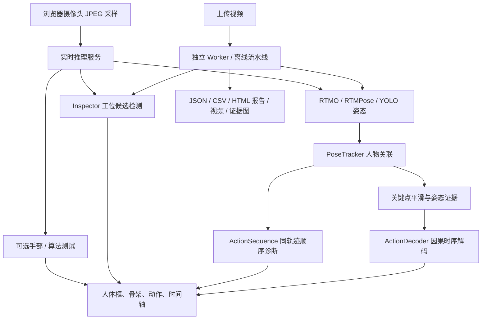

# AI-SOP 项目模型与算法梳理

整理日期：2026-10-14。适用对象：项目开发、算法维护、研究实验和项目交接。

本文依据当前工作区源码、配置、实际存在的权重和已有实验记录整理，包含尚未提交的实现。路径均相对于项目根目录。历史实验成绩注明来源；本次没有重新训练模型或开展现场精度测试。

## 1. 项目能力概览

项目采用“视觉检测／姿态估计 → 人物跟踪 → 姿态规则与时序稳定 → 动作顺序诊断／工位候选检测 → 证据与报告”的处理链。服务端主流程中的动作判定目前以几何规则为主，研究目录另外提供可训练的时序模型。

当前能力分为四类：

| 类别 | 已实现内容 | 当前状态 |
|---|---|---|
| 服务端视觉分析 | RTMO、RTMPose、YOLO 人体姿态，人物跟踪，五类姿态证据，按秒时序解码 | 已接入上传分析和实时采样 |
| 可选检测与诊断 | MediaPipe 手部，通用目标检测，工位 ROI 检测，动作顺序诊断 | 接口已实现；灯具现场配置和部分结果适配仍需补齐 |
| 公开数据研究 | HA4M 动作分类与四步装配阶段识别、Assembly101 事件错误分类 | 有源码和历史报告；当前工作区缺少历史 `work/` 数据与导出权重 |
| 灯具装配研究 | 拼接单尺度 TCN、质量门控关系与短长尺度 TCN、位置和边界多任务学习 | 有模型、训练、评测和合成权重；未接入服务端视频分析 |

**当前视频分析结果为 `REVIEW`。人体姿态、可见零件和观察到的动作顺序，均不能单独证明装配质量合格。** `process_rules.py` 可以对外部提供的已验证工艺事件进行规则回放，但目前没有与真实设备和视频事件形成生产闭环。

### 1.1 服务端处理关系



动作顺序诊断读取人物的当前帧 `signals` 和跟踪可靠性，不仅依赖稳定动作标签。工位检测与姿态检测是并行的候选证据来源，尚未自动融合成产品级工艺事件。

## 2. 模型清单与权重位置

### 2.1 已接入服务或算法测试的模型

| 模型 | 功能与输入输出 | 实现位置 | 权重与接入状态 |
|---|---|---|---|
| RTMO-m | 单阶段多人姿态；图像 → 人体框、检测分数、COCO-17 关键点 | [RTMLibDetector](../../algorithms/rtmlib_pose.py) | rtmlib 缓存中的 ONNX；服务端默认后端 |
| RTMPose-m | 自顶向下姿态；人体区域 → COCO-17 关键点 | [RTMLibDetector](../../algorithms/rtmlib_pose.py) | ONNX；与 YOLOX-m 组合为两阶段后端，可选 |
| YOLOX-m | RTMPose 前置人体检测；图像 → 人体框与分数 | [ScoredYOLOX 适配](../../algorithms/rtmlib_pose.py) | ONNX；仅作为两阶段检测组件 |
| YOLO11s-pose | 多人人体检测与 COCO-17 姿态 | [离线流水线](../../algorithms/pipeline.py)、[实时服务](../../backend/realtime.py) | `models/yolo11s-pose.pt`；可选后端、实时加载失败时的回退模型 |
| YOLO11n-pose | 更小的人体姿态模型 | [CLI 模型参数](../../tools/analyze-workers.py) | `models/yolo11n-pose.pt`；文件存在，默认服务配置不选择它，可通过 CLI 指定 |
| YOLO11n | COCO 通用目标检测；图像 → 类别、框、检测分数 | [AlgorithmLab](../../algorithms/lab.py) | `models/yolo11n.pt`；算法测试中的通用目标识别 |
| MediaPipe HandLandmarker | 图像 → 最多两只手的 21 点骨架、世界坐标；另用规则判定手形 | [HandLandmarker](../../algorithms/hands.py) | `models/hand_landmarker.task`；实时手部和握拳测试按需启用 |

这些模型提供视觉观测。YOLO11n 的 COCO 类别不包含灯具专用螺丝、卡扣、端子等工艺类别；MediaPipe 的闭手候选不等于真实持物或抓牢。

### 2.2 公开数据研究模型

| 模型／架构 | 任务与结构 | 源码 | 当前接入状态 |
|---|---|---|---|
| Frame MLP | HA4M 74 维骨架特征的逐帧 12 类动作基线 | [TemporalModel](../../experiments/public_training/train_temporal.py) | 研究实现，未接入服务端 |
| 因果 TCN | 74 维输入；宽度 64，扩张率 1/2/4/8，每块两层卷积 | 同上 | 研究实现；有效感受野 61 点 |
| 因果 Transformer | 74 维输入；宽度 64，4 头、2 层、因果注意力掩码 | 同上 | 研究实现；使用 64 点历史窗口 |
| Event MLP | 当前已完成事件的动词、两个对象、时长 → correct/mistake/correction | [SOPModel](../../experiments/public_training/train_sop.py) | Assembly101 事件分类基线 |
| SOP GRU | 当前及历史已完成事件 → 三类错误状态；单层、隐藏维度 64 | 同上 | 事件级研究；输入是标注事件，尚非视频端到端识别 |
| Dense TCN | HA4M 五阶段逐帧分段；可配置深度与宽度，因果残差块 | [DenseModel](../../experiments/public_training/scene_v2.py) | V2～V2.3 四步装配研究 |
| Dense GRU | 同一五阶段任务；两层 GRU | 同上 | 与 Dense TCN 参与概率集成 |

历史导出位置为 `work/public-training-2026-10-10/export/` 和 `work/simple-sop-2026-10-10/v2.3/export/`。**本次检查时 `work/` 目录不存在，因此上述权重、原始数据和历史回放不能在当前工作区直接复测。** 源码和 `docs/` 中的历史报告仍在。

### 2.3 灯具装配研究模型

| 模型 | 实现类与模型标识 | 结构 | 当前权重 |
|---|---|---|---|
| 拼接单尺度 TCN | `ConcatSingleScaleTCN`；`concat_single_scale_tcn` | 针对每个目标位置，拼接节点特征、相对坐标、掩码、年龄、质量和目标描述，再进行因果 TCN | [training-concat/best.pt](../../outputs/lamp-research-2026-10-14/training-concat/best.pt) |
| 质量门控关系与短长 TCN | `GatedRelationBoundaryTCN`；`gated_relation_boundary_short_long_tcn` | 目标查询与节点关系聚合、可靠度门控、短长因果分支、边界提示融合 | [training-relation/best.pt](../../outputs/lamp-research-2026-10-14/training-relation/best.pt) |

两个模型均位于 [experiments/lamp_assembly/models.py](../../experiments/lamp_assembly/models.py)。当前权重来自合成数据的三轮工程试训，不是已验证的现场部署模型。

### 2.4 实际权重盘点

本次核对了下列 9 个权重文件的存在性、大小和 SHA-256；灯具两种检查点另完成了严格参数重载。视觉模型没有在本次重新运行图像推理。

| 文件／组件 | 大小（MiB） | 位置 |
|---|---:|---|
| `yolo11s-pose.pt` | 19.429 | 项目 `models/` |
| `yolo11n-pose.pt` | 5.966 | 项目 `models/` |
| `yolo11n.pt` | 5.354 | 项目 `models/` |
| `hand_landmarker.task` | 7.457 | 项目 `models/` |
| RTMO-m ONNX | 85.134 | 本机 rtmlib 缓存 |
| RTMPose-m ONNX | 51.814 | 本机 rtmlib 缓存 |
| YOLOX-m ONNX | 96.703 | 本机 rtmlib 缓存 |
| 拼接 TCN `best.pt` | 0.065 | `outputs/lamp-research-2026-10-14/training-concat/` |
| 关系 TCN `best.pt` | 0.115 | `outputs/lamp-research-2026-10-14/training-relation/` |

本机缓存为 `C:/Users/86137/.cache/rtmlib/hub/checkpoints/`，三个文件分别为：

```text
rtmo-m_16xb16-600e_body7-640x640-39e78cc4_20231211.onnx
rtmpose-m_simcc-body7_pt-body7_420e-256x192-e48f03d0_20230504.onnx
yolox_m_8xb8-300e_humanart-c2c7a14a.onnx
```

缓存位于项目之外，迁移项目时需要另外准备。文件存在不等于当前运行服务已加载，也不能单独证明 CUDA 推理可用。权重大小依据当前文件，不能与历史文档中的近似大小混用。

## 3. 默认模型、调用入口与输出约定

### 3.1 不同入口的默认值

| 入口 | 默认后端 | 选择方式 | 依据 |
|---|---|---|---|
| Web 上传／新建分析任务 | RTMO | 页面选择，或任务 `pose_backend`；未提供时取 `POSE_BACKEND` | [Settings](../../backend/config.py)、[任务 API](../../backend/app.py) |
| 浏览器实时检测 | RTMO | `REALTIME_BACKEND=rtmo/rtmpose/yolo` | [RealtimeDetector](../../backend/realtime.py) |
| 离线 CLI | YOLO11s-pose | `--pose-backend`、`--model`、`--rtm-mode` | [analyze-workers.py](../../tools/analyze-workers.py) |
| 裸 `pipeline.analyze()`，未传 detector | Ultralytics YOLO | 调用者提供 `model_path` | [pipeline.py](../../algorithms/pipeline.py) |

因此，“服务端默认 RTMO”和“CLI 默认 YOLO”同时成立。早期文档中的默认值应按入口和修改时间理解。

服务端使用 rtmlib 的 `balanced` 档；CLI 还允许 `lightweight`、`performance`。RTMO／RTMPose 的 ONNX 输入尺寸来自导出模型规格，不能将通用 `imgsz` 参数理解为可以任意改变 ONNX 输入尺寸。

### 3.2 后端适配

[RTMLibDetector](../../algorithms/rtmlib_pose.py) 将 ONNX 输出转成跟踪器需要的接口：`boxes.xyxy`、`boxes.conf`、`keypoints.data`、`speed`。YOLOX 子类保留检测分数，RTMO 子类保留人体框。

RTMLib 适配器尝试使用 CUDA，构建失败时可改用 CPU；实时服务在 RTMLib 模型整体加载失败且 YOLO 文件可用时回退 YOLO。离线 Worker 没有同样的跨后端自动回退逻辑。应以结果中的模型与设备信息判断实际执行路径。

三种姿态后端统一为 17 个关键点，但分数分布和耗时口径不完全相同：Ultralytics 的 `speed.inference` 与适配器测量的整体调用耗时不能未经说明直接比较。

### 3.3 分析产物

离线分析主要输出：

| 产物 | 内容 |
|---|---|
| `analysis.json` | 模型、源文件、帧、人物轨迹、动作段、事件、证据、可选工位和顺序诊断 |
| `segments.csv` | 人物轨迹、动作区间、持续时间、检测平均分数、判定依据 |
| `report.html` | 可阅读的离线分析报告 |
| `video.webm` | 回放预览，最长 15 fps，最大 1280×720 |
| `evidence-*.jpg` | 按动作类别选取的证据图，至多六张 |
| `manifest.json` | 模型／源文件／产物／算法源码哈希、选项和完成记录 |

实时接口 `POST /api/v1/realtime/frame` 返回人体与骨架、动作、实际模型／设备、处理耗时、可选工位检测、手部和顺序诊断；不保存摄像头录像。

## 4. 服务端主要算法

### 4.1 视频校验与采样

实现：[algorithms/video.py](../../algorithms/video.py)、[algorithms/pipeline.py](../../algorithms/pipeline.py)。

先读取视频元信息、校验时间范围和裁切，再按目标采样率分析。离线默认 5 fps，允许 0.5～10 fps 且不得超过源帧率；默认视频时长上限 600 秒，每次分析最多 6,000 个采样点。源时间戳与预期恒定帧率相差超过 0.25 秒时拒绝发布完整结果。

检测通用调用参数为 `conf=0.35`、`iou=0.5`、`max_det=50`。这些是调用参数；RTMLib 的 NMS 仍由其模型实现和配置控制，不能假定传入的 `iou` 在所有后端都生效。

### 4.2 多人跟踪：运动预测与全局匹配

实现：[PoseTracker](../../algorithms/tracking.py)。

每个采样点执行如下步骤：

1. 将人体框和关键点转换为归一化坐标，过滤非法形状、非有限值和低分数观测。
2. 根据历史框中心速度预测位置，比较 IoU、按身高归一化的中心距离及可见骨架差异。
3. 使用匈牙利算法进行全局一对一关联，并允许创建新轨迹。
4. 对关联接近、长间隔和未观测轨迹清除动作证据，防止将不同人物的步骤累计在一起。

关联代价：

```text
cost = 0.45 × (1 - IoU)
     + 0.40 × min(中心距离 / 身体尺度, 1.5)
     + 0.15 × 骨架相对位置差异
```

| 参数 | 当前默认值／规则 |
|---|---|
| 活跃轨迹保留间隔 | 1.2 秒 |
| 运动预测时间上限 | 0.6 秒 |
| 关联接受代价 | 小于 0.95 |
| 模糊关联差值 | 竞争候选与已选代价差小于 0.06 |
| 新轨迹检测分数 | 至少 0.35 |
| 清除持续证据的长间隔 | 大于 0.75 秒 |
| 人物持续证据可靠条件 | 肩髋有效、关联无歧义、轨迹至少两次观测 |

轨迹编号表示连续视觉关联，不表示真实人员身份。

### 4.3 关键点平滑与骨架统一

实现：[pose.py](../../algorithms/pose.py)、[skeleton.py](../../algorithms/skeleton.py)。

当前 `PoseTracker` 调用 `smooth_keypoints()`：按运动幅度自适应调整指数平滑时间常数，小幅抖动时约 0.09 秒，快速运动时约 0.015 秒；只有前后均可见的关键点参与平滑。超过 0.35 秒的间隔不沿用该次平滑，不恢复遮挡点。

`OneEuroFilter` 和 `OneEuroPoseFilter` 已实现并导出，但**当前跟踪主链仍使用 `smooth_keypoints()`，尚未改为 One Euro Filter**。One Euro 的原理为速度增大时提高截止频率：

```text
cutoff = min_cutoff + beta × |平滑后的速度|
alpha  = 1 / (1 + 1 / (2π × cutoff × dt))
```

`skeleton.py` 统一 COCO-17 身体拓扑、MediaPipe 21 点手部拓扑、可见阈值 0.35 和可靠阈值 0.5。动作几何计算将横坐标按画面宽高比修正，减少非方形画面的距离偏差。这里只定义拓扑和几何工具，没有实现 ST-GCN 训练模型。

### 4.4 姿态证据：五类动作与未知状态

主实现：[action_observation()](../../algorithms/pose.py)。

模型关键点经平滑和尺度修正后，输出相互独立的规则支持度。支持度并非经人工真值校准的动作概率。

| 动作 | 规则依据 | 当前主要区间 |
|---|---|---|
| `raised` 抬手 | 同侧手腕高于肩部，除以躯干长度 | 0.05～0.20 倍躯干长度，线性增加支持度 |
| `reaching` 手臂伸出 | 手腕在髋上方，横向离肩距离除以躯干长度 | 0.40～0.75 倍躯干长度 |
| `bending` 躯干前倾 | 肩髋连线偏离竖直角度 | 25°～42° |
| `walking` 位移候选 | 历史髋部横坐标的两两斜率中位数，除以人体框高度 | 0.09～0.20 身高／秒 |
| `standing` 站立／原地作业 | 肩髋有效、双侧手腕可见，其他动作支持较低 | `质量权重 × (1 - 其他支持度最大值)` |
| `unknown` 不确定 | 肩髋不足、跟踪不可靠或时序证据不足 | 保留未知，不推定完成 |

位移用约 1.25 秒历史内的斜率中位数抑制单点抖动；需要至少三个观测、至少约 0.4 秒历史。静止、抬手和伸手等规则可同时得到支持，最终稳定标签由时序解码器选择。

同文件的 `action_rule()` 是保留的较早单标签规则；当前跟踪主链调用的是 `action_observation()`，两套阈值不应混用。

### 4.5 因果时序解码：ActionDecoder

实现：[algorithms/temporal.py](../../algorithms/temporal.py)，输出方法标识为 `causal-duration-v3`。

该算法是规则状态机，不是训练得到的神经网络。它先按真实时间间隔平滑支持度，再累计当前候选的有效持续时间，结合滞回、释放和转移阻尼输出稳定动作。

| 项目 | 默认值／规则 |
|---|---|
| 平滑时间常数 | 0.12 秒；`alpha = 1 - exp(-dt / tau)` |
| 候选确认 | 至少两次观测，累计有效时间达到 0.30 秒 |
| 候选进入 | 当前原始与平滑分数均至少 0.60 |
| 竞争标签滞回 | 分数差小于 0.12 时保留已激活动作 |
| 短暂证据抖动容忍 | 0.12 秒；暂停累计，不把缺失时间算作动作持续时间 |
| 低证据释放 | 原始支持低于 0.35 立即未知；低于 0.50 持续 0.18 秒后释放 |
| 大间隔重置 | 超过 0.75 秒 |
| 转移阻尼 | 抬手↔前倾减 0.25，移动↔前倾减 0.20 |

转移阻尼是启发式稳定策略，不是学习到的转移概率，也不证明相关姿态不能重叠发生。无效观测会重置状态，时间戳必须严格递增。

### 4.6 动作顺序诊断：ActionSequence

实现：[algorithms/action_sop.py](../../algorithms/action_sop.py)；配置：[config/action-workflows.json](../../config/action-workflows.json)。

当前内置示例为“抬手 → 伸手 → 前倾 → 移动”，共四步。每个人物轨迹独立保存已完成步骤、候选持续时间、释放状态、等待时间和循环编号。

默认步骤持续至少 0.5 秒、等待上限 30 秒；工作流阈值 0.65，最大连续间隔 0.75 秒，重复动作释放需要 0.2 秒。输出主要事件为 `STEP_OBSERVED`、`OUT_OF_ORDER`、`STEP_TIMEOUT`、`CONTINUITY_RESET`。

可选步骤 ROI 接受人体中心或可见手腕进入；手腕进入时给予 0.15 的空间支持增量。代码也接受人物内关联的可选手部点，但默认示例没有配置 ROI，当前实时服务没有把独立手部结果关联到具体人物。

有两个接入边界需要保留：

- 握拳和通用目标可以在算法测试中展示结果，但服务端尚未将 `lab.hands`、`lab.objects` 转换为人物级 `signals.grip`、`signals.objects`。流程引擎允许这些动作名，不等于对应测试步骤已经具备自动推进所需的证据适配。
- 观察不到步骤不等于实际漏做；观察完示例顺序也不等于产品合格。顺序诊断结果始终为 `REVIEW`。

### 4.7 实时跨帧状态

实现：[backend/realtime.py](../../backend/realtime.py)、[backend/streams.py](../../backend/streams.py)。

实时请求同时提供 `x-stream-id` 和 `x-frame-time` 时，服务端按登录会话与视频流隔离 `PoseTracker`、`ActionSequence` 状态，支持连续人物关联。未提供时为 `frame-local`，每帧新建跟踪器，不能累计稳定动作和步骤证据。

状态注册表默认最多 16 路、每个会话最多 4 路、空闲 60 秒过期；画面尺寸或配置签名变化会重建状态，时间戳过期拒绝处理。模型推理池默认两个槽位，可配置 1～4，满载立即返回 429。

因此 README 中早期“实时不提供跨帧跟踪”的表述不再覆盖当前源码的全部能力；当前应区分带流标识的连续请求与独立单帧请求。

## 5. 手部、目标与工位检测

### 5.1 举手与手形测试

实现：[lab.py](../../algorithms/lab.py)、[hands.py](../../algorithms/hands.py)。

算法测试中的举手规则要求肩腕分数至少 0.5，手腕高于肩部至少画面归一化纵坐标 0.04。它与通用姿态规则的躯干尺度归一化阈值不同，适用于交互测试。

手形由 MediaPipe 世界坐标中的四指关节角度判断，拇指不参与：

| 手形 | 规则 |
|---|---|
| `CLOSED` 闭手候选 | 至少三指角度小于 125° |
| `OPEN` 张手 | 四指角度均大于 155° |
| `PARTIAL` 部分弯曲 | 其余有效情况 |
| `UNKNOWN` 不确定 | 几何退化，无法计算有效角度 |

检测置信门槛和手部存在门槛均为 0.5。该规则不提供抓握力、工具接触和物体锁止信息。

### 5.2 工位候选检测：Inspector

实现：[inspection.py](../../algorithms/inspection.py)、[stations.py](../../algorithms/stations.py)。

仅在工位已批准、固定治具已确认、ROI 像素足够且清晰度达标时执行候选检测。ROI 最小边至少 8 像素，默认清晰度门槛为灰度拉普拉斯方差 30。

| 方法 | 算法 | 用途与限制 |
|---|---|---|
| HSV | HSV 阈值分割 → 3×3 开运算 → 最大连通域面积比例 | 仅用于黄色卡扣候选；默认 HSV 范围 `(18,90,70)`～`(40,255,255)`，面积比例 0.08～0.80 |
| 模板匹配 | 灰度 `TM_CCOEFF_NORMED`，取最大相关分数 | 固定视角／治具下的外观候选；模板必须可解码、有纹理且不大于 ROI |
| 专用 YOLO | 对 ROI 检测配置类别，按类别取最高分数 | 需要灯具专用 detect 权重；拒绝以人体 pose 权重代替零件模型 |

YOLO ROI 按资源、阈值、像素形状分组，每批最多八个区域；保持结果与目标位置对应。HSV 和模板走各自的逐区域路径。

配置约束包括：每工位最多 64 个位置、最多一个专用 YOLO 资源；每个检查项的 ROI 不能重叠，配置位置类别和数量须与 `expected` 一致。配置和资源进行版本化与哈希校验。

候选存在输出 `CANDIDATE`，未检出输出 `UNKNOWN`。后者不能区分遮挡和缺件，检查项和工位结论仍为 `REVIEW`。

### 5.3 六工位的当前配置

来源：[config/stations.json](../../config/stations.json)。

| 工位 | 配置需求 |
|---|---|
| 工位 1 | 四个定位孔、四颗螺丝 |
| 工位 2 | 五颗螺丝 |
| 工位 3 | 两颗螺丝、一个黄色卡扣 |
| 工位 4 | 两颗螺丝 |
| 工位 5 | 接端子动作、八颗螺丝及安装顺序 |
| 工位 6 | 壳体吹净、装饰框总成吹净、线束端子连接、四颗螺丝 |

本次核对为 **6 个工位、11 个检查项、0 个配置目标 ROI**；全部为 `draft-1`、`approved=false`、`fixed_fixture=false`。这是一份需求草案，尚不能据此执行灯具零件识别或完整工艺判定。

### 5.4 外部工艺事件规则回放

实现：[process_rules.py](../../algorithms/process_rules.py)；入口：[tools/check-process.py](../../tools/check-process.py)。

该模块接收 `ProcessSpec` 与 `Attempt`。事件需包含产品周期、目标位置、程序、OK／NG／UNKNOWN、起止时间区间、验证状态和修订号；同一事件使用最新修订。

规则采用三值逻辑：

| 规则 | TRUE | FALSE | UNKNOWN |
|---|---|---|---|
| 覆盖 | 有接受的 OK 事件且无未解决 NG | 有未解决 NG，或在完整检查点确认没有事件 | 证据不足 |
| 顺序 | 前置事件最晚结束不晚于后续最早开始 | 前置最早结束仍晚于后续最晚开始 | 不确定区间重叠或缺少依据 |
| 时长 | 所有可能时长落在允许区间内 | 时长范围与允许区间完全不交 | 只部分重叠 |

只有正式批准的规则、完整覆盖、有效检查点、无拒绝事件且全部规则为 TRUE 时才可在回放中输出 `PASS`；明确违反规则输出 `FAIL`，其余 `REVIEW`。这些结论只针对输入事件和规则，不证明原视频识别正确。当前实际调用来自诊断 CLI 和测试，尚未接入视频 API 的产品判定流程。

## 6. 公开数据的时序与 SOP 研究

### 6.1 HA4M 特征与数据协议

实现：[prepare_ha4m.py](../../experiments/public_training/prepare_ha4m.py)。

研究输入来自 Kinect 二维投影，映射为 COCO-17 顺序，按源 30 fps 每三帧采样一次，得到 10 Hz，禁止用未来观测插值。

74 维特征组成：

```text
17 × (躯干尺度归一化 x、y、置信度、可见掩码) = 68 维
髋部 x/y 速度、尺度变化速度、观测年龄、躯干尺度、可见比例 = 6 维
```

肩髋无效、可见关节少于八个、年龄超过 0.5 秒、多人歧义或 dont-care 等情况被掩码，不能直接改成背景。该特征分布和标签与在线 YOLO／RTMO 姿态规则不同，研究权重无法通过更换文件直接部署到现有服务链。

### 6.2 12 类动作模型与三类事件错误模型

HA4M 的 12 类标签为 `carrier`、`gear_bearings`、`planet_gears`、`carrier_shaft`、`sun_shaft`、`sun_gear`、`sun_gear_bearing`、`ring_bear`、`join_blocks`、`cover`、`screws`、`allen_key_turn_return`。

[train_temporal.py](../../experiments/public_training/train_temporal.py) 对比逐帧 MLP、因果 TCN 和因果 Transformer。归一化与类别权重仅由训练集计算，窗口不跨录制，按验证宏 F1 选型。

[train_sop.py](../../experiments/public_training/train_sop.py) 使用 Assembly101 的已标注动作事件。输入为动词嵌入 8 维、两个对象嵌入各 16 维、对数时长 1 维，共 41 维，投影至 64 维后由 MLP 或 GRU 分类。按完成时间暴露事件，不输入错误标签、错误备注、操作者、绝对时间或未来事件。

### 6.3 四步装配阶段模型与概率集成

四步研究将 HA4M 前八类合并为“其他作业”，后四类作为“合拢组件 → 放置盖板 → 放置螺丝 → 工具操作并归位”，共五类输出。实现：[prepare_simple_scene.py](../../experiments/public_training/prepare_simple_scene.py)、[scene_v2.py](../../experiments/public_training/scene_v2.py)。

Dense TCN 使用逐帧特征投影、LayerNorm、左侧填充扩张卷积和残差连接。每块一层核长 3 的扩张卷积，感受野为 `1 + 2 × sum(dilation)`；深度 7 对应 255 点，深度 8 对应 511 点。Dense GRU 使用两层循环状态。集成对各成员 softmax 概率取平均，不通过正式工序顺序强行约束类别。

`DensePredictor` 对 TCN 缓存逐层历史激活，对 GRU 缓存隐状态，录制结束后 `reset()`。这是公开数据推理器的增量优化，与灯具研究模型的窗口重算方式不同。

### 6.4 阶段稳定算法

| 算法 | 实现 | 核心机制 |
|---|---|---|
| 持续确认 | [scene_runtime.py](../../experiments/public_training/scene_runtime.py) | 连续 N 个有置信支持的观测后确认 |
| EMA + 持续确认 | [StageFilter](../../experiments/public_training/scene_v2.py) | 平滑五类概率，再累计胜出类别持续帧数 |
| 置信证据累积 | [EvidenceFilter](../../experiments/public_training/evidence_filter.py) | 累积第一名与第二名的概率裕度；换候选时重置 |
| HMM 在线前向滤波 | [HMMFilter](../../experiments/public_training/scene_filter_v3.py) | 黏性自转移先验、软化观测、前向后验与持续确认 |
| 衰减证据累积 | [EvidenceDecayFilter](../../experiments/public_training/scene_filter_v3.py) | 每类证据按帧衰减，短暂翻转不直接清零；达预算切换 |

以上均为因果后处理，不读取未来帧、不强迫遵守 SOP 顺序、不回填确认前的边界。无效观测重置，低置信观测输出未知。

V2.3 历史选中成员为 `tcn-d7-w96-s2026 + tcn-d8-w96-s2028 + gru-d0-w96-s2027`；过滤器为 `evidence-decay-v3`，参数：

```json
{"alpha": 0.3, "budget": 0.5, "threshold": 0.0, "margin": 0.1, "decay": 0.8}
```

成员和滤波参数由验证集搜索确定。`check_sop()` 再检查阶段事件的正常顺序、重复、逆序、未预期阶段和结束缺步；这与服务端人物级 `ActionSequence` 是两套不同任务与输入协议。

### 6.5 历史验证结果

以下为已有报告中的历史数值，当前工作区没有原始 `work/` 产物，本次未重新计算。

HA4M 首轮使用 41 人、82 段录制，按人员分为训练 27 人、验证 7 人、测试 7 人；成绩条件于可用、已标注的采样点。

| HA4M 12 类模型 | 测试帧准确率 | 宏 F1 | 分段 F1@0.5 |
|---|---:|---:|---:|
| Frame MLP，单次 | 47.19% | 38.28% | 3.27% |
| TCN，三个种子均值 | 65.60% | 63.53% | 19.90% |
| Transformer，三个种子均值 | 67.58% | 66.93% | 18.75% |

Assembly101 事件输入研究：Event MLP 测试宏 F1 为 65.19%，GRU 三种子均值为 66.06%；按验证集选出的 GRU 的 mistake 召回为 39.39%。这不等于视频异常检测召回率。

| HA4M 四步装配指标 | V2.3 历史结果 |
|---|---:|
| 完整阶段序列匹配 | 10/14 |
| 稳定帧准确率 | 84.09% |
| 稳定宏 F1 | 76.95% |
| 分段 F1@0.5 | 81.48% |
| 序列对齐后多余／缺失事件 | 3／2 |
| 匹配事件起点绝对偏移中位数 | 1.60 秒 |

四步任务的类别、模型和评测对象与 12 类任务不同，不能直接用这些数值推算架构提升。V2.3 使用此前已用过的测试人员，不是新的外部验证；其帧准确率增量的描述性区间包含 0。起点偏移不是摄像头到报警的实际发布延迟。

来源：[公共训练报告](../history/public-training-results-2026-10-10.md)、[V2.3 结果](../history/simple-sop-v23-results-2026-10-10.md)。

## 7. 灯具装配多任务模型

### 7.1 输入与输出协议

源码：[models.py](../../experiments/lamp_assembly/models.py)、[data.py](../../experiments/lamp_assembly/data.py)。设 B 为批量、T 为时间、N 为观测节点、K 为目标位置、D 为节点特征维度。

| 输入 | 形状 | 含义 |
|---|---|---|
| `features` | `[B,T,N,D]` | 前两维为同一相机坐标系下的归一化 XY；当前试训 D=8、N=3 |
| `targets` | `[B,K,G]` | 固定目标位置及描述，前两维为归一化 XY；试训 K=2、G=4 |
| `masks` | `[B,T,N]` | 布尔观测可用掩码 |
| `ages` | `[B,T,N]` | 观测年龄，单位秒 |
| `quality` | `[B,T,N,Q]` | 前两维为置信度和污染／遮挡程度，均在 0～1 |

| 输出 | 形状 | 含义 |
|---|---|---|
| `action_logits` | `[B,T,K,C]` | 每个位置的动作；试训为背景、接近、操作候选、撤离四类 |
| `position_logits` | `[B,T,K+2]` | K 个位置、无目标、位置不确定 |
| `boundary_logits` | `[B,T,K,2]` | 起点／终点 logits |
| `quality_logits` | `[B,T,K,Qc]` | 证据不可用／可用，试训两类 |

质量头表示观测证据是否可用，不表示产品质量。全缺失时位置显式回退“不确定”，质量回退“不可用”，动作原始 logits 本身仍须经过候选发布门控。

### 7.2 拼接单尺度基线

针对每个目标，将所有节点的特征、节点到目标的相对 XY、掩码、归一化年龄、质量与目标特征拼接，线性投影后进入单尺度因果 TCN，再接四个输出头。

试训宽度 32，扩张率 `[1,2,4]`，感受野 15 个采样点，参数量 **14,539**。其用途是提供相同输入下的简单基线；它没有关系模型的显式可靠度加权注意力。

### 7.3 质量门控关系与边界提示模型

候选模型的处理顺序为：

1. 编码节点特征、相对坐标、掩码／年龄／质量，并用目标特征构造查询。
2. 将显式可靠度先验与可学习门控相乘，抑制缺失、低置信和污染节点。
3. 通过目标查询与节点键的相似度进行可靠度加权聚合。
4. 分别进入短、长两个因果 TCN，用短分支的边界提示控制融合。
5. 输出动作、位置、边界和证据质量四个任务。

```text
基础可靠度 = mask × confidence × (1 - corruption) × exp(-age / age_tau)
节点权重   ∝ exp(目标查询与节点键相似度) × 基础可靠度 × 学习门控
融合特征   = gate × short + (1 - gate) × long
```

试训宽度 32，短扩张率 `[1,2]`、长扩张率 `[1,2,4]`，分支感受野分别为 7 和 15 点，参数量 **25,982**。配置允许扩大感受野；当前保存权重的长分支仍为 15 点，不能称为已经训练的大范围上下文模型。

### 7.4 数据、训练和选型

入口：[prepare_data.py](../../experiments/lamp_assembly/prepare_data.py)、[train.py](../../experiments/lamp_assembly/train.py)。

准备入口接收已经提取的周期 NPZ 和 manifest，校验周期、操作者、会话、文件路径和哈希的分区隔离。真实视频到统一节点特征的提取器尚未完成。

训练归一化只拟合训练集；保留前四个几何通道原尺度，质量与年龄遵循独立协议。未知标签和补齐帧通过任务掩码排除。

```text
loss = action_CE + 0.5 × position_CE
     + 0.5 × boundary_BCEWithLogits + 0.5 × quality_CE
```

默认 AdamW，学习率 `3e-4`，weight decay `1e-4`，batch size 4，seed 17，最多三轮，梯度裁剪范数 5。按最低验证多任务损失选权重；默认不打开测试数组，只有显式 `--evaluate-test` 才在选型后评价测试集。

### 7.5 流式推理与事件导出

运行时：[AssemblyPredictor](../../algorithms/assembly_predictor.py)。

该适配器按 `stream_id`、`cycle_id` 和特征／标定 `signature` 隔离状态。默认最多 16 路、TTL 60 秒、最大源时间间隔 2 秒，观测过期阈值默认同为 2 秒；周期或签名变化重建，长间隔清除上下文。

当前保存不超过感受野的输入窗口，每次重新前向计算，**没有使用公开数据 DensePredictor 的逐层增量缓存**。源视频时间、周期相对时间、当前上下文段时间和发布时间分别记录。边界候选仅在当前证据可用、质量头支持且位置关联正确时发布。

训练后的 `decode_operation_events()` 另采用简单离线连续区间导出：动作必须为操作候选、位置一致、质量可用且有新鲜观测；源时间大间隔切断事件。它尚未使用边界头来驱动事件发布。

目前模型运行时与服务端 `RealtimeDetector`、离线 `pipeline` 没有集成调用，也没有持久事件聚合和观察级 SOP 适配。

### 7.6 实际试训结果与验证范围

数据为明确标记 `is_synthetic=true` 的人工合成数据：六个虚拟操作者、30 个周期，每周期 48 个采样点，4 Hz；train/val/test 为 20/5/5 周期，操作者为 4/1/1。条件覆盖正常两位置、短操作、同位置重复、纯背景和不可观测区。

下列数值由本次读取现有训练与评测 JSON 核对；参数量由重载模型计算。

| 项目 | 拼接 TCN | 关系＋短长 TCN |
|---|---:|---:|
| 参数量 | 14,539 | 25,982 |
| 最佳 epoch | 3 | 3 |
| 最低验证损失 | 1.895915 | 1.971735 |
| 可评分操作真值事件 | 8 | 8 |
| 预测事件 | 0 | 0 |
| TP／FP／FN | 0／0／8 | 0／0／8 |
| 操作事件 F1@0.5 | 0 | 0 |

另有一个不可评分真值事件，真值可评分覆盖为 8/9。**两种模型均未在该次短训练中形成有效的操作事件识别；损失下降不能作为候选结构优势或现场识别有效性的证据。**

已有工程记录验证了因果性、批量／随机分块／逐帧数值一致、检查点往返、缺失与陈旧证据拒判、周期隔离和事件匹配反例。这些验证说明实现接口和数值性质，不代表识别准确率、实时加速或实际发布延迟已有提升。

来源：论文模型实验执行报告（历史引用，当前工作区缺少文件：`../../outputs/论文模型实验执行报告.md`）、[拼接训练记录](../../outputs/lamp-research-2026-10-14/training-concat/run-summary.json)、[关系训练记录](../../outputs/lamp-research-2026-10-14/training-relation/run-summary.json)。

## 8. 评测算法与指标口径

### 8.1 现有视频分析的现场评测入口

[tools/evaluate-accuracy.py](../../tools/evaluate-accuracy.py) 将人工标注时间与保存的 `analysis.json` 最近采样点对齐，输出人员出现 precision/recall/F1、动作宏 F1 和按现场条件分组的人员出现指标，不训练或调阈值。

当前实现按一帧内动作类别的集合统计，不逐人匹配、不评价人体框定位或关键点误差；没有匹配采样点的标注被跳过。使用时应同步报告时间对齐覆盖，不能将该分数称为完整多人人体检测、身份跟踪或端到端工序准确率。

### 8.2 公开时序研究指标

[common.py](../../experiments/public_training/common.py) 提供分类准确率、宏 F1、分段 F1@tIoU 和序列 Edit。帧级分类评价标签，分段指标评价区间重叠与碎片化，Edit 评价压缩后的类别序列；各指标不能互相替代。

### 8.3 灯具操作事件匹配

实现：[experiments/lamp_assembly/evaluate.py](../../experiments/lamp_assembly/evaluate.py)。

事件仅在相同 `cycle_id`、目标位置和动作类别内匹配，采用半开时间区间，默认 `tIoU >= 0.5`，且一对一匹配。

SciPy 路径先最大化合格匹配数量，再最大化总 IoU；缺少 SciPy 时增广路回退保证最大匹配数量，但不保证全局最大总 IoU 的次级目标。

先匹配可评分真值；未匹配且与明确不可观测区重叠的预测另列为 ambiguous，不直接计为已确定误报。主指标和保守敏感性结果分开报告，同时输出可评分覆盖。重复、错位置、跨周期和漏检不会借同一真值重复得分。

已匹配事件的起止误差属于边界误差；实时发布延迟需要另外记录真实采集、处理和发布时间。

## 9. 已有优化、未接入能力与后续工作

### 9.1 已实现的计算与工程优化

| 优化 | 位置 | 实际范围 |
|---|---|---|
| TCN 逐层历史激活缓存、GRU 隐状态 | `experiments/public_training/scene_v2.py` | 公开数据 DensePredictor；不是全部 TCN 的通用已接入优化 |
| 同尺寸、同阈值 ROI 合批，最多八个 | `algorithms/inspection.py` | 已配置专用检测资源的多个区域 |
| 模型复用与预热 | `backend/worker.py`、`backend/realtime.py` | Worker 复用当前模型；实时槽位惰性加载，主槽位预热 |
| 配置快照缓存与资源变更失效 | `algorithms/stations.py`、`algorithms/action_sop.py` | 降低连续采样的重复配置解析与哈希开销 |
| 有界轨迹、流状态与推理池 | `algorithms/tracking.py`、`backend/streams.py`、`backend/realtime.py` | 控制状态增长和繁忙反馈 |
| 分析版本与产物校验 | `algorithms/pipeline.py`、`backend/worker.py` | 源视频、模型、算法和结果可追溯 |

历史微基准记录：公开时序逐帧中位耗时 3.584 → 1.176 ms，八 ROI 检测 54.648 → 18.710 ms。来源：[推理优化记录](../history/inference-optimization-2026-10-10.md)。当前缺少其 `work/` 基准产物，本次未复测；这些数字不包含完整视频／网络流程，也不是现场灯具准确率或多路服务吞吐。

### 9.2 当前需要明确的实现边界

| 能力 | 当前情况 | 落地需要补齐 |
|---|---|---|
| 灯具零件与位置识别 | 检测框架有，六工位均无 ROI | 固定治具、批准配置、现场 ROI、模板或专用检测权重 |
| 抓握／通用目标的顺序推进 | 可展示独立测试结果 | 人物归属和当前帧信号适配 |
| One Euro 主链平滑 | 类与测试已有 | 在真实轨迹上比较，再决定是否替换现有平滑 |
| 灯具神经时序模型 | 有模型和合成工程试训 | 真实特征提取、现场数据、模型诊断与有效训练 |
| 边界驱动的在线事件 | 有边界头和逐帧候选 | 发布策略、事件聚合、重复事件处理、真实延迟评测 |
| 生产 SOP／质量结论 | 有外部事件诊断规则 | 正式 SOP、周期／位置／程序绑定、工具和设备 OK/NG 证据 |
| 公开数据实验复现 | 有源码和历史文档 | 恢复原数据、权重、冻结协议和回放产物 |
| 更复杂研究模型 | 研究文档讨论 MS-TCN++、ASFormer、FACT、ST-GCN 等 | 尚无对应完整项目实现和可用部署权重 |

建议顺序：先确认单工位 A/B 位置与工艺，试拍并检查可观测性；建立真实视频、周期、操作者和会话隔离标注；补齐特征提取与事件适配；在固定验证协议下对比基线与候选；最后封存测试，接设备证据并测真实处理／发布延迟。

## 10. 使用与复现入口

以下命令从项目根目录执行。生成新分析或实验时使用新输出目录，避免覆盖既有结果。

### 10.1 现有视频姿态分析

```powershell
# RTMO 离线分析示例，显式指定后端
node tools/python.cjs tools/analyze-workers.py --video assets/factory-workers.mp4 --pose-backend rtmo --start 0 --end 15 --sample-fps 5 --out runtime-data/model-review-rtmo

# YOLO 小模型姿态示例
node tools/python.cjs tools/analyze-workers.py --video assets/factory-workers.mp4 --pose-backend yolo --model models/yolo11n-pose.pt --start 0 --end 15 --out runtime-data/model-review-yolo-n
```

依赖见 [requirements-worker.txt](../../requirements-worker.txt)。RTMO／RTMPose 另需 rtmlib 和匹配 CUDA 的 ONNX Runtime；项目说明建议 `rtmlib --no-deps`，避免其依赖安装覆盖 GPU Runtime。具体版本适配按运行环境确定，见 [RTM 后端记录](../history/rtmpose-rtmo-backend-2026-10-10.md)。

### 10.2 灯具研究模块

```powershell
# 重用现有合成数据，在新目录训练；默认只训练和验证选型
node tools/python.cjs -m experiments.lamp_assembly.train --manifest outputs/lamp-research-2026-10-14/synthetic-data/manifest.json --kind concat --output-dir runtime-data/lamp-model-review/concat --epochs 3 --device cpu

node tools/python.cjs -m experiments.lamp_assembly.train --manifest outputs/lamp-research-2026-10-14/synthetic-data/manifest.json --kind relation --output-dir runtime-data/lamp-model-review/relation --epochs 3 --device cpu

# 复算已有合成预测的事件指标，不重新训练
node tools/python.cjs -m experiments.lamp_assembly.evaluate --manifest outputs/lamp-research-2026-10-14/synthetic-data/manifest.json --predictions outputs/lamp-research-2026-10-14/training-relation/test-predictions.json --split test --test-results runtime-data/lamp-model-review/evaluation.json
```

评测入口会自动创建输出目录。重新训练后如需测试评测，显式增加 `--evaluate-test`，不要将测试结果用于调参。

### 10.3 已有测试与评测入口

| 检查内容 | 入口 |
|---|---|
| 服务端和通用算法回归 | `npm run test:api` |
| 公开研究的因果性、滤波和分段逻辑 | `npm run test:scene` |
| 灯具数据、模型、运行时和事件匹配 | `node tools/python.cjs -m pytest experiments/lamp_assembly -q` |
| 已保存视频分析的现场标注评测 | `npm run evaluate:accuracy -- <标注文件> --split test` |
| 历史推理微基准 | `npm run benchmark:inference -- --iterations 60`，需要恢复历史基准输入与模型 |
| 历史四步浏览器回放 | `npm run test:scene-ui`，需要恢复 V2.3 回放和 CLI 产物 |

这些是可复用入口，不表示本次整理已经执行全部测试或重新验证历史成绩。

## 11. 维护索引与本次核对说明

| 要修改的内容 | 优先查看 |
|---|---|
| 姿态后端与默认模型 | [backend/config.py](../../backend/config.py)、[backend/realtime.py](../../backend/realtime.py)、[backend/worker.py](../../backend/worker.py)、[algorithms/rtmlib_pose.py](../../algorithms/rtmlib_pose.py) |
| 人物关联与动作规则 | [algorithms/tracking.py](../../algorithms/tracking.py)、[algorithms/pose.py](../../algorithms/pose.py)、[algorithms/temporal.py](../../algorithms/temporal.py) |
| 人体／手部拓扑和手形 | [algorithms/skeleton.py](../../algorithms/skeleton.py)、[algorithms/hands.py](../../algorithms/hands.py) |
| 工位需求、ROI 和候选检测 | [config/stations.json](../../config/stations.json)、[algorithms/stations.py](../../algorithms/stations.py)、[algorithms/inspection.py](../../algorithms/inspection.py) |
| 动作顺序与工艺规则 | [config/action-workflows.json](../../config/action-workflows.json)、[algorithms/action_sop.py](../../algorithms/action_sop.py)、[algorithms/process_rules.py](../../algorithms/process_rules.py) |
| 公共数据动作／事件训练 | [train_temporal.py](../../experiments/public_training/train_temporal.py)、[train_sop.py](../../experiments/public_training/train_sop.py) |
| 公共阶段模型与稳定滤波 | [scene_v2.py](../../experiments/public_training/scene_v2.py)、[evidence_filter.py](../../experiments/public_training/evidence_filter.py)、[scene_filter_v3.py](../../experiments/public_training/scene_filter_v3.py) |
| 灯具多任务模型与流式适配 | [models.py](../../experiments/lamp_assembly/models.py)、[assembly_predictor.py](../../algorithms/assembly_predictor.py) |
| 灯具数据、训练与事件评测 | [data.py](../../experiments/lamp_assembly/data.py)、[train.py](../../experiments/lamp_assembly/train.py)、[evaluate.py](../../experiments/lamp_assembly/evaluate.py) |

本次核对包括：41 个核心 Python 文件的语法结构与源码哈希、9 个权重文件的路径／大小／哈希、两种灯具检查点严格重载及参数量、30 个合成周期文件哈希，以及工位和工作流配置。本文只以 Markdown 交付；未重新运行视觉推理、训练、历史基准或现场准确率实验。

进一步阅读：

- [算法详解与优化研究路线](algorithm-explanation-and-research-2026-10-14.md)与[灯具模型训练诊断](lamp-model-training-diagnostics-2026-10-14.md)
- [工位算法与配置](../guides/station-algorithms.md)
- [通用动作时序](../guides/action-temporal.md)与[动作顺序诊断](../guides/action-sequence.md)
- [现场准确率评测](../guides/accuracy-evaluation.md)
- [公共数据训练结果](../history/public-training-results-2026-10-10.md)与[V2.3 阶段实验](../history/simple-sop-v23-results-2026-10-10.md)
- 灯具模型研究方案（历史引用，当前工作区缺少文件：`../../outputs/面向灯具装配的模型优化与论文实验方案.md`）与实际执行报告（历史引用，当前工作区缺少文件：`../../outputs/论文模型实验执行报告.md`）
