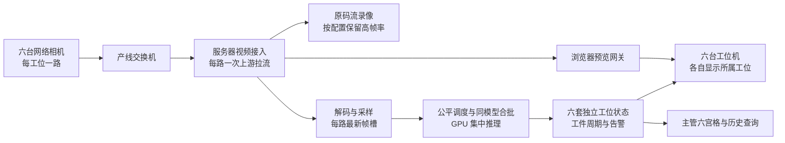

# 六工位六路视频接入与 GPU 集中推理优化方案

日期：2026-11-06（Asia/Singapore）。依据：当前工作区源码、2026-11-05 的本机实测报告及厂家公开资料。本文件是设计方案；本文所列新接口、调度器和部署参数尚未实施。未连接六台现场工位机或目标服务器，建议指标不是已达标结果。

结论：六路通过服务器登记的“工位—工位机—相机”绑定区分，每路独立维护工件周期和动作状态；服务器统一分配推理资源。相机高帧率录像、前端预览与 AI 检测分别设计。优先解决固定绑定、专项串行瓶颈及六路公平调度，再优化模型计算。

## 1. 先确定相机接入方式

用户提供“USB 摄像头”，随后提供“DS-2CD6B45FWD-1ZS，400W、60fps”。海康官方公开目录对应型号为 **DS-2CD6B45FWD-IZS/60fps**（IZS 首字母为 I），归类为“场景数字化网络摄像机 / 生产记录 / 产线相机专用产品”[S1]。

因此主要方案按网络摄像机设计，保留 USB 接入分支。公开页的完整接口和码流参数需要登录，尚不能确认现场实物的固件、供电、主子码流组合以及最高分辨率与 60fps 能否同时启用。现场核对铭牌、接线和实际协商出的码流即可，无需等待这些信息才开展软件设计。若通过采集卡或虚拟摄像头转换为 USB，应将转换设备也登记。

### 推荐拓扑：网络摄像机直接接入服务器



- 相机输出经确认可用的 RTSP 或厂家 SDK 视频流；接入服务只建立必要的上游连接，内部向录像、推理和预览分发。
- 浏览器预览经 WebRTC 网关交付，可评估 MediaMTX；它具备 RTSP 接入和 WebRTC 浏览器读取能力[ S3 ]。是否可直接转封装取决于码流与浏览器编解码兼容性，必要转码必须计入算力、带宽与时延。
- 工位机负责操作、显示和扫码；关掉页面不应停止服务器视频采集和推理。
- 供电依据实物手册选配，不能在尚未核验接口时默认所有设备均支持同一种 PoE 方案。

### USB 分支：每台工位机采集本机相机

```text
USB 相机 i → 工位机 i 的采集服务 → 局域网 → 中央接入与 GPU 推理
                         └→ 本机预览     中央结果 → 工位机 i
```

短期验证可用浏览器 getUserMedia，并选择明确的 deviceId；远程部署用 HTTPS。该 API 要求安全上下文[ S2 ]。连续生产建议采集服务随系统启动、断流重连，浏览器只显示；当前浏览器专项采样在页面隐藏时会暂停。USB 设备在单台电脑上使用设备实例/序列号与采集端配置定位；浏览器 deviceId 不作为全厂唯一相机标识。

两种接入方式共用以下工位身份与结果协议，不重复做六套业务系统。

## 2. 前端如何可靠区分六路

### 2.1 固定登记表

| 物理工位 | 工位机 | 相机逻辑编号 | 该电脑默认显示 |
| --- | --- | --- | --- |
| station-1 | pc-01 | cam-01 | 工位1：4孔检查后4螺丝 |
| station-2 | pc-02 | cam-02 | 工位2：5螺丝 |
| station-3 | pc-03 | cam-03 | 工位3：2螺丝与黄色卡扣 |
| station-4 | pc-04 | cam-04 | 工位4：2螺丝 |
| station-5 | pc-05 | cam-05 | 工位5：端子记录后8螺丝 |
| station-6 | pc-06 | cam-06 | 工位6：吹净、端子、4螺丝 |

这是拟采用的设备编号，尚未写入现场配置。项目已有前端任务值 `station1`–`station6`、人工周期值 `station-1`–`station-6`；对外统一物理工位用后者，由适配层转换。旧实时接口的 `station_id` 是检测配置参数，不能直接当作新设备身份字段。

配置草案如下，仅用于评审；当前程序不会读取这些新字段。实际地址、凭据和各工位模型版本在部署时填写，凭据仅保存在服务器或采集服务中。

```yaml
stations:
  - {stationId: station-1, workstationId: pc-01, cameraId: cam-01}
  - {stationId: station-2, workstationId: pc-02, cameraId: cam-02}
  - {stationId: station-3, workstationId: pc-03, cameraId: cam-03}
  - {stationId: station-4, workstationId: pc-04, cameraId: cam-04}
  - {stationId: station-5, workstationId: pc-05, cameraId: cam-05}
  - {stationId: station-6, workstationId: pc-06, cameraId: cam-06}
realtimePolicy:
  pendingFramesPerStream: 1
  inFlightFramesPerStream: 1
  scheduler: fair-round-robin
  maxBatchWaitMs: 10
  staleResultAfterMs: 1000
```

首次安装由管理员将设备凭据绑定到工位和相机，服务端返回其允许的工位、任务版本、视频订阅地址。页面大字显示工位编号、相机编号、工件号、检测帧率及结果年龄。工位终端固定显示本工位；主管权限可查看六路。

同一cameraId只允许一个有效采集写入租约，租约带递增代次；旧采集进程即使重连也不能覆盖新进程的帧。新租约、工件切换与最终判定应在服务端原子执行，防止双开页面或采集服务重复启动造成交叉写入。

URL 如 `/station-3` 只是导航，localStorage 只是本机偏好，均不能充当权限或设备绑定。后端必须验证设备凭据与 stationId 的关系。普通工位终端改 URL、改请求字段不能获得其他工位的写权限。相机 IP 用于连接，逻辑 cameraId 和序列号用于核对身份；重新分配 IP 不改变工位归属。

### 2.2 区分四种生命周期

| 标识 | 作用 | 何时变化 |
| --- | --- | --- |
| stationId / cameraId | 物理位置及图像来源 | 管理员重新绑定时 |
| streamId / streamEpoch | 一次采集连接及重连代次 | 重启、断流重连时 |
| cycleId / partNumber | 当前产品的检查周期及追溯号 | 开始下一件时 |
| frameSeq / frameId | 同一流内严格递增的采样序号及唯一帧号 | 每个实际采样 |

建议服务端下发的结果封装如下，字段为设计草案：

```json
{
  "stationId": "station-3",
  "workstationId": "pc-03",
  "cameraId": "cam-03",
  "streamId": "<server-issued UUID>",
  "streamEpoch": 4,
  "cycleId": "<cycle UUID>",
  "frameSeq": 1203,
  "frameId": "<unique sample ID>",
  "captureMonotonicMs": 35127.4,
  "captureTimeSource": "collector",
  "modelRevision": "<model hash>",
  "ruleRevision": "<rule hash>",
  "configRevision": "<binding and calibration hash>"
}
```

工位由服务器凭据映射确认，不能只相信请求自报字段；算法处理前后都保留关联标识。前端仅接受与当前绑定、流代次、工件周期一致的结果；同一流只显示递增的 frameSeq，迟到的上一件结果直接丢弃。

追踪、动作累计、缺帧记录和最终判定按 `(stationId, cameraId, streamEpoch, cycleId)` 隔离，模型权重可共享。现有按 `(token_hash, stream_id)` 隔离的状态需要适配，不能把六路写进同一个 streamId。登录续期不得悄悄清空工件证据；重连产生新流，原周期记录缺口并按规则恢复或复核。当前流时间上限86400秒及登录期限也应纳入换班和长运行测试。

### 2.3 拟新增的接口

| 接口草案 | 用途 |
| --- | --- |
| `GET /api/v1/terminal/context` | 根据已认证终端凭据返回固定工位、相机、权限 |
| `POST /api/v1/station-streams` | 服务端校验绑定并签发流与代次，冻结模型及规则版本 |
| `GET /api/v1/stations/{id}/events` | SSE 订阅结果、在线状态和告警，支持事件游标补读 |
| `GET /api/v1/stations/{id}/live-status` | 获取最新状态、有效FPS、结果年龄和当前工件 |
| 现有人工周期接口的受控扩展 | 将已核对的算法证据关联到对应 cycleId，保留人工确认审计 |

事件通道只传结果和状态；预览视频走媒体通道。慢客户端合并中间状态更新，告警及最终判定持久化后可补读。主管六宫格使用较小预览画面，点开某路再获取详细视图，避免每个终端拉取全部六路原始画面。

## 3. 实时性指标及容量预算

60fps 表示相机视频的标称能力，不等于每路都必须做60次AI推理。建议保留高帧率回溯录像；AI先按工艺最短事件和目标尺寸确定采样率，再采购或分配算力。

以下是待现场确认的工程目标，全部为设计目标：

| 项目 | 建议目标 | 统计口径 |
| --- | --- | --- |
| 录像 | 按相机实测支持的分辨率保留60fps | 核对落盘PTS和掉帧，不只看配置菜单 |
| 预览 | 工位机25–30fps起步，必要时60fps | 页面呈现帧率，与检测FPS分别显示 |
| 首阶段AI验收 | 六路各4fps，合计24fps | 六路同时持续运行，不能用总数平均掩盖某路饥饿 |
| 后续AI目标 | 六路各10fps，合计60fps | 现场动作要求允许时采用；仍需通过真实模型压测 |
| 采样到页面结果 | p95≤500ms，p99≤800ms | 已完成有效采样，拒绝与超时单列 |
| 结果过期 | 年龄>1秒时标为过期/待复核 | 不继续显示为当前有效“通过” |
| 在线状态 | 1秒心跳，3次缺失显示离线 | 流的新鲜度单独检查，心跳在线不等于视频正常 |

对持续时间为 d 秒的关键动作，如果至少希望观察到3帧，可用 `f ≥ 3/d` 作初始采样预算：0.3秒动作至少10fps，0.2秒动作至少15fps。它是均匀采样、无遮挡前提下的设计启发，不能保证识别准确或包含完整动作；真实验证还要考虑采样相位、快门、丢帧及模型要求。4fps只适用于足够慢的事件或外观检查，不能作为所有工序通用达标线。

若要求六路60fps逐帧AI，需求是360帧/秒，应作为单独高吞吐方案验收，不能由现有结果推导可满足。

容量目标按预留30%空闲计算：

```text
总到达率 λ = Σ 每路目标FPS
持续处理能力 C 至少达到 λ / 0.70
六路4fps：至少34.3帧/秒
六路10fps：至少85.7帧/秒
六路60fps：至少514.3帧/秒
```

上述单位是一帧完成该工位所需全部处理的“有效结果”，不是某个YOLO模型的一次forward。不同工位使用不同模型时，应按模型/CPU阶段分别测负荷，并在最终混合负载中确认总预算。

拟分配的500ms单帧时延预算：

| 环节 | 预算 |
| --- | ---: |
| 相机采集/编码/缓冲 | 120ms |
| 传输与解码、预处理 | 60ms |
| 等待调度和合批 | 50ms |
| GPU推理及工序规则 | 200ms |
| 结果返回与页面更新 | 70ms |

这是分配预算，不能把各阶段独立的p95直接相加声称整体p95达标。必须采集每帧完整时间线。服务器仅从收到码流计时的延迟，不可标成物理曝光到显示延迟；相机时间戳可校准时记录其时间源和误差，否则使用可见计时器/LED与录像验证真实端到端延迟。工位机本地采样到显示使用单调时钟；跨机器时间需同步并保留同步误差。

动作判定的等待窗口另列：业务告警延迟还包含等待下一采样、动作持续时间/释放确认、规则窗口，不能用500ms推理目标冒充动作发生后500ms必定完成工序判定。

## 4. 当前代码的具体差距

| 当前实现 | 六路部署的影响 | 对应改动 |
| --- | --- | --- |
| `backend/pilot_config.py`、`frontend/pilot-dashboard.js` 为六工位人工流程 | 选择工位不会自动绑定摄像头或运行其专用模型 | 接终端绑定与每工位检测配置，不把人工流程标题当作AI已接入 |
| `backend/app.py`、`backend/streams.py` 按登录token与streamId隔离 | 已能避免正常独立流混状态，但没有硬件工位归属 | 加设备绑定、工件关联及结果身份校验 |
| `backend/transport.py` 的 screw/sticker/scene 容量分别为1 | 同专项多路只能争抢，429没有逐路公平性保证 | 引入每路最新帧槽与公平调度 |
| `backend/screw_realtime.py`、`backend/sticker_realtime.py` 全局锁覆盖完整predict | 单纯提高API线程数或姿态池不增加专项吞吐 | 拆成预处理、无状态模型计算、逐流状态更新 |
| `backend/scene_realtime.py` 只缓存一个通用场景模型 | 六工位不同模型轮换时可能反复清空和加载 | 按模型hash常驻，按显存预算管理；开线前预热 |
| `frontend/screw-dashboard.js` 默认4fps、单请求在途、隐藏时暂停 | 适合验证；不满足关页面继续生产采集 | 网络相机服务端拉流或USB常驻采集服务 |
| `compose.yaml` 的API、离线Worker共享GPU | 离线分析或训练可能影响实时延迟 | 生产时实时独占预算，离线任务移时段或单独GPU |
| 跟踪状态和调度状态存进程内存 | 直接增加多个API进程会分散同一流状态 | 独立流状态服务或明确粘性路由，不能仅增uvicorn workers |

`REALTIME_POOL_SIZE` 只控制姿态模型槽位，合法范围1–4，既不是六工位数量，也不是总GPU并发限制。不能改成6就宣称支持六路。

2026-11-05在本机RTX 5070 Ti的既有实测：

| 单路任务 | 10fps输入下有效FPS | API p95 |
| --- | ---: | ---: |
| 螺丝 | 9.77 | 108.90ms |
| 贴条 | 4.42 | 247.86ms |

见 `docs/history/realtime-10fps-evaluation-2026-11-05.md`。这些是录像驱动的单路模拟，JPEG提前生成，不含真实采集、网络和浏览器，不能当作六路验收。若同专项仍串行且理想均分，仅作数量级估算，螺丝约1.63fps/路、贴条约0.74fps/路；实际公平性和争用可能更差。目标服务器GPU尚未知。

贴条同报告还有R05动作漏检，4/10fps均未修复。性能与准确性必须分别验收。螺丝可见不等于扭矩合格；吹净、端子等工艺的完成标准和数据仍需逐项建立，不将现有螺丝模型复制六份当作六工位完整算法。

## 5. 后端优化的实施顺序

### P0：绑定、测量及公平调度

1. **固定输入身份。** 建工位/终端/相机映射、独立凭据、流代次、工件周期关联；先完成串流和错工位防护。
2. **最新帧有限缓存。** 每路至多保留1张待处理帧、1个在途采样；新帧替换未处理旧帧，记录替换数量和时间间隔。避免全局无限FIFO将延迟积累到数秒。录像独立连续保存。
3. **公平调度。** 在可运行的流之间轮询；若模型分组，组间也按已消耗算力或额度公平服务。每路设最小服务频率与等待上限，不允许持续活跃的一路占满所有配额。过期帧丢弃并报警，不能为追求最新而掩盖未达到有效FPS。
4. **流内有序。** 同一流的时序状态更新串行；无状态模型可跨流合批。正在处理的帧不可被新帧改写，结束周期需先结算在途结果并冻结状态。
5. **API与推理解耦。** 鉴权、查询、结果订阅在API层；模型执行集中到每GPU一个受控推理进程起步；解码/CPU预处理用有界执行池。每路状态放在明确的服务实例中，重启和迁移须产生可识别的缺口。
6. **生产采集独立于页面。** 网络相机服务器拉流；USB使用常驻采集端。网络错误退避重连时增加随机抖动，避免六路同时重试。保持现有429保护，不能通过删除限流来制造排队。

仅改变排队策略无法创造算力。六路总吞吐不足时，公平调度能避免某路饥饿，但依然需要下面的计算优化或增加GPU。

### P1：减少每帧成本并合批

1. **统一解码。** 同一相机画面在服务器解码一次，复用到人体、零件、动作等任务；服务器已拿到解码帧时，提供内部ndarray/张量入口，避免再次编码JPEG再经HTTP解码。保留现有HTTP JPEG入口用于验证与兼容。
2. **分层分辨率。** 人体姿态用适合的缩放输入；小螺丝、端子保留原始细节，裁剪标定ROI后推理。变焦、机位、分辨率或工装改变时重新标定并冻结版本。不能把400万像素整图一律压成640后期待小目标不受影响。
3. **先测CPU占比。** 当前贴条包含配准、透视变换、特征提取及分类，并非仅YOLO。复用同帧中间结果，缓存固定参考；复用配准变换仅在质量门限通过时启用，失败立即重新定位。保留不确定状态，不能使用旧变换生成虚假完成证据。
4. **模型常驻和预热。** 按权重hash/输入协议缓存所需模型；六路所用全部模型预热成功才标记可生产。不同ROI配置尽量共享兼容权重，状态独立。显存不足时分卡或重新分配任务，避免在生产帧路径里反复换模型。
5. **同模型小批量。** 把无状态神经网络部分按模型hash、输入尺寸、预处理协议分组，尝试batch=1/2/4/6，最多等待5–10ms作为初始实验值；不足批次立即按时限发出，不能等齐六路。现有单帧多ROI推理已存在合批，需要扩展到跨流，不能重复宣称已有能力是新优化。
6. **FP16/TensorRT。** 对兼容的神经网络单独评估导出及FP16；动作规则、CPU配准和自定义分类器不能自动获得同等收益。NVIDIA文档支持此类推理优化，但批量增加并不保证更低延迟，应测量本模型与目标GPU[ S4, S5 ]。模型输出变化需用冻结的现场验证集重新评测，INT8后置。
7. **动作与外观分频。** 动作链按最短事件要求采样；外观检查可在工件稳定或结束触发后追加高分辨率检查。空闲降频、动作时升频只有在触发召回已验证后才启用，否则可能漏掉启动瞬间。

使用Triton时仅将可合批的无状态网络交给dynamic batching，跟踪及工序状态仍按流更新；官方文档也将该调度器用于无状态模型[ S4 ]。它是可选实现，不是六路系统必须新增的依赖。

### P2：录像、部署及可靠性

- 原码流分段录像与实时推理解耦；同时写工位、相机、时钟映射、PTS、周期索引，告警可定位到前后片段。当前项目JPEG采样证据不等于连续60fps原始录像。
- 数据库写摘要、事件和索引；原视频放文件/对象存储。告警记录可靠提交，归档失败显示“取证不可用”，不能返回已归档。低优先级预览允许降画质，证据规则不随负载静默放宽。
- GPU使用按模型、解码器、显存、CPU配准分别测量；必要时两块GPU各负责固定三路或按模型分组。状态不能在多GPU间随机轮转。未知服务器型号时不预先保证一块卡足够。
- 开线期间暂停同卡训练与大批量离线分析；仅限制训练显存并不等于隔离计算争用。
- 一个工位断流应局部降级，其他五路继续；当前周期记录缺口并按验证规则转复核。现有3秒缺口保护不能自动适用于0.2秒关键动作，应增加任务级最大可容忍采样间隔，原始时间戳不补造。

## 6. 网络和录像容量

以下是预算示例，非该相机官方固定码率；用现场复杂场景的实测峰值和均值替换。

| 假设编码码率 | 六路上行合计 | 每24小时录像 | 连续30天录像 |
| --- | ---: | ---: | ---: |
| 每路8Mb/s | 48Mb/s | 518.4GB | 15.552TB |
| 每路16Mb/s | 96Mb/s | 1,036.8GB | 31.104TB |

单位按十进制、全天24小时计算；8小时班制且仅开线录像时约为上述1/3。另计预览流量、协议开销、索引、冗余与存储余量。仅告警片段保留30天与全量录像保留30天是不同策略，现场应明确选择。

建议千兆有线接入作为起点，交换机上联按六路原流、预览、录像复制与峰值预算；更多并发观看或NAS共享链路时再评估更高带宽。禁止把6路解码后的RGB原图直接当普通网络传输：即便按1920×1080、RGB三通道、60fps计算，也约17.9Gb/s，远超上述压缩视频预算。

USB浏览器JPEG上传示例：若平均100KB/帧，六路10fps约48Mb/s，六路60fps约288Mb/s，尚未计算编码CPU和协议开销；真实帧大小应测分布。当前接口单帧上限1MiB，姿态输入上限1280×720、螺丝1920×1080、贴条/通用场景长边1920且像素不超1920×1080；新增400万像素接入应通过内部解码/ROI路径适配，不能直接把超限JPEG提交给旧API。

## 7. 验收与分步交付

| 步骤 | 工作 | 完成依据 |
| --- | --- | --- |
| A | 铭牌/接口/实际60fps模式核对；六台终端绑定 | 每台只显示对应相机；改URL、错凭据、旧结果均不会串工位 |
| B | 建逐路采集、录像、指标和当前代码基线 | 六路同时输入，输出每路FPS、p95/p99、429、缺口；结果可复现 |
| C | 最新帧调度、内部解码复用、模型常驻 | 同等输入下比较吞吐和逐路延迟，六路无饥饿、队列不累积 |
| D | 同模型合批、FP16等逐项消融 | 速度及现场动作/缺陷指标同时通过，保留上一版本回退 |
| E | 六路4fps，再按工艺升级到10fps或更高 | 按每路签署指标；任何一路未满足都不以总均值代替 |
| F | 8小时班次试运行，再72小时稳定性 | 资源无持续增长，录像可回放，重连、切件、换班可恢复 |

压测必须使用固定到达率和真实六路任务组合，不能客户端等待完后才决定下一帧到达、再把低请求量当可承载能力。预热单列，冷启动单列；记录采集数、候选采样数、提交数、完成数、deadline内完成数、丢弃/替换/429数和最长无有效采样间隔。采样到显示延迟按成功有效结果统计，同时公开所有未完成请求，避免快速拒绝使延迟看似更好。

负载矩阵至少包括：单路基线；六路同期同专项；六路真实工位混合；主管同时打开六宫格；录像开启；某路断网/重连；重复或乱序帧；页面隐藏；切换工件时旧响应返回；服务重启；离线任务误启动；存储慢/满。CPU、GPU、显存、解码利用率、网络、每路队列年龄和有效FPS一起记录。

识别验收使用未参与训练的完整工件视频和真实异常件，分别记录漏步骤、错序、遮挡、漏装、误放行及误拒绝。已知R05问题单列修复；性能达标不能替代业务正确性。

实施前仍需补充的现场参数：目标服务器GPU型号/数量/显存与CPU、每工位检测任务及最短动作时长、实际码流信息、每天录像时长与保留策略、允许的结果/业务告警延迟。它们用于选最终配置，不影响先完成绑定和调度设计。

## 8. 依据

- 本地：`backend/app.py`、`backend/transport.py`、`backend/streams.py`、`backend/realtime.py`、三个专项realtime模块、`frontend/screw-dashboard.js`、`frontend/pilot-dashboard.js`、`compose.yaml`。
- 本地实测：`docs/history/realtime-10fps-evaluation-2026-11-05.md`、`docs/history/inference-runtime-2026-11-05.md`。
- 工位边界：`docs/guides/manual-stations.md`、`backend/pilot_config.py`。
- [S1] 海康威视官方合作伙伴产品目录，DS-2CD6B45FWD-IZS/60fps，公开页核验于2026-11-06。`https://partners.hikvision.com/product/detail/3b9d0bf9`
- [S2] MDN，MediaDevices.getUserMedia()：安全上下文及deviceId选设备。`https://developer.mozilla.org/en-US/docs/Web/API/MediaDevices/getUserMedia`
- [S3] MediaMTX官方文档，Publish and read streams：RTSP、WebRTC协议能力。`https://mediamtx.org/docs/features/publish-and-read`
- [S4] NVIDIA Triton，Batchers：无状态模型动态合批、最大等待时间。`https://docs.nvidia.com/deeplearning/triton-inference-server/user-guide/docs/user_guide/batcher.html`
- [S5] NVIDIA TensorRT，Optimizing TensorRT Performance：批量、精度、吞吐和延迟权衡。`https://docs.nvidia.com/deeplearning/tensorrt/latest/performance/optimization.html`
