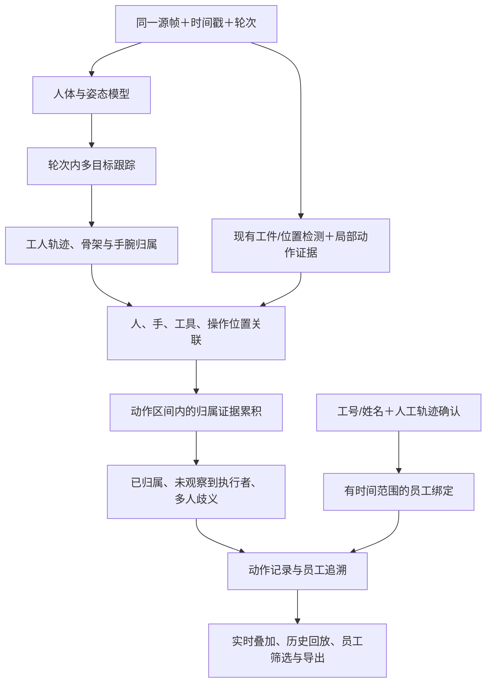

# 人体、骨架、工人跟踪与员工动作归属接入方案

日期：2026-10-25。

本版为设计方案，业务代码、数据库、在线模型均未改动。设计硬件按 RTX 5070 Ti 16GB，准确率优先，兼顾实时速度。适用于螺丝、贴条两个专项任务的实时和离线分析，并衔接已有的检测＋动作时序重训练方案。

## 1. 本版目标与结果边界

补齐四层能力：

1. 当前帧检测工人，输出人体框与 COCO-17 骨架。
2. 在同一检测轮次/视频中持续关联人员，分配局部稳定的轨迹编号。
3. 将可观察到的动作事件关联到工人轨迹；存在多人竞争、遮挡或关键证据缺失时保留归属不确定。
4. 通过工号/工牌或人工确认将轨迹绑定到员工，形成带来源、有效时间与修订记录的动作追溯。

轨迹编号、员工身份、动作执行者是三个独立概念。P01 表示当前轮次中的视觉轨迹；E012 表示员工档案；某动作归属于 P01 还需要该动作区间的视觉证据。员工绑定不能绕过动作归属判断。

首版采用工号/姓名录入与人工轨迹确认完成身份绑定；员工有现成工牌或工位登录系统时接收其绑定事件。人体、骨架或跟踪模型不直接识别员工姓名。

**螺丝头出现不等于当前最近的工人完成了安装。** 首版对螺丝输出人员与位置互动候选，视觉安装状态保持独立；要声称“谁进行了可见拧紧操作”，需接入后续时序模型或真实工具操作信号。贴条可以基于已有动作事件，增加动作区间内的人员归属。两者的证据层级在界面和导出中明确标注。

## 2. 整体流程

人体检测与专项检测必须读取同一帧和同一时间戳。人员进入/离开、轨迹中断和工件换件分别处理，不能混成同一个状态。

## 3. 人体与骨架模块

### 3.1 模型选择

- 优先复用仓库已有姿态后端和本地权重，如 YOLO11s-pose；同时将已有 RTMO 后端作为准确率/速度对照。
- 姿态模型同时提供人体框与 17 点骨架，首版不额外重复运行一个仅检测 person 的模型。
- 首轮以输入 640/960 做对照，重点检查上半身、手腕可见性、相互遮挡和小尺寸人员。工件局部检测继续保留原图细节，不随人体输入缩放而降低精度。
- 如需精细手部姿态，可复用现有手部关键点模块作为增量能力；先检查现场戴手套条件，不将 21 点手部骨架设为所有动作的硬前提。

### 3.2 输出与可靠性

每人输出 track_id、人体框、身体关键点、左右手腕、检测分数、可见性、跟踪状态及当前观测时间。左右手腕的归属由人体骨架确定；单独检测到的手需要与人体手腕和运动连续性关联，不能只靠画面左右位置归属。

骨架显示只绘制当前采样帧可靠可见的点与连线。定位丢失、结果过期或未检出时撤销当前框线；预测位置可用于跟踪内部计算，不伪装成当前帧实际检出。

## 4. 轮次内人员持续跟踪

首版复用 `PoseTracker` 的人体框、关键点、运动与匈牙利分配逻辑，拆分“轨迹关联可靠”与“通用姿态动作规则可靠”，避免人体动作分类条件反过来阻断员工跟踪。

关键设计：

- 使用 `source/session + tracking_epoch + track_id` 组成轨迹键，防止不同视频、用户或轮次的 P01 混用。
- 短暂遮挡在有限时间内尝试续接；明确离场、长间隔、关联歧义或重新检测轮次时中断关联。
- 多人交叉或竞争匹配时标记不确定；不能为维持编号连续而强制续接。
- 员工绑定不自动转移到新轨迹。疑似重新出现可以提示人工确认续绑，但必须保留记录。
- 已离场轨迹保留在本轮历史列表，不绘制旧框；轨迹数量和缓存有界。
- 当前无法观察到人员不直接解释为人员离岗；应区分未检出、遮挡、跟踪丢失和明确离场。

评测中比较现有跟踪器与 BoT-SORT 等候选，只有在人员交叉和重现表现有收益时增加外观重识别。视觉重识别的作用是辅助轨迹关联，不等同于员工身份认证。

## 5. 动作归属：从一个采样点扩展到整个事件

### 5.1 候选关联

对每个操作位，在工件坐标或统一图像坐标中比较：

- 工人的可见手腕/手部与操作区的距离和重叠；
- 手部进入、接触、离开操作区的运动；
- 工具及可见端点与手部、目标位的关系；
- 当前帧关键点质量、轨迹关联歧义、检测年龄和遮挡。

只有人体框靠近工位，不构成执行动作的证据。当前工具检测不可用时记录该模态缺失，不虚构工具归属。部分画面只有手、没有可关联的人体时，可以保留手部动作，但执行工人状态为未确定。

### 5.2 事件级归属

归属依据覆盖动作开始到操作结束的有效观测，不能只取确认完成的那一帧。

1. 逐帧保存“操作位→候选轨迹、证据类型、关联分、歧义、时间”。
2. 确认动作事件时，聚合事件区间内的证据。
3. 同一轨迹有持续一致证据时输出已归属；关联分阈值、最少有效观测及覆盖要求在验证数据上确定。
4. 有两个工人竞争、交接无法分段或关键区间长期不可见时输出不确定及原因。首版不强行从多人中选一个，也不凭多数票掩盖明确交接。
5. 该位置没有当前新鲜证据时，历史分数不能单独制造新动作或释放。

关联分作为关联证据评分，不直接称为校准后的“员工执行概率”。后续可用新训练的 RGB/几何 TCN 输出增强事件证据，但仍保留明确的质量与歧义门控。

### 5.3 两类专项任务的首版行为

| 场景 | 首版可以记录 | 首版不能据此推断 |
| --- | --- | --- |
| 贴条确认动作，动作区间内同一工人手部持续匹配 | 该贴条动作归属轨迹 P01，并按有效绑定关联员工 | 贴片实际存在、粘附质量 |
| 螺丝位置附近出现工人手部接近/撤离 | 某轨迹与该位置发生可见互动候选 | 该工人拧紧了螺丝或扭矩合格 |
| 工件入场时已带螺丝 | 当前视觉安装状态、当前可见人员 | 当前人员实施了安装 |
| 两个人手部同时覆盖同一位置 | 多人竞争或协作候选，首版进入待复核 | 自动选择最近人员作为唯一执行者 |
| 画面只有手/工件 | 动作及目标位置，执行者未确定 | 凭手套颜色确定员工 |

后续接入新时序模型后，将螺丝互动候选升级为“位置相关可见操作事件”，再做相同的事件归属验收；设备扭矩记录单独融合。

## 6. 员工绑定与审计

### 6.1 默认交互

实时检测出现稳定轨迹后，用户在人员面板选择 P01，输入或选择工号与姓名并确认绑定。界面显示“P01 · 张三 / E012 · 人工确认绑定”，并显示生效时间。

绑定默认从当前源时间生效，不无提示地重写此前动作。历史视频可以显式选择轨迹与时间段进行人工绑定，并标注为回放人工确认。单工位登录员工可作为绑定候选；多人入画时仍需确定实际执行轨迹。

### 6.2 拟保存的数据

- 员工档案：employee_id、工号、姓名、启用状态及所属管理范围。
- 绑定记录：owner、来源/轮次、tracking_epoch、track_id、employee_id、有效起止时间、绑定方式、操作者和修订号。
- 动作归属：event_id、工件轮次、位置、动作类型、执行轨迹、绑定记录引用、员工信息快照、证据层级、归属状态及原因。
- 修订记录：解绑、更正、续绑或历史确认的前后值及时间；更正产生新版本，不静默覆盖原结论。

动作归属与员工绑定分别保存。没有员工绑定的 P01 动作可以明确归属于轨迹，但员工状态仍是未绑定；已经绑定员工的轨迹如果动作关联不确定，也不能显示为该员工已完成动作。

### 6.3 权限与隔离

所有读写复用现有登录、CSRF 和任务所有权校验。实时绑定必须验证该用户拥有该轮次且目标轨迹实际存在；其他轮次、其他用户和失效轨迹不能借编号绑定。绑定不靠客户端自行提交的最终员工归属结论。

新增表走显式、幂等迁移；不在每帧请求中建表或迁移。

## 7. 实时、离线与历史记录

### 7.1 实时

人体模型由进程内受控推理服务复用，每个 stream/cycle 持有独立跟踪与归属状态。绑定操作与帧处理在相同状态锁下协调，避免改绑与事件确认竞争。

帧响应增加 workers、interactions、action_attributions、worker_status 等字段。结束轮次时保存人员/动作摘要和绑定版本，支持后续追溯；继续保留专项结果及原来的 PASS/FAIL/REVIEW 语义。

### 7.2 离线视频

在现有 analyze 循环中，使用同一采样帧运行人体与专项检测，生成逐帧人员、人员轨迹和事件归属。任务创建时冻结人体模型与预处理版本，避免后台换权重后结果无法追溯。

离线完成后允许人工选择轨迹和时间范围绑定员工。原始 `analysis.json` 与其模型/文件哈希保持可追溯，人工绑定作为独立注释/修订层保存；读取和导出时明确展示模型原始结果与人工确认后的员工信息，不能直接改写冻结产物而不更新来源记录。

### 7.3 拟新增 API

| 接口 | 用途 |
| --- | --- |
| `GET/POST /api/v1/employees` | 查询、建立员工档案 |
| `GET /api/v1/analysis-runs/{id}/workers` | 查询视频中的轨迹和归属摘要 |
| `POST /api/v1/analysis-runs/{id}/worker-bindings` | 对历史轨迹及时间范围做明确员工绑定 |
| `POST /api/v1/realtime/streams/{id}/worker-bindings` | 绑定当前实时轨迹，带专项类型与生效时间 |
| 员工归属导出接口 | 输出事件、员工、绑定来源、时间范围及修订版本 |

以上为拟定接口，不表示目前已经实现。

## 8. 前端呈现

在原监控布局增加“人员与动作”面板，包含：轨迹编号、工号/姓名、跟踪状态、当前关联位置、动作数量、归属不确定原因以及绑定/解绑入口。

- 视频叠加人体框、骨架及标签，与螺丝/贴条框采用不同颜色。
- 显示开关与计算开关分离，关闭骨架绘制不停止人员跟踪。
- 点击员工或轨迹筛选动作时间轴；点击动作定位到视频，并展示相应目标位、人员与证据。
- 人员离场后在历史列表保留记录，当前画面撤框。切换视频或新轮次后清空当前选择和轨迹。
- 归属状态至少包括：已绑定且已归属、已归属但员工未绑定、多人歧义、执行者未观察到、人员模块不可用。
- 历史改绑明确显示选择的轨迹、时间范围及“人工确认”，不伪装成模型识别姓名。

如果现有镜头只覆盖手部与工件，首版仍能保留局部动作，但可靠人员归属需要补足人体视野。可采用广角看人与近景看操作的双视角方案；双视角需要时间同步、空间/工位关联和独立验收，作为后续扩展。

## 9. 代码衔接位置

| 位置 | 计划改动 |
| --- | --- |
| 新增 `algorithms/workers.py` | 人体推理适配、轮次状态、人员与目标关联、事件归属 |
| `algorithms/tracking.py` | 复用/拆分轨迹可靠性，增加关联歧义和中断处理 |
| `backend/screw_realtime.py`、`sticker_realtime.py` | 同帧调用人员模块，返回人员与归属，处理轮次结束 |
| `algorithms/screws.py`、`stickers.py` | 离线分析加入同帧人员及事件归属产物 |
| `backend/app.py`、`backend/db.py` | 员工档案、范围绑定、权限与历史修订接口 |
| `backend/worker.py` | 冻结/校验人体模型资产与新增输出 |
| `screw-dashboard.js`、CSS | 人员骨架叠加、绑定面板、员工筛选与归属详情 |
| 新增人员与归属测试 | 人员中断、多人歧义、绑定范围、跨用户隔离、离线实时一致性 |

模块不可用时必须明确返回人员能力不可用，不产生虚假员工归属。已有螺丝/贴条视觉结果仍按各自范围输出；需要员工追溯的记录不能因专项视觉 PASS 就显示人员归属已完成。

## 10. 测试与验收

### 10.1 必需测试场景

1. 单人操作与正常员工绑定，动作正确关联到轨迹和员工。
2. 两人同时入画但只有一人操作；旁人经过不能抢占动作。
3. 双手交叉、多人交叉、同一位置交接或协作；有歧义时不强制归属。
4. 遮挡后续接、长间隔重现、换件和重新开轮次，验证绑定不错误继承。
5. 只有手、没有人体，仍记录可见动作但执行者未知。
6. 安装完毕的螺丝静置，不生成当前工人的安装操作记录。
7. 实时改绑、员工重名、旧事件、历史范围更正，验证来源和生效时间。
8. 跨用户/跨轮次绑定、非法轨迹、过期请求及并发改绑的隔离。
9. 模型失败、帧过期、空画面时撤框和明确状态。
10. 同一视频实时模拟与离线分析输出相近的轨迹/归属，允许明确说明的采样差异。

先用测试替身验证编排和边界，再用真实姿态权重、实际单人/多人视频验证。单元测试通过不能代替人员归属现场精度。

### 10.2 主指标

- 人体检测召回、可见关键点/手腕质量。
- 跟踪 IDF1、ID switch、遮挡续接与交叉场景错误。
- 自动动作归属准确率及覆盖率，同时报告未绑定、多人歧义和未知比例。
- 员工绑定时间范围和审计一致性；不将人工绑定成功率当作自动身份识别准确率。
- 专项检测精度回归、实际新鲜采样率、完整请求 P95、显存和队列等待。

归属准确率的开发目标可以先设为 ≥98%，但必须连同覆盖率及多人困难条件一起评估。通过大量输出未知可以提高条件准确率，因此两者不能分开承诺。RTX 5070 Ti 上新增姿态模型后的实际吞吐需要重新测量。

## 11. 实施阶段

| 阶段 | 交付 | 主要依赖 |
| --- | --- | --- |
| A：可视化与跟踪 | 专项视频中人体/骨架、稳定轨迹、实时离线同帧输出 | 现有人体权重及可见人体的视频 |
| B：员工绑定 | 员工档案、轨迹时间范围绑定、审计、历史查询与导出 | 员工管理字段与现场确认流程 |
| C：动作归属 | 贴条事件归属、螺丝互动候选、多人歧义和证据回放 | 有事件/执行者标注的单人多人视频 |
| D：时序升级 | 新训练 TCN 的操作事件与轨迹/员工关联 | 前一版重训练计划与真实工艺数据 |

在模型和视频素材可用的条件下，A–C 作为首版工程可按约 1–2 周安排，实际取决于数据、现场歧义和测试返工；D 纳入已有重训练周期。首版验收完成后形成独立候选版本，再安排上线切换。
