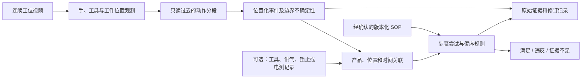

# 灯具装配行为识别与工序时序模型：技术研究方案

日期：2026-10-05（北京时间）  
范围：研究设计；用户已确认暂无线体视频、正式 SOP 与工具/PLC 日志。  
状态：下文模型、数据规模、实验条件及阶段安排均为**建议方案**，不代表已训练、已部署或已有现场指标。需由工艺与质量人员复核具体完成标准。

## 1. 推荐研究主线

**面向灯具装配的可拒判因果动作分段与偏序工艺合规校验。**

先以工位 5 的端子连接、八处螺丝操作为主场景，工位 6 的吹净和线束连接作为扩展验证。工位 1–4 的定位孔、螺丝、卡扣检测可为位置识别提供基础，但不足以单独回答“有没有按工艺执行”。

建议把研究问题收敛为：在手部遮挡、相似紧固动作、允许换序以及证据缺失条件下，如何从连续视频提取具有位置归属和时间不确定性的动作事件，并识别漏步、错序和未闭环返工，同时控制错误放行与人工复核负担？

这里的“因果”仅指在线预测只使用当前和过去的信息，**不是**从视频推断干预因果关系。这里的“可拒判”指证据不足时输出待复核，不能靠提高拒判比例来掩盖模型性能。

### 可以检验的三个假设

| 假设 | 对照方式 | 否定条件 |
|---|---|---|
| H1：工具—手—位置交互特征比人体粗姿态更适合区分重复装配动作 | 在相同标注、划分和时序网络下比较全景、人体、交互特征 | 相同计算预算下，位置化事件指标没有改善 |
| H2：偏序规则能减少允许换序的误报，三值判断能减少缺证据时的错误放行 | 固定感知输出，只替换线性/偏序、二值/三值规则，分别消融 | 改善仅来自更多待复核，或关键错序漏检增加 |
| H3：独立校准的拒判与多源证据能改善可靠性 | 在相同自动判定覆盖率下比较错误放行；另测风险—覆盖曲线 | 只在训练分布有效，或新增信号的贡献无法与位置关联区分 |

这些是假设，不是已确认创新。原创性需要结合预调研中的程序错误检测、在线动作分段和不确定过程一致性研究继续核查。系统拼接本身不宜作为论文的唯一贡献。

### 最接近的近期研究与差异验证

本轮已获取以下官方摘要页。表中仅据已读摘要判断研究范围，完整复现与原创性判定仍需方法全文和代码核查。

| 研究 | 已覆盖的能力 | 本课题需要进一步验证的区别 |
|---|---|---|
| [Progress-Aware Online Action Segmentation，CVPR 2024](https://openaccess.thecvf.com/content/CVPR2024/html/Shen_Progress-Aware_Online_Action_Segmentation_for_Egocentric_Procedural_Task_Videos_CVPR_2024_paper.html) | 因果化分段、动作进度和学习的任务图 | 正常路径平滑面对真实错序是否仍可靠；物理位置/设备证据如何介入 |
| [MistSense，ICCV 2025](https://openaccess.thecvf.com/content/ICCV2025/html/Patsch_MistSense_Versatile_Online_Detection_of_Procedural_and_Execution_Mistakes_ICCV_2025_paper.html) | RGB 与手姿态融合，在线程序与执行错误检测、解释 | 多产品周期归属、证据缺失和工艺完成条件是否能在同一协议下验证 |
| [Generalized Task Graph，ICCV 2025](https://openaccess.thecvf.com/content/ICCV2025/html/Lee_Error_Recognition_in_Procedural_Videos_using_Generalized_Task_Graph_ICCV_2025_paper.html) | 任务图视频对齐、联合分段与错误识别 | 工业偏序、时间误差及返工后证据失效的显式语义 |
| [Mistake Attribution，CVPR 2026](https://openaccess.thecvf.com/content/CVPR2026/html/Li_Mistake_Attribution_Fine-Grained_Mistake_Understanding_in_Egocentric_Videos_CVPR_2026_paper.html) | 语义、时间和空间三个维度的细粒度错误归因 | 归因结果如何接受独立的产品/位置/设备证据核验 |

上述区别是**待检验切入点**，不能仅凭摘要未提到某功能，就宣称现有方法完全没有该能力。优先贡献应落在清晰的任务定义、可复现评测协议和可量化增益。

## 2. 将“行为”和“工序”分成两个时间尺度

| 层次 | 要回答的问题 | 输出 | 候选方法 |
|---|---|---|---|
| 观测与定位 | 哪只手、哪把工具、哪个工件位置可见？ | 目标、轨迹、位置候选及可见性 | 专用检测、工具尖端关键点、工件配准 |
| 动作分段 | 正在接近、接触操作、保持还是撤离？什么时候开始结束？ | 带时间边界的动作片段 | 因果 TCN；有界历史窗口 Transformer |
| 工序状态 | 哪一步有了足够完成证据？哪些仍未知？ | 每位置的步骤尝试和证据状态 | 事件关联、完成条件、状态更新 |
| 工序合规 | 必需步骤是否覆盖，前置关系与时间条件是否满足？ | 满足 / 违反 / 证据不足 | 偏序图与运行时规则；复杂返工再考虑 Petri 网 |

动作分段预测“观察到什么”；SOP 规定“应该怎样做”。不得把感知序列强制投影到合法 SOP 路径，再据此判断合规，否则真正的错序会被修正掉。若研究 SOP 先验，应保留未受约束的原始预测，单独衡量先验对异常的抑制程度。

模型选型建议如下，表中是针对本研究约束的工程判断，最终以相同条件下的实验比较为准：

| 候选 | 适合承担的部分 | 本场景的取舍 |
|---|---|---|
| GRU/LSTM | 流式动作状态或阶段预测 | 可作小模型对照；需检查长周期隐藏状态漂移、重连与周期重置 |
| 因果 TCN | 局部至中程动作分段 | 首选基线，窗口和计算较易控制；重复动作仍依赖位置证据 |
| 因果 Transformer | 较长历史与多对象交互 | 第二阶段比较；需限定缓存、验证数据规模和端到端时延 |
| HMM/HSMM | 状态转移及显式持续时间先验 | 适合解释性基线；允许路径的先验不能掩盖实际违规路径 |
| 偏序 DAG / Petri 网 | 工艺前置、并行、分支与返工 | 显式表达正式规则；不负责从原始画面直接识别动作 |

因此，首版的建议组合是“因果 TCN 负责动作时间段，偏序规则负责工艺关系”。它们解决不同问题，可以分开升级。

## 3. 场景与标签体系

### 3.1 主场景：工位 5

八颗螺丝必须表示为八个不同的**工件位置**，不能用八次“拧螺丝”动作计数代替位置覆盖。位置暂以 `S01…S08` 占位，编号不表示安装次序。具体孔位坐标、工具程序以及哪些位置必须先后执行，全部等待正式 SOP。

建议采用“动作动词 × 对象/位置 × 可观测状态”的组合标签：

- 动作动词：接近、对准、持续接触操作、撤离、拿取/放下、其他可观察动作。
- 操作类别：紧固相关操作、端子插接相关操作；精细阶段需通过试标注确认是否能稳定区分。
- 对象：工具、端子、灯体、螺丝位置；位置不可确定时保留多个候选。
- 可观测状态：可见、局部遮挡、完全遮挡、视野外、画质不足。
- 完成证据：视觉候选、人工核验、设备结果；与动作类别分开记录。

“看不见”是观测状态，不应自动成为“没有动作”；“其他动作”也不能当成所有难例的垃圾类别。若接触与保持难以一致标注，先合并成较粗的可复核类别，再研究更细分段。

### 3.2 扩展场景：工位 6

| 任务 | 视频可提供的证据 | 需要独立定义或补充的完成/质量证据 |
|---|---|---|
| 壳体、装饰框吹净 | 气枪朝向、作用区域、覆盖轨迹和操作时段 | 是否实际供气、流量/压力、有效持续时间；清洁质量需另外验证 |
| 端子/线束连接 | 对准、插入相关动作、可见最终位置 | 锁止、拉力、导通或现场认可的确认条件 |
| 螺丝紧固 | 工具在指定位置的接触操作 | 正确程序的扭矩/角度或其他正式工艺结果 |

即使日后接入扭矩 OK，也必须确认它属于当前产品、当前位置和正确程序。工具触发时间接近某个动作，不能自动证明二者一致。

## 4. 行为识别模型设计

### 4.1 先验证可观测性，再选择大模型

先检查工具尖端、端子和螺丝位置在候选机位下是否有足够像素、是否被手遮挡、运动模糊是否影响边界。固定侧上方相机可以作为第一方案；第二相机只在单视角确有不可恢复盲区时加入。二维单应配准只适合近似平面区域；灯体明显非平面时需分区域配准或三维标定。

人体骨架可辅助确定操作区域和身体遮挡，但肩、髋、腕的大关节几何通常不能直接区分端子插接与螺丝紧固。优先让输入包含局部工具/手/零件外观及其空间关系。

### 4.2 建议基线：冻结视觉表征 + 轻量因果 TCN

在标注有限时，先复用预训练视觉编码器，训练较小的时序头；是否进一步微调由学习曲线决定。可比较单帧局部编码器与严格过去窗口的视频编码器，分别报告计算成本。

每个时刻构造：

\[
x_t=[v_t^{scene},v_t^{hand/tool},g_t,m_t,\Delta t_t],
\]

其中，\(v\) 为全景和交互局部外观，\(g_t\) 为工具尖端相对候选孔位的距离、朝向与位移，\(m_t\) 为可见性/缺失掩码，\(\Delta t_t\) 为实际时间间隔。缺失关键点不能直接补零而不提供掩码；工件配准失败时，位置预测应降低可信度或拒判。

\[
h_t=\operatorname{CausalTCN}(x_{t-R+1:t}),\quad
(p_t^{action},p_t^{target},b_t)=\operatorname{Heads}(h_t).
\]

分别预测动作、位置分布和边界分数。位置与动作可共享表示，但仍需单独评价位置正确性。置信度校准在独立验证集上完成；时间区间来自边界误差校准或明确的观测上下界，不能把 softmax 分数直接转换成有覆盖保证的时间区间。

一个仅供选型的配置例子：6 层、卷积核 3、膨胀率 \(1,2,4,8,16,32\)，每层一层时序卷积，感受野为

\[
R=1+(3-1)(1+2+4+8+16+32)=127.
\]

在 10 Hz 的规则采样下，最早与当前采样点相距 12.6 秒。这个数字不是建议的最终窗口，更不表示 12.6 秒报警延迟；过去窗口长度与输出确认延迟必须分别测量。若每个残差块包含两层卷积，必须重新计算感受野。端子短动作可能需要更高采样率，现有姿态分析默认 5 Hz 不能直接作为工艺分段采样标准。

训练目标可从动作交叉熵、位置交叉熵和边界损失开始：

\[
\mathcal L=\mathcal L_{action}+\lambda_p\mathcal L_{position}
+\lambda_b\mathcal L_{boundary}+\lambda_s\mathcal L_{smooth}.
\]

平滑项不能跨真实动作边界无限加强；要专门检查短动作被吞并、同位置重复操作被合并的情况。类别权重、损失权重、片段最短长度与阈值都在验证集选择。

### 4.3 因果性需要覆盖整个推理链

过去窗口视频特征、归一化、轨迹平滑、边界确认和多视角同步均不能偷看未来。离线双向模型只作为单列的离线对照，不与在线模型混报。

建议实现“前缀不变性”检查：同一视频前缀分别接不同的未来内容，已承诺发布的输出必须相同。若允许后续修订，初始输出和修订输出分别记账；不能用看过完整视频后的修订结果声称实时准确率。

确认延迟还包含采集、解码、批处理等待、特征提取、时序推理、去抖/边界确认、融合等待与网络传输。只报告单帧 GPU 推理时间不能代表产线报警延迟。

### 4.4 双手与并发动作

一只手固定灯体、另一只手紧固是可能同时发生的活动。首版若只预测一个主操作标签，必须明确仅评价主工具操作，不能声称完整识别两只手。扩展版可按工具/交互区域产生并行事件流，或为左右手设置独立标签头，并单独处理手身份交换和遮挡。

[Polyphony（CVPR 2026）](https://openaccess.thecvf.com/content/CVPR2026/html/Zheng_Polyphony_Diffusion-based_Dual-Hand_Action_Segmentation_with_Alternating_Vision_Transformer_and_CVPR_2026_paper.html)已经研究双手动作分段及手间依赖，因此“双手建模”本身不是新贡献。应先判断现场是否需要它，再比较双手性能、在线可用性和额外算力。

## 5. 工序时序模型设计

### 5.1 从最小偏序模型开始

偏序与不确定日志已有成熟研究基础：[Partially Ordered Event Data（2015）](https://link.springer.com/chapter/10.1007/978-3-319-15895-2_7)研究粗糙/错误时间戳下的偏序对齐；[Conformance Checking over Uncertain Event Data（期刊版 2021，预印本 2020）](https://arxiv.org/abs/2009.14452)显式处理事件时间、活动和实例归属的不确定性，并计算一致性的上下界。因此，使用偏序或保留不确定性本身不能宣称为本课题创新。下文给出适配当前原型的简化运行时规则，并非上述完整对齐算法的实现。

定义经确认的规范：

\[
\mathcal S=(V,E_{pre},C_{complete},D,\mathcal R,version).
\]

\(V\) 是步骤/位置集合，\(E_{pre}\) 是必须先后发生的关系，\(C_{complete}\) 是各步骤的完成证据条件，\(D\) 是允许的时长约束，\(\mathcal R\) 是返工及复检语义。没有前序边不等于所有顺序均被正式允许；还需确认规范完整性。

首版使用偏序 DAG 表达普通流程；出现循环返工时，把规范步骤与每次实际尝试分开，或用 Petri 网表达状态与返工。不要直接向 DAG 加环后继续使用无环图求解器，也不要把所有可能的八螺丝排列枚举成状态。

时序 Transformer 可预测下一步或发现常见模式，但“历史常见”不能替代正式的“工艺允许”。剩余工时预测属于后续独立任务，不与本次合规判定混为一个指标。

### 5.2 事件与证据契约

每次实际尝试建议记录：

| 字段组 | 必需内容 |
|---|---|
| 业务归属 | 产品/周期、工位、SOP 版本、工件位置；未知可以为空 |
| 动作证据 | 事件 ID、动作类别、位置候选、视频时间段、来源相机和片段索引 |
| 时间 | 起止区间、时钟域、同步误差、事件发生时间、接收时间 |
| 来源质量 | 可见性、原始预测分数、校准版本、关联状态 |
| 完成与质量 | 工具程序、设备结果、证据类型、核验状态 |
| 生命周期 | 修订版本、有效性、替代/撤销关系、返工关联 |

`action_confidence`、`position_confidence`、`association_confidence` 分别保存。三种未经校准且互相相关的分数相乘，不会自然得到可信的“产品合格概率”。

当前项目的 `Attempt.verified` 是输入契约中的信任标志，尚无自动生成它的设备适配器。后续实现必须规定谁能设置该字段及其证据；不能让前端或动作模型把它随意设为 true。

### 5.3 三值时序判断

设前驱结束区间为 \(E_a=[e_a^-,e_a^+]\)，后继开始区间为 \(S_b=[s_b^-,s_b^+]\)。若规则要求前驱完成后才能开始后继，则：

\[
\operatorname{Precedes}(a,b)=
\begin{cases}
\mathrm{TRUE},&e_a^+\le s_b^-\\
\mathrm{FALSE},&e_a^->s_b^+\\
\mathrm{UNKNOWN},&\text{其他情况}.
\end{cases}
\]

这是对不确定时间的保守关系判断；区间重叠本身不证明违反。时间区间覆盖误差需要单独校准和检验。已知错误设备结果或确定的违反可以产生 FAIL；未完成周期、缺关键记录、未定位置通常保留 REVIEW。

判定覆盖缺失为“漏装”还需要：到达规定检查点、所需数据源覆盖完整、产品关联成立、规范版本已确认。视频播放结束不等于设备日志覆盖完整；未检测到工具也不等于未执行动作。

### 5.4 重复操作、返工与迟到证据

同一个位置操作两次仍只覆盖一个位置，但两次尝试都要保留。一次 NG 后出现 OK 不应自动抹掉此前的 NG；需要明确该 NG 是否已通过规范允许的返工和复检关闭。

若返工改变了下游检查依赖的状态，应撤销相应完成结论并要求复检。撤销哪些步骤必须由工艺语义定义，不能默认所有后续步骤都失效。

多视角对同一次物理操作的重复观测，需要通过共同周期、位置、时间和工具关联进行去重。共享时间戳只是条件之一；时间相近的两个操作也可能不同。

跨来源存在迟到数据时，记录暂定结论和最终结论。最终放行条件必须包含业务检查点及所需数据已到达的依据；不能仅因等待了固定秒数就断言数据完整。

## 6. 无现场数据时可以开展的工作

1. 对照文献明确任务边界、标注规范和方法差异；不要把通用动作分类榜单当作装配工序效果。
2. 在 Assembly101、IKEA ASM、HA4M、MECCANO 等候选数据集中检查是否包含所需标签、视角、错误/纠错记录；具体适配性以预调研逐条核验结果为准。未提供工艺合规真值的数据只能验证相应感知子任务。
3. 先使用人工给定事件验证偏序、重复、错产品、未知位置、返工与时间不确定性规则。合成事件只能验证软件/逻辑行为，不能生成视频识别准确率或产线有效性结论。
4. 准备首批采集、标注与数据划分协议，列出模型选择和算力测试方法。数据未到之前不训练一个号称可识别灯具工艺的专用模型。

公共数据集的主要作用是方法预验证及表征迁移。其动作类别、产品结构、工具、拍摄条件和 SOP 与灯具现场不同，成绩不得直接移植为项目指标。

## 7. 现场采集与标注计划

### 7.1 先做可观测性小样，再决定规模

建议试采约 30–50 个完整产品周期，覆盖多个操作者、至少两次不同日期的采集、正常与遮挡情况。这只是发现机位和标签问题的起始量，不是足以训练或验收的样本量。

每周期同步保存原始视频、相机参数、产品/治具周期标识、SOP 版本；如设备可接入，再记录工具程序、时间戳、结果和时钟同步信息。正常生产与经安排的异常演示分开标识；不能把演示异常的发生比例当作实际不良率。

先抽取跨操作者与困难情形的片段双人独立标注，讨论动作定义和边界分歧，再扩展数据集。记录一致性及边界分歧分布；无法一致标注的细标签需要合并或重新定义。

### 7.2 最小标注表

| 单位 | 字段 | 用途 |
|---|---|---|
| 产品周期 | `cycle_id, worker_group, day, sku, station, camera_set, sop_version` | 数据隔离与域外评估 |
| 动作片段 | `start, end, verb, operation, target_id, visibility, boundary_uncertainty` | 动作、位置与边界学习 |
| 设备事件 | `event_id, event_time, clock_error, program, target_source, result` | 完成证据与关联评估 |
| 步骤尝试 | `attempt_id, cycle_id, step_id, completion_evidence, rework_link` | 过程真值 |
| 周期结论 | `PASS/FAIL/UNKNOWN, violation_type, evidence_refs, adjudicator` | 端到端工艺评价 |

动作标注和质量真值应分别取证。不能先让模型生成步骤，再不经独立复核直接作为模型评价真值。

### 7.3 数据划分与困难子集

最小隔离单元是完整产品周期，同一周期的全部相机、裁剪和增强都进入同一个集合。训练、验证、测试按工人、日期和采集会话分组；另做跨工人、跨产品型号/工装的外推评估。实际可分多少组取决于采集条件。

必须单列以下困难子集：

- 正常但允许换序；不能把它当作错序负例。
- 动作次数正确但螺丝位置重复或遗漏。
- 真正违反前序要求，与仅因时间误差暂不能确定先后的情况。
- 工具停留但没有有效紧固结果；气枪指向正确但供气证据缺失。
- NG 后重做、返工影响下游、复检未完成。
- 遮挡、相机漂移、工具换型、强反光，以及跨周期/跨产品错关联。

## 8. 对照实验与消融

| 编号 | 方法 | 用途 |
|---|---|---|
| B0 | 当前姿态规则与现有工位候选输出 | 工程能力对照；标签空间不同，不直接混入细动作分类排名 |
| B1 | 专用工具/位置检测 + 停留阈值 + 简单状态机 | 测量低成本工程方案能解决多少问题 |
| B2 | 冻结局部外观 + 因果 TCN + 线性规则 | 可训练在线基线 |
| B3 | B2 加入手—工具—位置交互及缺失掩码 | 单独验证交互表征 |
| B4 | 固定 B3 感知输出，使用偏序和三值规则 | 单独验证规范推理；线性/偏序与二值/三值做 2×2 消融 |
| B5 | B4 + 可用设备证据及显式关联 | 验证多模态增益；无设备数据时不报告该项结果 |
| B6 | Progress-Aware 在线分段；条件允许时复现 MistSense | 与已发表相关方法比较，先核查代码、标签与输入模态是否可比 |
| O1 | FACT 或 ASFormer 等代表性离线动作分段模型 | 比较离线上下文价值，独立报告未来信息和运算量 |

所有可比的感知模型使用相同划分、标注预算、输入分辨率和采样协议，训练多随机种子，报告均值与波动。模型差异较大时同时给出准确率、时延、显存/内存，不声称仅靠参数数量就代表成本。

优先消融：移除位置特征、移除工具局部、移除可见性掩码、固定长度与可变时间间隔、去掉校准/拒判、二值化未知证据、用严格线性序列代替偏序、加入 SOP 硬约束解码。最后一项用于测量是否掩盖真实异常，不作为默认方案。

### 将系统误差拆开

同时进行三种评价：人工事件输入规则、预测动作配人工位置、全部预测输入规则。这样能区分规则错误、位置关联错误和动作分段错误。若只报告最终 PASS/FAIL，很难知道改进来自哪一层。

## 9. 指标、统计与验收口径

### 9.1 感知层

使用帧级 macro-F1、片段 F1@IoU 0.10/0.25/0.50、序列 Edit，以及带目标位置的事件 precision/recall/F1。片段指标按预先定义的匹配规则计算；单纯帧准确率容易被长背景或长时间紧固动作主导。

位置化事件匹配要求同周期、同动作类别、同目标位置，并满足预设时间匹配条件；采用一对一匹配，不能让一个预测片段重复命中多个真值。另报告起止边界误差与预设容忍窗口下的检出率。

### 9.2 工艺层

对经独立判定的真实违反周期，主要风险指标为：

\[
\mathrm{FalsePassRate}=\frac{N(真值违反\land系统PASS)}{N(真值违反)}.
\]

另报告放行结果中的错误比例 \(N(真值违反\land PASS)/N(PASS)\)，其数值受异常基率影响；受控异常集的比例不能替代真实生产比例。

必须同时报告正常周期的 FAIL 比例、REVIEW 比例、自动判定覆盖率、各异常类别漏检率。绘制风险—自动判定覆盖率曲线，并在相同覆盖率下比较系统，防止“全部待复核”看似安全却没有实际价值。没有可信真值的周期单独列出，不能强行纳入正确率。

边界延迟按动作真实结束或业务可判定时点到系统首次给出对应结果的时间计算，报告中位数和 p95；不同异常的可判定时点不同，例如漏步通常要到检查点才可确认。临时提示和最终结论分别评价。

### 9.3 样本量与不确定性

验收阈值由工艺风险、节拍和复核能力共同决定，本方案不预设“准确率 99%”等无依据承诺。先用小样估计误差，再据目标风险确定所需独立周期数。

例如，在独立同分布的二项假设下，若 \(n\) 个真实异常周期中零次错误放行，错误放行概率的单侧 95% 精确上限为 \(1-0.05^{1/n}\)。约 299 个独立异常周期且零错误时，上限才接近 1%。这是样本量解释，**不是本项目结果**；同一操作者连续重复演示的片段不一定满足独立性。

正式统计以产品周期为单位，按采集会话/操作者等结构做聚类 bootstrap 或分组报告。不要把同一动作的几百帧当作几百个独立合格样本。异常很少时报告区间和不足，不能只公布一个很高的百分比。

## 10. 与当前 myarc 项目的衔接

本节依据 2026-10-05 对源码的只读检查；本轮未修改服务代码，也未运行现场实验。

| 已有实现 | 可复用部分 | 研究需要补齐的能力 |
|---|---|---|
| [pose.py](D:/Project/myarc/algorithms/pose.py:13) | 人体可见性、粗姿态辅助 | 工具/手/零件交互，细动作训练和位置归属 |
| [inspection.py](D:/Project/myarc/algorithms/inspection.py:49) | ROI/HSV/模板/专用检测接口，候选与 REVIEW 区分 | 跨帧事件生成；工具尖端与工件配准 |
| [pipeline.py](D:/Project/myarc/algorithms/pipeline.py:62) | 视频处理、轨迹/片段与证据导出 | 针对短动作的采样，时序特征和模型版本契约 |
| [process_rules.py](D:/Project/myarc/algorithms/process_rules.py:74) | 输入事件回放、前序和时长区间、版本去重、NG 历史 | 感知到事件的可信转换、返工依赖失效、迟到数据处理 |
| [工位配置说明](D:/Project/myarc/docs/station-algorithms.md) | 六工位十一项的配置和能力边界 | 正式 SOP、现场 ROI、专用资源及设备映射 |

当前 `process_rules.py` 是 `DIAGNOSTIC_REPLAY`，并未证明上游视频识别正确。现有 `Inspector` 输出 REVIEW 是保留证据边界的行为，不应为了演示“跑通”而直接改成 PASS。

建议后续新增独立实验模块而非立刻改动生产路径：`interaction_features`、`causal_segmenter`、`event_builder`、`process_monitor`、`evaluation`。先保存标准中间事件，使用现有规则引擎回放；规则与感知分别验收后再接入实时服务。

## 11. 分阶段工作包与停止条件

| 阶段 | 交付物 | 进入下一阶段的依据 |
|---|---|---|
| P0：当前方案阶段 | 文献预调研、推荐选题、本技术方案 | 明确主工位、任务层次和需要补齐的数据 |
| P1：现场定义 | 机位小样、位置表、标签手册、正式 SOP 和证据矩阵 | 目标可见，标签可一致判定，关键完成条件有依据 |
| P2：最小感知基线 | 数据划分、工具/位置基线、因果 TCN、学习曲线 | 比简单规则有可解释增益；失败案例定位明确 |
| P3：过程模型 | 事件契约、偏序三值监测、返工案例、消融报告 | 人工事件回放和预测事件回放分别通过规定用例 |
| P4：现场影子评价 | 完整周期盲测、风险/覆盖/时延报告、人工复核记录 | 满足经确认的指标和数据完整性条件 |
| P5：研究总结 | 可复现方法、限制、贡献验证和论文材料 | 所有结果可追溯；不以合成或公共数据替代现场效果 |

若在 P1 发现关键动作长期完全不可见，应优先调整机位或补传感器；更大的模型无法恢复从未被观测的信息。若正式 SOP 未明确允许换序和返工，先完成工艺定义，不能让模型自行“学习”一个放行标准。

在未掌握采集许可、实际节拍、标注人力和算力之前，不承诺训练周期、上线日期或成本收益。

## 12. 下一步的最小资料清单

准备一份工位 5 正常完整周期视频、八个螺丝位置示意、实际前置关系、端子完成标准，以及可用工具信号说明，即可启动可观测性与标签小样验证。若暂时仍拿不到数据，可先完成 SOP/证据矩阵访谈和公共数据适配检查。

相关文献与候选题见同目录的 `literature_pre_survey.md`、`research_exploration.md` 和 `topic_matrix.md`。本方案提供可验证路线，尚未构成灯具场景的性能或原创性证明。
