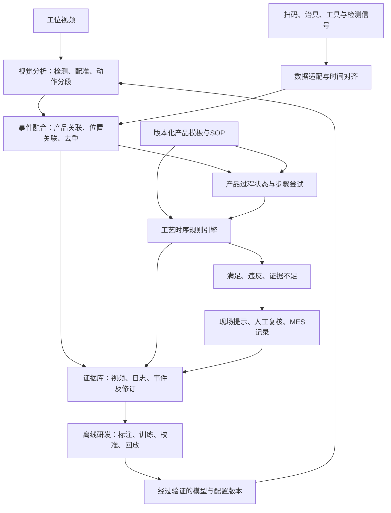
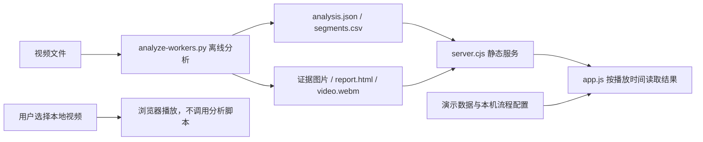
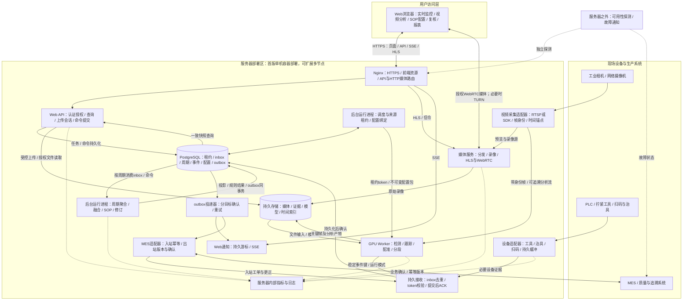
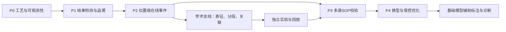

# 灯具装配场景SOP人因行为识别与工序时序合规校验研究

> 稿件类型：方法研究与工程架构设计  
> 场景依据：用户提供的摩托车灯装配检测评估材料  
> 公开资料核验日期：2026年10月2日  
> 研究状态：本文提出算法、架构及验证方案；尚未获得可复核的现场实验数据，不报告已实现的性能或成本收益。
> 工程深化依据：2026年10月2日读取当前`D:/Project/myarc`项目源码及既有离线产物；下文区分现有实现、静态检查发现和建议改造。既有演示视频的运行记录不属于灯具产线实验结果。

> 实施进度更新：已在原项目上实现服务器离线上传分析首版，包括认证、任务与独立Worker、结果回放和报告。本文完整架构仍包含未实施的后续能力；当前实现与验收范围见[运行说明](D:/Project/myarc/docs/server-quickstart.md)和[首版验收记录](D:/Project/myarc/outputs/server-mvp/验收记录.md)。附录C保留的是重构前审视依据，其旧源码行号不再对应当前模块。

## 摘要

> 检测能力更新：已增加浏览器摄像头实时采样、六工位十一项检查清单、实时与离线共用的固定ROI/HSV/模板/专用YOLO配置，以及独立的工艺事件规则回放工具。用户确认现场资源尚未配置，因此默认均为“未配置／待复核”。现有姿态权重不能执行灯具专用检测；工具尖端、因果动作模型、自动产品关联及设备融合尚未实现。实现范围、配置格式和与本文的对应关系见[灯具算法与配置说明](D:/Project/myarc/docs/station-algorithms.md)。

灯具装配同时包含定位、紧固、端子连接和吹净等操作，产品最终状态难以完整反映动作过程与安装顺序。针对固定工位中操作差异、零件遮挡、重复动作及返工造成的检测困难，本文结合工业界的防错控制、数字作业指导和产品追溯思路，以及学术界的动作识别、时间分段、多视角活动理解与视频预训练研究，提出“位置关联—因果动作分段—多源事件融合—版本化SOP校验”的技术框架。系统以产品周期为分析单元，关联人员、工具、零件和操作位置，将视觉观察与设备反馈形成可追溯事件；以带条件分支和返工语义的偏序工艺模型检验位置覆盖、前置关系、持续时间和复检要求；采用满足、违反、证据不足三值判断，保留遮挡、时钟误差和数据缺失造成的不确定性。研究重点讨论八颗螺丝安装顺序、端子连接和吹净任务，并给出工业与学术技术发展路线、分阶段实施条件、对照实验和评价指标。本文的贡献在于形成可检验的方法与系统设计，其现场效果需要在正式SOP和真实产线数据上验证。

在软件工程层面，本文进一步以现有离线姿态分析与回放项目为基线，细化模块接口、状态所有权、数据存储、任务恢复及模型包契约，提出按可验收工作包推进的开发流程，覆盖需求追踪、算法实验、持续集成、现场影子运行、发布迁移和回滚。所列结构与流程属于待实施设计，既有视频分析记录仅用于解释原型能力与优化依据。

**关键词：**灯具装配；SOP；人因行为识别；时间动作分段；工序合规；多源证据；过程追溯

## 1 引言

灯具装配中的过程偏差不一定立即表现为可见缺陷。螺丝数量正确不能证明安装顺序满足要求，接线手势完整不能直接证明端子锁止，气枪进入目标区域也不能证明供气与清洁效果合格。因此，终态图像检测与过程行为检测需要协同工作。

工业系统通常优先降低操作失误、稳定工艺执行并建立产品追溯。其基础包括治具防错、工具参数控制、扫码关联、数字化作业指导和质量记录。学术研究则持续改进动作表征、时间边界、长程依赖、多视角互补和有限标注条件下的泛化能力。两者解决的问题具有互补性：工业骨架明确产品、工艺和质量依据，学习式视觉补充人工操作过程的可观测性。

本文所称“人因行为”限定为可观察的作业动作、手—物交互、工具使用、停顿和重复操作。疲劳、注意力和动机等内部状态不能直接由装配视频可靠推断，不作为本文的直接识别目标。

研究围绕三个问题展开：

1. 如何把连续视频和设备信号转化为具有产品、位置和时间归属的可靠事件？
2. 如何识别真实工艺偏差，同时容纳允许的并行、换序和返工？
3. 如何在证据缺失或冲突时保留不确定性，避免错误确认工序完成？

本文采用的方法是面向场景的工程综合设计。相关论文和产品资料支持其组成模块的研究方向，但不构成整个方案已经在目标产线验证的证据。

## 2 工业界与学术界的技术发展路线

### 2.1 工业路线：从防错控制到产品级过程追溯

工业能力的发展可概括为下表。各阶段可以长期共存，表中次序表达能力扩展关系，不代表统一的行业年代史。

| 能力阶段 | 核心技术与目标 | 对灯具装配的作用 | 需要保留的边界 |
|---|---|---|---|
| 机械防错与工具控制 | 治具约束、到位检测、工具程序及参数窗口 | 建立装载周期与紧固结果等基础证据 | 工具OK须关联正确产品、位置和程序 |
| 单工位视觉结果检测 | 有无、数量、位置和外观检测 | 确认定位特征、卡扣及可见螺丝状态 | 完成态图像通常不能恢复历史顺序 |
| 数字化作业指导 | 步骤、条件触发、数据采集、版本发布 | 将SOP转为可执行的步骤和完成条件 | 点击“下一步”只是交互事件 |
| 多源过程追溯 | 视频、工具、扫码、治具与工单关联 | 建立产品级事件链和返工记录 | 数据接入不自动解决产品与位置关联 |
| 受控优化闭环 | 异常复核、节拍分析、模型更新与回滚 | 形成数据和工艺持续改进机制 | 历史常见路径不能直接替代正式SOP |

Tulip的数字作业指导资料展示了步骤式指导、条件触发、工具与扫码接入、步骤耗时记录以及版本发布和审批等产品思路[3]。这些功能说明工业系统已将作业文件、现场交互和数据采集连接起来；厂商页面中的收益描述不能移用为本项目的实验结果。

ISA-95相关OPC UA模型提供生产层级与资源建模依据[2]。本文据此区分设备控制与生产业务职责：PLC及工具控制器承担确定性的设备逻辑，过程监测服务承担证据提取和规则校验，MES承担工单、质量记录与追溯。OPC UA for Machinery提供机器标识、状态、计数和通知等语义构件[4]，但并未直接定义本文的行为事件与SOP校验模型。

### 2.2 学术路线：从动作分类到程序化活动理解

代表性研究路线如下。本文选择与目标问题相关的文献，不把该表视为完整文献综述。

| 研究方向与代表工作 | 技术进展 | 本文吸收的思路 | 迁移限制 |
|---|---|---|---|
| 视频动作分类：I3D，2017[6] | 利用时空表征识别视频片段中的动作 | 为局部操作视频建立视觉特征 | 片段类别不提供产品归属和完整工序边界 |
| 连续动作分段：MS-TCN，2019[7] | 多阶段时间卷积与平滑损失缓解过度分段 | 将帧级预测整理为连续操作片段 | 原始分段设定不能直接作为严格在线系统 |
| 长程时序建模：ASFormer，BMVC 2021[8] | 结合局部先验、层次时序表示与预测细化 | 研究上下文对相似动作区分的价值 | 注意力、解码与前端特征均需检查因果性 |
| 多视角装配：Assembly101，2022[9] | 提供装配/拆解、顺序变化、错误与修正数据 | 借鉴动作层级、位置交互和异常标注 | 玩具装配数据不能替代灯具生产验收集 |
| 视频自监督：VideoMAE，2022[10] | 掩码视频预训练改善表征学习 | 研究有限现场标注下的样本效率 | 仍需适配小零件、工艺动作与领域差异 |
| 熟练活动多视角：Ego-Exo4D，2024[11] | 结合第一/第三人称与多模态信息 | 借鉴视角互补与细粒度活动理解 | 不直接解决固定工位跨相机产品关联 |
| 视频基础模型：InternVideo2，2024[12]；Qwen2.5-VL，2025[13] | 扩展视频表征、视频语言理解和长视频分析 | 支持候选片段检索、辅助标注与离线解释 | 不能替代精确位置证据及确定的工艺规则 |
| 流程一致性研究[14][15] | 比较观测事件与规定流程，分析偏差 | 引入显式过程模型、事件回放与诊断 | 日志缺失和识别错误需与真实流程偏差区分 |

Assembly101包含自然顺序变化、操作错误与修正，使其比一般动作分类数据更接近本文的问题[9]。Ego-Exo4D进一步体现多视角、长过程和熟练活动研究的发展[11]。这些数据集可用于方法借鉴和预训练研究，最终评价仍需使用现场产品、工具和规则。

视频预训练及视觉语言模型扩展了表征和辅助分析能力，但其输出通常不天然包含可靠的产品编号、螺丝位置、工具结果和SOP版本。本文将它们放在表征研究、辅助标注与离线复核路径中，并保持在线规则链的证据可追溯性。

### 2.3 两条路线的结合与本文研究定位

本文采用“工业业务骨架＋学习式感知＋显式工艺推理”的组合：

- 产品标识、设备反馈和正式SOP确定业务对象与完成条件。
- 对象定位和时序模型补充人工操作的过程证据。
- 规则引擎表达前置关系、分支、返工与复检要求。
- 不确定性机制决定哪些结果可自动判断，哪些需要复核。

这种组合可称为学习式感知与符号规则结合的系统架构。它是本文提出的研究设计，不能据此宣称上述文献共同验证了本系统。

## 3 场景分析与问题形式化

### 3.1 六工位与十一项检测需求

用户提供的评估材料按原表的检测项目分组列出十一项任务，其中工位3的“两颗螺丝和黄色卡扣”合列为一项[1]。下表按工位汇总，不另行拆分项目计数。

| 工位 | 检测内容 | 过程研究重点 |
|---|---|---|
| 工位1 | 四个定位孔、四个螺丝 | 定位特征与紧固位置对应 |
| 工位2 | 五个螺丝 | 位置覆盖、漏装与检测时机 |
| 工位3 | 两个螺丝、黄色卡扣 | 多类零件组合与装配完整性 |
| 工位4 | 两个螺丝 | 操作与结果证据关联 |
| 工位5 | 接端子动作、八个螺丝 | 连接动作及有顺序要求的紧固过程 |
| 工位6 | 壳体吹净、装饰框总成吹净、线束端子连接、四颗螺丝 | 多动作区分、跨视角关联和完成确认 |

该表是检测项目清单，不是完整工艺顺序。材料指出工位5的螺丝安装后易被工件遮挡，原方案无法检测安装顺序；工位6部分动作使用不同相机。系统设计必须正面处理这两类观测与关联问题。

材料尚未提供八个螺丝的具体位置编号和顺序、端子完成标准、吹气时间或紧固参数等完整工艺配置。上述信息是后续规则落地的输入条件，不能由算法自行补写。

### 3.2 证据分层

对每项任务，分别记录以下事实：

| 层次 | 例子 | 能支持的判断 |
|---|---|---|
| 动作发生 | 工具在目标位置形成紧固相关操作 | 该位置发生了相关操作 |
| 工序完成 | 规定位置具有满足SOP的完成证据 | 该步骤达到配置的完成状态 |
| 质量验证 | 工具或检测设备输出合格结果 | 对应指标满足规定条件 |

高置信度的动作识别不自动升级为质量验证。必要设备结果为不合格时，视觉动作完整也不能抵消该结果。

### 3.3 事件与步骤模型

定义产品周期级事件：

$$
e_i=(p_i,\kappa_i,w_i,a_i,h_i,\tau_i,z_i,q_i,v_i)
$$

其中，$p_i$为产品标识，$\kappa_i$为装配周期，$w_i$为工位，$a_i$为动作类别，$h_i$为操作对象或位置，$\tau_i$为时间区间，$z_i$为证据集合，$q_i$为识别置信度，$v_i$为事件修订版本。

置信度用于表达识别可信程度，工艺结论由证据类型与规则计算。分类概率还需在独立验证集上进行校准；温度缩放等方法可作为基线，但其在本场景中的作用需要单独评价[16]。

工序规范`StepSpec`定义“应当怎样执行”，实际记录`StepAttempt`定义“某件产品怎样执行”。后者包含操作尝试、证据、有效性和返工关联，避免一次布尔完成标记覆盖全部过程。

## 4 系统架构与数据流

### 4.1 在线检测与离线研发架构



图1展示主数据链。在线链提供有界延迟的事件与判断；离线链进行标注、模型研究和完整周期复核。模型上线后，工艺规则仍由独立版本管理。

### 4.2 产品关联与时间基础

优先利用扫码、载具或治具装载周期建立产品键。相机局部跟踪编号仅在本视角内有效，不能直接作为全局产品编号。缺少可靠标识时，可以研究基于工件进入、固定和离开的周期划分，但须报告关联错误与未知比例。

不同来源统一时间基准，并保留同步误差、漂移和采样间隔。每个动作起止时刻采用区间表示，不使用单点时间戳制造超出观测能力的精度。

事件融合采用事件时间处理，保留迟到窗口。必要来源断流时将其标记为数据缺失，迟到消息可修订先前事件并重新计算受影响规则。缓存超时本身不能证明漏工序。

### 4.3 服务划分与工业职责

首版采用三个主要服务，避免在数据规模尚未明确时引入复杂服务体系。

| 服务 | 功能 | 主要状态 |
|---|---|---|
| 视觉推理服务 | 视频解码、目标检测、位置估计、在线分段、片段缓存 | 轨迹、特征窗口、动作候选 |
| 事件与规则服务 | 产品关联、事件融合、步骤状态、时序校验与修订 | 产品周期、事件、工艺状态 |
| 业务与证据服务 | 配置发布、复核、查询、追溯、MES适配 | 版本、证据、审计记录 |

相机与设备按现场接口接入；支持时可使用RTSP、OPC UA或相应工具协议。OPC UA语义规范为设备标识和状态统一提供参考[4]，本文事件模式仍需自行定义。

MES用于生产业务与追溯，PLC及工具控制器执行设备控制。若后续把检测结论接入生产联锁，应另行验证控制接口、失效处理和权限。视觉服务不承担急停或功能安全回路。

网络分区、访问控制、日志及受控更新可参考ISA/IEC 62443体系[5]。这些工程要求与模型精度、产品质量和功能安全分别评价，不相互替代。

### 4.4 现有项目的软件结构与真实执行路径

本节以当前工作区的AI-SOP原型为参照。它已经具备可运行的页面、离线人体姿态推理、证据导出和回放功能，尚未实现前文的灯具专用检测、多源关联和产品级规则引擎。`README.md`前部描述了实际工人分析，后部仍保留“不包含人体检测、姿态估计”的早期说明；判断能力应以执行路径为准，文档后续应同步修订。

| 现有文件／组件 | 实际职责与数据流 | 可复用部分 | 需要改变的边界 |
|---|---|---|---|
| `index.html`、`styles.css` | 工位画面、检测表、时间轴、SOP及告警界面 | 页面布局、Canvas叠加、报告和CSV入口 | 视觉展示不承担工艺事实判定 |
| `app.js` | 同时管理演示数据、上传回放、离线JSON、界面状态及本机存储 | 播放控制、结果可视化、数据来源提示 | 拆分数据适配与渲染；演示时间推进不得进入生产规则 |
| `server.cjs` | Node.js静态文件服务、视频Range请求；监听本机地址 | 本地预览和媒体读取 | 当前没有分析任务API、事件存储、任务队列或模型调用 |
| `tools/analyze-workers.py` | OpenCV解码和裁切→YOLO姿态→自定义跟踪→几何规则→片段聚合→JSON、CSV、证据图和HTML | 模型适配雏形、原始分数、规则解释、权重和视频哈希 | 采集、推理、状态、导出集中于一个脚本；需分离可测试的算法核心 |
| `assets/worker-analysis/analysis.json` | 保存`frames/tracks/segments/events/sop`及模型、来源、统计 | 作为回放基线与兼容性样本 | 当前没有产品周期、孔位、设备尝试、正式SOP版本和事件修订契约 |
| `tools/smoke-test.cjs`、`tools/worker-test.cjs` | Playwright检查页面、切换、导出、报告和空合格率 | 继续作为前端回归测试 | 未覆盖算法真值、跟踪归属、时间边界与迟到事件重算 |
| `package.json` | 启动静态服务、执行浏览器测试、调用离线脚本 | 保留统一启动入口 | 分析命令写死本机Python路径，需迁移为可配置解释器和锁定依赖 |

现有实际链路如下，模型计算在页面加载之前完成：



`app.js`的`currentState()`按播放时间和演示步骤时长生成阶段；实际工人模式则读取JSON并把SOP置为待复核。离线脚本中的跟踪是IoU和中心距离的逐目标贪心匹配，并未调用ByteTrack；动作标签来自`action_rule()`和最多三次采样的多数滤波，并未实现TCN。应将“当前已有算法”和第5节“候选升级算法”明确分开。

### 4.5 从现有脚本迁移到模块化软件

首轮改造保留现有页面和离线入口，先形成模块化单体，再按推理资源和故障隔离需要拆进程。第4.3节的三个服务首先是职责边界，不要求初期部署三个独立网络服务。

```text
myarc/                            建议结构，当前尚未创建
  web/
    data/                         DemoAdapter、OfflineAdapter、LiveAdapter
    state/                        页面模式、数据版本、查询游标
    views/                        画面、时间轴、事件、复核
  backend/
    api/                          分析任务、查询、配置发布、复核记录
    domain/                       Cycle、Attempt、RuleResult及纯状态转换
    fusion/                       时间门控、位置关联、去重与证据约束
    persistence/                  事件日志、快照、任务状态、发布记录
  algorithms/
    io/                           解码、时间戳、裁切与坐标变换
    perception/                   检测器、关键点、跟踪器、配准
    temporal/                     特征、因果窗口、分段与事件状态机
    evaluation/                   真值匹配、指标、困难子集和回放
  contracts/                      JSON Schema、枚举、兼容规则
  configs/                        模型、产品模板、SOP的独立版本
  tools/                          兼容现有命令的薄入口
  tests/                          契约、状态转换、回放、浏览器验收
  runtime-data/                   运行产物，由配置决定存储位置
```

建议算法和事件核心先统一采用Python，以减少NumPy张量与JSON之间的反复转换；业务查询可由同一Python应用提供API，现有Node服务暂保留静态资源职责。若团队需要保留Node业务后端，只跨语言传递稳定的观测／事件契约，不能让两端分别实现一套SOP判定。Python Web框架、SQL数据库及事件传输方式属于实施选型，不是算法成立的前提。

数据适配器统一提供`loadManifest()`、`queryObservations(timeRange)`、`queryEvents(cycleId)`等接口，并声明`mode=DEMO/OFFLINE/LIVE`及支持能力。离线适配器读取现有JSON，在线适配器读取API和事件流。旧数据没有产品和规则证据时，兼容转换输出“缺少这些字段”，不生成虚构的`product_id`或合规结果。

### 4.6 数据契约、时间与坐标的统一

算法输出先进入观测层，再形成事件层，最后产生工艺结论。各层有独立版本，避免框坐标变动直接改写已审核的业务结论。

| 契约 | 必需字段示意 | 约束 |
|---|---|---|
| `FramePacket` | `source_id/source_epoch/frame_seq/pts/time_base/capture_interval/received_at/transform_id/quality` | 重连后更新epoch；PTS与time_base共同定义媒体时间；跨设备比较需映射到共同时间 |
| `Observation` | `observation_id/frame_key/class/bbox/keypoints/visibility/detector_score/model_version` | 明确坐标空间、维度和缺失原因；人体检测分数不命名为动作置信度 |
| `InteractionCandidate` | `cycle_id/tool_track/target_candidates/action_scores/association_score/time_interval` | 产品或位置不明允许为空；候选不能直接计入完成数量 |
| `ProcessEvent` | 附录A字段，加`schema_version/event_type/revision_reason/evidence_complete` | 事件版本不可覆盖历史；观察到操作和工具验证结果分别保留 |
| `RuleResult` | `cycle_id/rule_id/rule_version/state/reason_code/input_event_revisions/evaluated_at` | 必须能恢复本次判断使用的事件版本；复核处置与规则事实分开 |
| `AnalysisManifest` | `run_id/run_mode/code_version/config_hash/model_hash/source_hash/media_mapping/output_hashes/status` | 明确PRODUCTION／SHADOW／REPLAY模式；只有正式发布绑定的生产运行可影响生产投影 |

当前脚本将框和关键点归一化到裁切图像，动作几何计算另用`x *= w/h`修正宽高比；前端则把归一化坐标映射到Canvas。这种处理在固定样例可用，但增加ROI或模型letterbox后，需要显式维护“原视频像素→裁切像素→网络输入→工件坐标”的变换链。每次输出记录`transform_id`，并验证逆变换；不能将两个坐标空间的距离直接相加。

对不改变播放速率和时间基准的离线裁切，媒体映射可定义为`t_source = t_clip + origin`；原视频回放使用源时间，裁切视频使用片段时间。现有工人样例的起点为0、裁切为整幅，因此前端固定播放原视频可以对齐；换成非零起点或局部裁切后，必须根据清单选择匹配媒体并转换时间与坐标。直播重连、转码、丢帧及播放协议转换不能假设该简单公式始终成立，需要第4.10.5节的分段时间锚点。

离线任务建议使用`QUEUED→RUNNING→SUCCEEDED/FAILED/CANCELLED`状态，返回`run_id`后查询进度；完成通知只是告诉前端有新结果，实际结果仍按清单和版本查询。视频字节保存在媒体文件中，API返回可定位的证据引用，不把整段视频或完整历史骨架反复推给浏览器。

### 4.7 模块依赖、接口与状态所有权

目录拆分之后，还需要限制依赖方向：`API／任务编排→应用服务→领域模型与算法接口`；数据库、设备协议和模型运行时通过适配器接入。领域层不导入Web框架、数据库会话或YOLO对象，渲染层不执行规则判定。以下接口是建议设计，不是已有代码API。

| 模块及建议接口 | 输入→输出 | 拥有的状态 | 不应承担的职责 |
|---|---|---|---|
| `SourceReader.read()` | 视频／相机配置→FramePacket或来源状态 | 解码游标、source_epoch、时间映射 | 识别产品是否合格 |
| `Detector.infer(batch)` | 图像和变换清单→对象与关键点观测 | 权重、推理会话及批缓冲 | 保存跨产品工艺状态 |
| `Tracker.update(frame_key, observations)` | 按源有序观测→局部轨迹 | 当前源活动轨迹、运动估计 | 把轨迹编号当产品身份 |
| `Registrar.estimate(observations, template)` | 基准点与产品模板→变换、误差及有效性 | 校准版本及短期配准缓存 | 在配准失效时沿用无限期旧位置 |
| `Interactor.update(cycle, tracks, registration)` | 产品、工具和孔位候选→交互特征 | 受控时间内的位置候选 | 根据SOP补写不可见操作 |
| `Segmenter.update(stream_key, features)` | 有时间差的历史特征→阶段和边界 | 因果特征缓存、预热状态 | 修改其他产品的窗口 |
| `EventBuilder.update(candidate)` | 阶段和关联证据→尝试及事件修订 | 该交互流状态机 | 决定整件产品通过 |
| `EvidenceMatcher.match(events, device_results)` | 候选事件及设备周期→绑定或冲突 | 未决匹配窗口与证据索引 | 用软分数抵消设备NG |
| `RuleEvaluator.evaluate(snapshot, sop)` | 确定的事件版本集合→规则结果 | 不持有隐式可变状态 | 查询随时变化的“最新SOP” |
| `CycleService.apply(command)` | 已校验命令→投影版本与通知 | 周期聚合、事务及并发控制 | 执行GPU推理或阻塞视频解码 |

跟踪状态键使用`source_id/source_epoch/tracker_version`；交互和分段状态键另加`run_id/cycle_id/interaction_region/tool_track_id`。source_epoch仅在所属来源内解释，不能单独区分不同相机；产品未确定的候选进入独立缓冲，不借用其他周期缓存。GPU可合批不同视频的无状态检测，但跟踪和时序更新按各自状态键串行提交；推理异步返回时先按帧序号排序，超时帧形成缺口，迟到结果进入声明的修订路径，不倒插进已经推进的状态机而不留记录。

`reset(reason)`应成为所有有状态模块的显式接口，原因包括产品卸载、相机重连、模板不兼容、长缺口和人工重置。周期结束后先持久化必要证据，再清理缓存。模型与模板能否热切换由兼容矩阵决定；不兼容切换等待周期边界，禁止一段动作前半段使用旧特征维度、后半段使用新模型。

### 4.8 存储模型与事务边界

原始媒体与证据图片使用文件／对象存储，数据库保存可查询元数据、引用和哈希。不要把逐帧大数组、视频字节和业务状态放进同一张表。本项目已确定服务器多用户访问，首版统一使用PostgreSQL；SQLite只用于不连接生产链的个人试验，不再作为服务器版的迁移前置阶段。

| 建议实体／表 | 关键字段与唯一约束 | 生命周期与主要查询 |
|---|---|---|
| `analysis_runs` | `run_id/run_mode/deployment_id`；source/config/code/model哈希，status，worker_token | 同输入重跑保留独立run；影子与回放运行不写生产投影或发送生产MES结果 |
| `sources`与`source_epochs` | `source_id`；`(source_id, epoch)`唯一 | 保存每次连接、时钟映射及断流区间 |
| `source_assignments` | `(source_id, pipeline_role)`唯一；owner、lease_until、fencing_token | 管理实时来源归属；服务端校验token后才接受当前生产写入 |
| `inbox_messages` | `(producer_id, producer_epoch, sequence)`唯一；payload_hash、status | 接收持久化后确认，失败可重放；相同键异内容进入冲突处理 |
| `media_sessions`与`timeline_anchors` | media_session_id、source_epoch、rendition、源／播放时间锚点 | 记录直播、转码和重连的时间对应及误差；查询叠加同步是否有效 |
| `upload_sessions` | upload_id、owner、object_key、expected_size、status | 控制断点上传、校验及READY发布；浏览器不能登记任意服务器路径 |
| `product_cycles` | `cycle_id`；product/station/carrier，配置绑定，projection_version | 查某产品某次工位周期；产品号不是周期唯一键，返站会产生新周期 |
| `observations`或分块索引 | `(run_id, source_id, epoch, frame_seq, local_index)`唯一 | 按来源和时间区间查观测；密集数组可分块文件化 |
| `event_revisions` | `(event_id, revision)`唯一；payload_hash、cycle_id、event_time | 追加历史版本，按周期及时间查询，冲突内容不能覆盖 |
| `step_attempts` | `attempt_id`；cycle/step/target/tool_cycle/rework_of | 查询某孔位全部尝试；验证状态属于可重建投影 |
| `evidence_objects`与`event_evidence` | `evidence_id`；内容哈希、URI、媒体区间、保留状态 | 多事件共享证据，引用完整性检查；证据缺失不能静默忽略 |
| `rule_results` | `(cycle_id, rule_id, evaluation_revision)`唯一 | 保存输入事件版本、配置和原因；提供当前视图与历史视图 |
| `config_versions`与`deployments` | 配置类型、版本、内容哈希；工位生效记录 | 配置不可变，发布记录决定新周期使用哪个组合 |
| `review_records`、`outbox`与`outbox_deliveries` | 复核ID／消息ID唯一；`(message_id, destination)`唯一 | 每个投递目标分别确认与重试；MES失败不阻塞Web通知，反之亦然 |

将“一个周期的一次有效事件修订、受影响投影、规则结果、outbox消息”作为数据库事务边界。媒体写入通常不参与数据库事务：先写临时文件、校验内容并持久化，再提交其可用引用，最后发布清单；中途失败的未引用文件由可审计的清理流程回收。清单发布采用不可变版本和原子指针切换，避免前端读到一半新JSON、一半旧证据。

生产配置的删除应转为停用或新版本；历史周期仍引用原版本。媒体保留期限与结构化审计记录分别配置，删除前检查证据引用和保留策略；过期证据显示“已过保留期”，不伪装成历史上从未存在。逐帧数据量可通过时间分区、分块和降采样查询控制，但原始业务事件不因图表降采样而删除。

### 4.9 API、前端状态与故障隔离

| 建议API | 职责及关键语义 |
|---|---|
| `POST /api/v1/analysis-runs` | 提交已登记媒体及配置版本，返回202和run_id；幂等键限定调用方和操作，同键异内容返回冲突 |
| `GET /api/v1/analysis-runs/{run_id}` | 返回状态、进度依据、错误阶段及清单版本；不知道总工作量时不制造百分比 |
| `POST /api/v1/analysis-runs/{run_id}/cancel` | 请求取消；已完成任务不改写为取消；在安全检查点停止并标记未完成产物 |
| `GET /api/v1/cycles/{cycle_id}` | 返回一个一致投影版本的步骤、当前结论和历史问题摘要 |
| `GET /api/v1/cycles/{cycle_id}/events?cursor=...` | 按稳定游标分页，响应带快照／水位信息，避免翻页时重复或漏项 |
| `POST /api/v1/reviews` | 提交针对指定结果版本的复核；携带expected_revision，过期复核返回冲突供重新检查 |
| `POST /api/v1/config-deployments` | 发布已验证的配置组合，指定适用工位与周期边界，不原地修改进行中周期 |
| `GET /api/v1/stream` | 可用SSE推送任务或周期版本变化；支持游标重连，前端再查询一致快照 |

错误响应统一包含`code/message/retryable/correlation_id/details`；区分媒体打不开、模型加载失败、证据不足与规则违反。后三者不能统一呈现为“检测失败”，其中证据不足和规则违反属于正常业务结果。客户端超时只说明请求未得到响应，应按幂等键查询结果后决定是否重试。

前端将`data_mode`、`playback_state`、`analysis_job_state`和`cycle_verdict`分开管理。例如视频正在播放且离线任务已成功，SOP仍可能为`REVIEW`；播放按钮不能驱动工艺完成状态。收到版本变化通知时，以`cycle_id + projection_version`去重，并保持画面、事件和证据来自同一分析清单。

部署初期将Web API、独立的后台运行进程、GPU Worker、媒体进程及数据库作为运行边界。周期、规则和证据逻辑仍是共享Python领域包，由后台运行进程消费持久化命令／事件；API负责认证、提交和查询，不能在每个API副本中自动启动调度循环。离线任务和实时来源分别管理租约，过期Worker不得提交受保护的生产写入；从有效检查点恢复，或者显式记录状态重置和观测缺口。GPU进程失败不应使历史查询和复核不可用。

### 4.10 面向服务器部署与Web访问的整体架构

**部署目标明确为：算法与业务统一在服务器运行，用户通过浏览器访问。**当前`server.cjs`与浏览器本地文件回放仅是原型基线；生产版的文件分析、用户配置、复核记录和工艺结论由服务端管理。浏览器关闭后，服务器的采集、分析、规则计算及证据保存仍继续运行。

首版建议部署于能够访问产线设备的厂内GPU服务器或厂内服务器网络。若服务器位于云端或异地机房，由现场接入网关通过受控网络连接上传视频及设备数据；网关负责协议适配、时间信息和必要缓冲，是否增加边缘推理由带宽与时延测试决定。下图中的接入适配器可与中心服务同机，也可运行在现场网关。



图3为优化后的逻辑与部署架构，框不等于独立微服务。Web API只提交命令与查询投影；调度、周期处理和投递器首版可在一个独立后台进程内作为不同循环运行，使用共享领域包，但不占用Web请求事件循环。持久接收可作为内部API路由实现，只有数据库提交成功才确认接收。GPU Worker与媒体进程独立，实时帧不进入SQL任务表；SQL任务分配文件或视频来源，持久inbox接收必要设备证据与已形成的动作事件。高频骨架走可丢弃的展示缓存或观测分块，不与工艺证据共用无界队列。

#### 4.10.1 技术选型与服务器部署单元

| 层次 | 首版建议 | 部署及职责说明 |
|---|---|---|
| Web前端 | TypeScript＋Vue 3；现有页面可逐步迁移 | 构建为静态资源，由Nginx提供；迁移不阻塞后端契约开发；前端负责展示与操作，不执行工艺判定 |
| 统一入口 | Nginx＋HTTPS | 统一页面、API、通知及HTTP媒体路由；启用用户认证和工位级授权，浏览器不直接访问数据库或GPU端口 |
| 业务及规则 | FastAPI Web进程＋独立后台运行进程＋共享Python领域包 | API负责认证与提交／查询；后台负责调度、inbox消费、投影、规则和outbox投递；API扩容不重复启动后台循环 |
| GPU算法 | 独立Python Worker＋PyTorch／Ultralytics，按测量结果导出ONNX或TensorRT | 模型常驻、按来源保留状态、任务租约和有界缓冲；CPU核数和GPU数量依据真实负载测量 |
| 媒体接入与播放 | 采集适配器＋MediaMTX等媒体服务＋按需FFmpeg | RTSP可转发压缩流；SDK原始帧由适配器接入，不假设媒体服务直接支持相机SDK；预览编码不阻塞分析 |
| 数据库与任务调度 | PostgreSQL任务／来源租约、inbox、投影和outbox | 独立运行后台消费与投递；通知只用于唤醒，持久记录才是恢复依据；数据库不存逐帧任务 |
| 文件与模型 | 首版服务器持久卷，统一存储接口；多机时采用S3兼容对象存储 | 存储原视频、关键帧、报告和模型包，数据库只保存引用与哈希；多机不能假设其他节点可读取本机路径 |
| 实时结果 | 持久通知记录＋SSE＋HTTP一致快照；独立叠加缓存 | SOP事件可重放，瞬时框允许限流丢弃；媒体会话锚点通过验证后才能同步叠加 |
| 部署与运维 | Linux GPU服务器＋Docker Compose＋NVIDIA容器运行支持 | 分离API、Worker、媒体和数据库进程，持久卷及备份置于容器之外；日志与指标统一采集 |

以上为建议技术栈，不代表当前项目已安装这些组件。GPU驱动、CUDA、PyTorch及容器版本必须按选定硬件验证后锁定；容器化本身不提供高可用。首版单机简化运维，多节点、负载均衡和编排平台在容量或可用性要求明确后引入。

#### 4.10.2 四条核心业务链

1. **实时检测。**采集适配器为来源建立帧身份和时间映射，分别供给分析与预览链；调度器绑定来源、Worker及配置。设备证据和动作事件经持久inbox后由后台按周期处理。浏览器依照经过验证的媒体会话锚点关联框与画面，不能将浏览器currentTime直接当作相机PTS。
2. **上传分析。**浏览器上传至授权的服务端存储，服务端确认完整性与媒体可读性后登记媒体ID，再创建异步任务。Worker读取服务器文件，完成后发布清单；浏览器查询进度并打开报告。该流程替代当前仅使用本地Blob URL回放的上传行为。
3. **SOP配置与复核。**用户通过API提交配置草稿和复核意见，服务端校验版本与权限；已发布SOP绑定新周期。复核记录引用具体规则结果版本，不能通过浏览器localStorage修改生产结论。
4. **MES追溯。**入站工单与产品信息经适配器进入inbox；出站结果通过独立outbox投递器提交，规则事务不等待MES网络请求。各目标分别确认与重试；MES需支持稳定业务键和版本幂等，无法提供时转入查询对账与人工异常处理，不能仅靠发送端重试保证不重复报工。

浏览器通常不能直接播放RTSP，需由媒体服务输出WebRTC或HLS。WebRTC适合低延迟查看，但媒体通道需单独配置ICE、可达端口及必要的TURN中继，不能假设所有媒体都经过Nginx的443端口；HLS通过HTTPS分片播放，通常有更高播放延迟。无论采用哪种协议，都要校验用户的工位访问范围，检测告警延迟与浏览器播放延迟分别统计。

#### 4.10.3 从单服务器到多节点的扩展路径

首版可在一台GPU服务器部署全部组件，Web用户从工作站浏览器访问统一域名。数据库和媒体目录使用持久卷，并将备份保存在独立位置；服务器整体故障时本机无法主动发送故障通知。浏览器以心跳超时显示“连接失效／结果过期”，MES或外部监控从服务器之外探测可用性，按约定进入降级流程；恢复后补报故障区间。单机不具备自动容灾。

负载增加后，优先把媒体存储、数据库和GPU Worker分离：API无状态扩容，来源调度采用共享租约及接收端fencing校验，产品周期投影采用单写者或数据库并发控制。相机流归属与产品周期归属分别管理，因为多个相机可观察同一产品。接管旧流须恢复兼容检查点，或显式标记重置与缺口，不能由两个Worker重复累加同一产品完成数。

若存在跨厂区访问，优先在现场保留协议接入与缓冲，经受控网络连接中心服务；上传带宽至少依据各相机编码码率、录像策略和并发回放量实测规划。摄像机原始流不直接暴露给公网浏览器。硬件选型以相机路数、分辨率、采样率、模型与保留天数为输入，当前资料不足以给出可信的GPU数量和磁盘容量承诺。

#### 4.10.4 必要事件不丢失与重复消费控制

设备和算法生产者使用稳定的`producer_id/producer_epoch/sequence`生成消息身份；重试使用原键，不能每次重新生成事件ID。接收端验证schema、内容哈希、运行模式、来源租约及配置绑定后写入inbox，**提交成功才返回接收ACK**。ACK只表示服务器已可靠接收，不表示SOP通过或MES已经确认。接收端同键同内容直接返回既有确认，同键异内容进入冲突处理。

后台按周期读取inbox，在同一事务内更新事件版本、周期投影、规则结果、outbox及消费状态；崩溃后重试不重复计数。不能在事务中调用GPU、MES或等待媒体上传。尚未关联产品的消息先持久保留，解析周期后再处理；相关必要证据未完整时不能自动通过。

生产者在收到ACK前保留持久缓冲，重启后重发；设备协议本身不支持补传且适配器断电丢失的区间必须标为不可恢复缺口。缓冲容量应覆盖约定断网窗口，满载时进入显式降级，不能宣称任意时长断网都能保证零丢失。普通逐帧候选可以不全部持久化，但由此产生的分析覆盖缺口必须进入规则证据完整性判断。

消息去重和物理操作去重分别实现。换Worker或多视角可能给同一操作产生不同消息键，仍需按产品、目标、工具周期及尝试证据合成为一个规范事件；已有工具周期号时优先作为可验证关联依据。没有足够证据判断两条记录是否同一操作时保留歧义，不能仅靠UUID唯一就当作两次紧固，也不能仅靠时间接近合并。

租约领取与续约由数据库原子操作控制，使用数据库时钟和递增token。接收端、任务完成发布及受保护的周期写入都校验token；仅在Worker本地检查租约无效，旧Worker仍可能继续写入。旧token迟到消息不更新当前生产状态，进入隔离审计，经确认确为过去有效证据后通过明确的修订命令补入，不能无条件丢弃历史证据或允许过期Worker恢复写权限。

来源生产租约与周期处理租约分开校验：inbox在合法来源租约下已经提交的消息，不因后来Worker更换而变成无效；消费时校验的是当前周期处理者的写权限和原接收记录，而非要求原生产者继续持有租约。这避免切换Worker时误丢已经确认接收的有效事件。

outbox投递器按`(message_id, destination)`独立保存状态和重试时间，记录最后错误，采用有界退避。MES未确认不阻塞Web通知，也不撤销已经持久化的规则结果；界面分别显示“工艺结论”和“MES投递状态”。每个产品结果的外发版本单调，接收端拒绝旧版本覆盖新版本；人工对账处理不支持幂等确认的外部系统。

#### 4.10.5 视频同步与结果通知的实际约束

识别结果和浏览器视频经两条链到达，可能发生不同延迟、丢帧和转码。每个播放会话记录`media_session_id/source_id/source_epoch/rendition_id`及源时间到播放时间的分段锚点；映射同时包含有效区间和误差上界。模型输出引用源帧身份，前端以当前会话锚点换算，任何跨重连、变码率或时间重置都创建新锚点区段。

对于录像／HLS，可结合分片PTS、记录的源时间和分片不连续标记维护映射；不能默认摄像机墙上时钟准确。对于WebRTC，浏览器不天然暴露可直接对应原相机PTS的统一时间轴，应实际验证网关、RTP／RTCP与浏览器可用帧元数据的对应关系及支持范围。若无法建立满足误差要求的映射，首版选择服务端在分析分支生成带框预览，或暂不画精确叠加框，仅显示独立事件面板；不能按最近收到的结果强行贴框。

当结果晚于正在播放的画面，可使用有上限的显示缓冲，或在结果到达后定位历史证据回放。显示缓冲只影响用户预览，不阻塞实时采集、推理与规则告警；到达缓冲上限仍无法对齐则标记叠加暂不可用。`requestVideoFrameCallback`可在支持时驱动逐帧绘制，但它不是相机时间同步协议。

SSE只承载任务、事件和投影版本变化，框和骨架采用独立、限流、有过期时间的展示数据通道；丢弃过期框不丢弃SOP事件。服务端提供可重放通知记录，重连携带Last-Event-ID；游标必须对应已提交且稳定可枚举的通知顺序，不能仅假设数据库自增ID等于事务提交顺序。游标过期时明确要求重新查询一致快照，再从新水位继续。

Nginx的SSE路由关闭响应缓冲，设置心跳、合理超时和连接上限。多API副本共享通知记录或分发机制，各自管理客户端连接；不能只用某个进程的内存队列。每次订阅及回放均校验工位权限，身份到期或权限撤销后终止订阅并重新鉴权。历史PASS保持历史含义，连接失效时另显示“当前状态过期”，不把旧通过标识当作当前产线健康证明。

#### 4.10.6 实时任务、上传分析与存储的资源隔离

实时分析、用户上传长视频、预览转码和模型训练不能无约束竞争同一GPU、CPU、内存和磁盘。调度区分`LIVE`与`BATCH`资源队列，先为已批准实时来源预留容量，再准入离线任务；单GPU且不具备可靠隔离时，暂停或拒绝新增离线任务。任务优先级不能抢占已经执行的任意GPU内核，因此必须限制批大小和非抢占执行段，不能只给实时任务设置一个“高优先级”字段。

默认训练在独立资源或维护窗口执行，不在生产推理进程中训练。预览／转码限定并发、分辨率及码率，其过载不得反向阻塞采集和规则链；必要时降低预览质量，同时明确分析覆盖是否受影响。自动重试只用于可恢复故障，模型不兼容和无效配置等错误应直接失败等待修复，避免无限重试耗尽资源。

视频上传采用“创建会话→传输→完成校验→发布READY媒体→创建分析任务”的流程。首版可使用流式上传到临时存储，扩展时用限定对象键、大小和期限的分片签名上传；实际文件长度、容器可读性、解码限制及配额由服务器校验。API不接受浏览器任意指定本机路径或自由拉取内网URL；已完成媒体以不可变ID引用，媒体未READY不得进入Worker。

媒体服务账号只写录像目录；GPU只读取批准模型／输入并写自己的run临时产物；Web服务按授权返回媒体引用。模型文件来自受控注册流程，不作为普通视频上传附件自动加载。模型、原始录像、业务证据和临时上传分开设置配额，存储低水位时优先停止新离线任务和无引用临时产物增长，不能删除仍被有效证据引用的文件。

持久卷保存的是运行数据，不等于备份。数据库备份、媒体清单和实际文件要能恢复到可解释的一致时点；恢复后校验引用和哈希，缺失证据标记为不可用。记录并演练恢复点目标（RPO）与恢复时间目标（RTO），没有演练结果不宣称容灾能力。

#### 4.10.7 生产运行、离线回放与配置闭环

创建周期时绑定不可变的`deployment_id`，该清单包括SOP、模板、模型、特征、标签和校准版本；调度器把同一绑定传给Worker和周期处理器。产品型号在扫码前未知时，可运行型号无关检测并缓存有限观测，不能选择猜测模板直接完成孔位判断。必要配置、版本和产品归属未解析时保持未就绪。

推理需要周期上下文时，从服务端控制通道获得当前周期及绑定；原始观测仍保存来源时间与帧身份，后续产品归属修订可以重算。设备事件与视觉事件到达先后不决定真实顺序。多相机周期聚合使用统一cycle_id和显式相机—工位关系，不能把每个相机的局部轨迹当作独立产品。

影子模型和历史回放使用独立run_id及投影命名空间，访问同一原始证据不意味着拥有相同生产写权限。接收端按run_mode和部署绑定限制生产投影、自动放行及MES外发；模式不能由浏览器随意提升。离线发现真实历史错误时，经过明确授权的更正流程产生新修订，保留原运行及审核依据，而不是重跑视频后覆盖线上结论。

### 4.11 架构审视结果与实施前验证项

本次已直接修正前稿的设计缺口；下表用于追踪设计是否在后续代码和部署中落实，不表示这些能力已经实现。

| 前稿问题 | 已采用的修正 | 实施时必须验证 |
|---|---|---|
| 算法／设备直连规则，断线和崩溃的接收边界不清 | 持久inbox、提交后ACK、生产者缓冲、幂等消费 | 写入后ACK丢失再重发只形成一次有效业务事实 |
| 数据库直接“推SSE”，MES与规则调用混在一条链 | 显式outbox投递器、独立目标状态和可重放通知 | MES停机不阻塞规则和Web；重连不漏掉必要更正 |
| 将浏览器播放时间等同相机PTS | 会话／来源epoch／分段锚点，无法同步时降级 | 转码、重连和延迟抖动后不把旧框画到新画面 |
| RTSP媒体服务与工业相机SDK接入混淆 | 单独采集适配器，分析与预览分支分离 | SDK采集能建立帧身份，预览编码过载不阻塞分析 |
| API副本与后台循环的进程边界不明确 | API与后台进程分离，来源和周期独立分区 | 两个API副本不会启动重复采集／规则消费 |
| 有租约但未限定谁拒绝旧Worker写入 | 接收和发布端fencing校验，迟到证据隔离修订 | 租约转移后旧进程不能继续更新生产状态 |
| 离线任务与实时推理共用GPU无准入约束 | 独立队列、容量预留、有界执行段 | 上传长视频时实时确认延迟仍满足约定门槛 |
| 影子／回放结果可能进入生产事件链 | run_mode、deployment绑定和独立投影 | 重放同一视频不增加生产计数、不重复发送MES结果 |
| 单机故障还要求本机主动告警 | 外部探测、客户端超时、恢复后补报 | 整机断电时旧状态显示过期，外部系统触发降级 |
| 上传、证据存储和恢复边界不完整 | READY发布、配额、受控路径、备份与引用校验 | 未完成上传不能推理；恢复后缺证据不能被隐藏 |

首版收敛为**一个Web API应用、一个独立后台运行进程、一个或多个GPU Worker、采集／媒体组件、PostgreSQL和持久存储**。不以增加微服务数量作为优化目标，也不把SQL任务调度扩展为逐帧消息系统。优先完成可信接收、正确时序、可重放规则和资源有界，再根据实测瓶颈拆分部署。

## 5 感知与行为事件算法

### 5.1 对象检测、跟踪与工件配准

固定工位采用“轻量对象检测＋短期跟踪＋工具尖端关键点”的基础方案。检测对象包括工件、治具基准、手部、拧紧枪、气枪、端子、卡扣和可见紧固件。ByteTrack等跟踪实现可用于候选轨迹维护，最终选择需根据目标尺寸与现场运动验证。

每个对象保留类别、坐标、可见性和质量。遮挡只改变当前可见状态，不自动撤销此前有效证据。

为每种产品建立操作位置模板，包含基准点、位置编号、目标区域和完成证据。近似平面的安装面使用单应性配准：

$$
\tilde{\mathbf{x}}^{part}_t \sim H_t\tilde{\mathbf{x}}^{image}_t
$$

明显非平面的灯体采用局部模板，或在具备相机标定与三维模型时进行姿态估计。工具尖端只有处于可解释的接触几何条件下，才可用于关联安装位置。

定义位置关联距离：

$$
d_j=(\mathbf{x}^{part}_{tip}-\mathbf{h}_j)^\top
\Sigma_j^{-1}(\mathbf{x}^{part}_{tip}-\mathbf{h}_j)
$$

$\mathbf{h}_j$为目标位置，$\Sigma_j$包含工具和配准误差。接受关联需同时满足最近距离阈值与候选区分度；多个位置无法区分时保留未知，不强制指派最近位置。

### 5.2 因果动作分段

针对工具—对象交互区域构建特征：

$$
\mathbf{f}_t=
[\mathbf{v}_t,\mathbf{x}^{hand}_t,\mathbf{x}^{tool}_t,
\Delta\mathbf{x}^{tool}_t,\mathbf{d}_t,\mathbf{m}_t]
$$

其中，$\mathbf{v}_t$为局部视觉表征，位置与运动经过工件坐标归一化，$\mathbf{d}_t$为交互距离和方向，$\mathbf{m}_t$记录遮挡与缺失特征。

首版使用因果TCN处理过去窗口：

$$
(\mathbf{p}_t,\mathbf{b}_t)=
\operatorname{CausalTCN}(\mathbf{f}_{t-L+1},\ldots,\mathbf{f}_t)
$$

$\mathbf{p}_t$表示动作阶段概率，$\mathbf{b}_t$表示边界预测。不同交互区域采用独立流，允许并行操作，避免用整工位单一标签压缩多个同时发生的动作。

训练损失可写为：

$$
\mathcal{L}=\mathcal{L}_{cls}
+\lambda_b\mathcal{L}_{boundary}
+\lambda_s\mathcal{L}_{smooth}
$$

分类损失识别动作阶段，边界损失定位起止，平滑损失抑制片段内部抖动。平滑项避开真实边界，防止短插接动作被抹去。MS-TCN的分段与抑制过度分段思路提供方法参考[7]，该因果版本是本文的在线适配方案。

因果性应覆盖整个链：即使TCN单向运行，若前端特征来自以当前帧为中心的片段，仍可能读取未来帧。使用VideoMAE等过去窗口编码器时，输出按窗口实际可用时刻计算延迟，不回填时间后声称即时识别[10]。原始MS-TCN、ASFormer可作为离线对照，不能直接与在线延迟混合报告[7][8]。

### 5.3 动作片段转事件

事件生成采用以下状态：

```text
IDLE → CANDIDATE → ACTIVE → CLOSED
          ↓           ↓
       候选取消     中断或证据不足
```

进入和退出使用迟滞阈值，并结合连续观测确认。短暂遮挡导致的片段断裂，只有在产品、位置、动作、轨迹和设备周期相容时才合并。独立设备周期或明确退出再进入，应保留为不同尝试。

每个事件保存开始、结束及确认时刻。确认时刻用于计算真实决策延迟，不能与动作实际发生时刻混为一谈。

### 5.4 多源事件融合

融合首先判断产品归属，其次判断是否为同一物理操作。关联条件包括同一周期、动作相容、位置一致、时间相容及无冲突证据。

多视角观察合并为一个规范事件，保留多个证据来源。吹净与接线即使时间接近也不合并。工具工作结果还需关联产品、目标位置、程序及执行尝试，不能只按最近时间配对。

第一版使用显式关联门限和冲突检查，便于定位错误。后续可研究学习式关联评分，但不能以综合分数代替必要证据。已确认的设备不合格也不能被其他高置信度观察抵消。

### 5.5 常用算法选型：检测、跟踪与空间定位

下表列出可实现前述模块的常见算法。它们是候选实现，不表示需要全部叠加；首版优先采用便于标注、调试和回放的方法，再用现场误差决定升级路径。传统视觉与几何方法可参考OpenCV文档[17]，YOLO系列的工程实现可参考Ultralytics文档[19]。

| 模块 | 常用算法及输入→输出 | 适用条件与优点 | 局限与首版选择 |
|---|---|---|---|
| 图像预处理与可见性检查 | 畸变校正、亮度归一化、拉普拉斯清晰度、遮挡比例检查；图像及标定参数→校正图像、质量标记 | 固定相机下实现简单，有助于区分画面失效与目标缺失 | 清晰度阈值随纹理变化；首版先稳定照明、曝光和标定，低质量帧保留缺失标记 |
| 零件、手部与工具检测 | YOLO系列单阶段检测、Faster R-CNN两阶段检测；图像→类别、框、分数 | YOLO适合作为实时基线；两阶段检测可作为精度与计算成本对照 | 小螺丝、端子及反光表面仍需现场训练；首版使用工位ROI裁剪与轻量YOLO，避免缩小整幅图导致小目标消失 |
| 轮廓与可见状态 | HSV阈值＋连通域、模板匹配、Mask R-CNN或YOLO分割；局部图像→区域掩膜、存在状态 | 稳定光照下黄色卡扣可先用颜色与形状规则；分割有利于不规则边界定位 | 颜色易受反光干扰，掩膜只描述可见部分；首版按目标选择规则或分割，不将遮挡当缺件 |
| 单相机短期跟踪 | SORT、DeepSORT、ByteTrack；逐帧检测→局部轨迹ID及位置序列 | SORT以卡尔曼预测和匹配提供低成本基线；DeepSORT加入外观特征；ByteTrack利用低分检测恢复部分关联[18] | 相似工具交叉、长遮挡仍可能换ID；首版ByteTrack，轨迹ID仅用于当前相机和周期 |
| 工具尖端与手部关键点 | 热图回归、YOLO Pose；ROI图像→尖端、工具轴向、手部关键点及可见性 | 比检测框中心更接近接触位置；专用工具关键点可直接支持孔位关联 | 人体姿态模型不能直接提供工具尖端，需自定义标注；首版优先标尖端及轴向，手部骨架按需加入 |
| 平面工件配准 | ORB特征匹配＋RANSAC单应性，或已知治具基准点＋单应性；图像对应点→工件平面变换 | 固定治具和近似平面安装区易解释、成本低 | 低纹理、重复纹理和非平面视差会失效；首版使用可稳定观察的基准点，检查内点数及重投影误差 |
| 非平面位姿估计 | PnP＋RANSAC；标定相机、3D模板点和2D关键点→工件旋转与平移 | 有CAD或可靠三维标定时可把孔位投影到图像 | 依赖点对应及标定精度；已知工件位姿不等于已知工具接触深度，必要时增加双目或工具定位 |
| 孔位关联 | 点落入ROI、欧氏距离、马氏距离门控；工件坐标中的尖端及误差→位置ID或未知 | ROI简单；马氏距离能表达不同方向的定位误差 | 最近孔位不一定是实际接触孔位；首版采用距离门控、第一与第二候选差距及停留确认，保留歧义 |

卡尔曼滤波可平滑位置并预测短期运动，但预测值不能作为遮挡期间的接触事实。多工具同时与多个位置关联时，可在门控后求解线性分配；候选中必须允许“不匹配”，防止优化算法强行填满所有配对。SciPy的`linear_sum_assignment`提供线性分配求解器，其实现采用改进的Jonker–Volgenant算法，不宜将该接口直接称为匈牙利算法实现[21]。

### 5.6 常用算法选型：动作表征、分段与事件生成

| 模块 | 常用算法及输入→输出 | 适用条件与优点 | 局限与首版选择 |
|---|---|---|---|
| 低成本交互特征 | 距离、速度、方向、停留时间、Lucas–Kanade稀疏光流；关键点或局部图像序列→运动特征 | 小数据、固定视角下便于解释，可建立快速基线 | 光流反映图像运动，不能确认紧固或插接完成；首版优先几何特征，光流按收益加入 |
| 传统动作分类 | SVM、随机森林；过去窗口统计特征→动作类别与分数[20] | 数据较少时可验证几何特征是否有效，训练成本低 | 固定窗口容易混合动作边界；作为基线，输出仍需状态机形成事件 |
| 视频片段表征 | 2D CNN＋时间聚合、I3D、VideoMAE、InternVideo2；局部视频窗口→特征或动作概率[6][10][12] | 可吸收手—工具—零件的外观和运动信息，预训练可作为初始化候选 | 计算与数据需求需实测；片段类别不等于连续分段，在线窗口必须只使用当时已到达帧 |
| 显式状态时序 | HMM、HSMM；逐帧特征或观测概率→动作状态序列 | HMM表达状态转移；HSMM显式建模持续时间，适合阶段较明确的短动作[22] | 分布假设和阶段定义可能过于简化；在线用前向滤波或声明延迟的固定滞后推断，全序列解码属于离线方案 |
| 学习式在线分段 | 单向LSTM/GRU、因果TCN；历史特征→当前阶段概率、边界候选 | 可建模动作上下文；因果TCN可用固定历史窗口控制推理开销 | 单向循环网络也需管理状态重置；首版选因果TCN，与几何规则基线比较 |
| 离线精细分段 | MS-TCN、ASFormer；完整序列特征→帧标签与片段[7][8] | 适合完整周期复核、训练分析和离线上限对照 | 原始配置可能使用未来信息，改成因果版本需重新训练和评估，不能直接沿用原论文性能 |
| 片段转事件 | 迟滞阈值、连续帧确认、有限状态机、短间隔合并；阶段概率及关联状态→事件起止与确认时刻 | 行为清楚、易追溯，适合流式运行 | 确认窗口增加延迟；首版按动作类别分别设阈值，并用设备周期防止两次紧固误合并 |

HMM可作为TCN之前的低数据基线，但其转移约束应描述动作阶段，例如“接近—操作—离开”，不能提前把合法SOP顺序强加给观测解码。否则真实错序可能被模型改写为合法顺序，后端失去发现违规的机会。基于SOP的纠正建议应与原始观测事件分开存储。

### 5.7 常用算法选型：多源融合与置信度

| 模块 | 常用算法及输入→输出 | 适用条件与优点 | 局限与首版选择 |
|---|---|---|---|
| 时间对齐 | 公共触发、已同步时间戳；离线互相关估计偏移；多路记录→统一时间及误差区间 | 公共时基优先；互相关可辅助排查固定偏移 | 重复动作可能产生多个相关峰；首版保留同步状态、漂移估计及不确定区间，不靠相关峰证明同一事件 |
| 视觉—设备关联 | 硬门控＋代价矩阵＋线性分配；事件候选与工具记录→配对或未匹配[21] | 可同时约束产品、位置、程序、动作与时间 | 一对一分配只适合同一配对层；首版先合并同操作多视角观察，再与设备尝试配对 |
| 多视角去重 | 时间交叠、位置一致、设备周期一致＋规范事件ID；多相机观察→一个事件及证据集合 | 固定工位中比全局人员重识别更容易调试 | 不能仅因时间相近而合并；组内所有成员须相容，避免A近B、B近C造成A与C被错误合并 |
| 概率融合 | 逻辑回归晚期融合、贝叶斯更新；多源特征和缺失标记→候选关联分数[20] | 有标注配对数据时可学习不同来源的贡献 | 同一视频产生的多个分数并不独立，直接相乘易过度自信；首版使用显式规则，学习分数只参与软关联 |
| 概率校准与拒识 | 温度缩放、Platt缩放、保序回归；验证集分数及标签→校准概率[16][20] | 帮助选择自动接受和人工复核阈值 | 校准不能修复错误产品归属或补足质量证据；首版温度缩放，并检查可靠性图、Brier分数及覆盖率 |

可把候选关联代价写为：

$$
C_{ij}=\alpha d_{time}(i,j)+\beta d_{position}(i,j)
+\gamma d_{appearance}(i,j).
$$

各距离先归一化；只有通过产品、周期、动作和程序等硬门控的候选才计算软代价。不相容组合禁止匹配，并设置未匹配代价或虚拟节点。对共享时钟误差和共享视觉输入保留相关性说明，融合后也不能把设备不合格改成合格。

### 5.8 从视频到操作事件的确定执行逻辑

算法工程的核心不是把模型串起来，而是规定每一步在什么条件下接受、拒绝或保留未知。建议按以下顺序执行，并为各阶段记录输入版本、输出和耗时。

1. **验证输入与采样。**先检查视频打开状态、帧率、时间范围、ROI和采样频率，再做帧数／帧率除法；逐帧记录实际PTS和解码结果。短动作的最小时长决定采样需求，不能沿用演示的5 fps作为产线默认值。
2. **建立周期。**以扫码和治具信号创建`cycle_id`并绑定SOP；没有周期的观测进入未关联缓冲区，不计入任何产品。两个周期交界处存在歧义时保留候选归属，不按“最新产品”强制绑定。
3. **检测与坐标恢复。**输出工具、零件和关键点的可见性；把模型坐标恢复到指定空间。低清晰度、裁切越界、关键点不可见分别编码，避免全部压成低分。
4. **跟踪与位置关联。**跟踪只延续运动身份；在通过工件配准质量门槛后，用工具尖端、轴向和孔位候选建立接触假设。位置门控失败时继续记录轨迹，不累加该孔的有效操作时长。
5. **提取因果特征。**以产品—工具—交互区域为流键保存历史，包含相对位置、速度、轴向、设备状态、缺失掩码和实际时间差。长间隔、换产品或模板切换时清空相关历史。
6. **识别动作阶段。**输出接近、操作、退出等观测阶段及边界候选；阶段序列描述视觉行为，不通过SOP把错序“纠正”为合法动作。
7. **形成操作尝试。**状态机在位置稳定和操作证据持续满足时确认开始；操作结束形成`StepAttempt`。同一孔的第二个独立工具周期创建新尝试，不能仅因动作标签相同而合并。
8. **融合并计算规则。**将设备结果关联到尝试，检查完整性与冲突，再由版本化规则判断。模型服务不直接输出产品`PASS`。

#### 5.8.1 用有效时间替代固定帧数

现有三次采样多数滤波在5 fps下通常涉及约0.4秒历史跨度，但窗口启动、平票和实际采样间隔都会影响切换时刻，不能把它视为固定延迟保证。上线后应使用毫秒窗口和有效观测时间，不能在帧率变化后继续用“连续三帧”表示同一工艺条件。

设相邻有效观测时差为$\Delta t_i$。只有图像、关联和动作均有效，且$0<\Delta t_i\le g_{max}$时，才在约定的采样保持假设下累积候选持续时间。大于允许间隔的部分标记未知；涉及质量要求的连续时长，应由设备连续信号或保守时间区间确认，不能仅靠帧标签保持获得。

对于核宽$k$、步长1且每层仅有一次时间卷积的因果堆叠，扩张率为$d_\ell$时，其感受野为：

$$
R=1+(k-1)\sum_{\ell=1}^{L}d_\ell.
$$

例如$k=3$、扩张率$1,2,4,8$时，$R=31$；5 fps规则采样下覆盖约6秒历史。残差块含多次卷积时必须按实际层数重算。感受野不等于必须等待6秒才输出：流式模型可因果填充并标记预热状态，但对历史不足的预测单独评价；设备数据迟到与事件确认窗口另外计入延迟。

#### 5.8.2 操作状态机与缺失传播

| 当前状态 | 触发条件 | 下一状态与动作 |
|---|---|---|
| `IDLE` | 工具与目标形成可解释的交互候选 | `CANDIDATE`，记录候选开始区间，不计完成 |
| `CANDIDATE` | 位置稳定且动作证据达到启动条件 | `ACTIVE`，创建尝试，记录实际确认时间 |
| `CANDIDATE` | 候选消失、位置歧义或周期改变 | 取消候选；保留需要诊断的观测 |
| `ACTIVE` | 短遮挡或必要来源暂缺 | `SUSPENDED`，冻结有效时长，不用运动预测补充完成证据 |
| `SUSPENDED` | 同一周期、工具尝试和位置在允许窗口内恢复 | 恢复`ACTIVE`，保留中间缺口；连续工艺条件须另行判断 |
| `ACTIVE` | 观测到可信退出或设备周期结束 | `CLOSED`，固定当前片段边界；缺少质量结果则仍为待验证 |
| `SUSPENDED` | 超时、断流或产品离开 | `CLOSED_INCOMPLETE`，输出证据不足；关闭不代表操作完成 |
| `CLOSED` | 迟到工具结果或位置修订 | 新事件版本，重新融合和检查，不再修改旧版本 |

阈值至少区分启动、保持和退出，并在验证集上按事件召回、边界误差、重复事件率及延迟联合选择。异常标签和`unknown`都需要原因码，例如`KEYPOINT_OCCLUDED`、`TARGET_AMBIGUOUS`、`DEVICE_RESULT_MISSING`，便于决定应该补数据、改阈值还是增加传感器。

### 5.9 当前姿态基线的算法改进顺序

`action_rule()`按抬手、前倾、伸臂、横向移动、站立依次返回单个类别，因此同一人在移动中抬手只会显示优先命中的标签。这个行为是代码定义的互斥决策，并非模型学到的工艺层级。建议先保留多标签姿态属性，再由工具—对象交互流识别工艺动作；人员姿态可以作为上下文，不充当紧固或插接完成证据。

现有跟踪在每个检测上依次选择`IoU - 中心距离`最大的轨迹，检测遍历顺序会影响分配。改进时先形成整帧候选矩阵，归一化几何距离，加入运动预测和门控，再全局分配或替换为ByteTrack。跟踪质量用ID切换、轨迹碎片和位置事件错绑评价；轨迹数下降本身不证明改进，因为错误合并也会减少轨迹数。

现有历史队列即使当前关键点不足仍追加髋部位置，后续移动判断又读取旧位置。建议历史项增加`validity/visibility/timestamp`，只用有效髋部对计算速度，并基于真实时间差选择最近的有效历史样本。三次多数滤波的解释也应保存原始标签、平滑标签和证据时间，避免把此前“抬手”的几何依据当作当前帧事实。

训练升级按“对象和孔位→交互阶段→工艺事件”分层标注。每段标注包含产品周期、目标位置、动作起止区间、遮挡和工具尝试号；接近但未插入、同孔重复、空枪移动、工具OK但错位置作为专门负样本。先冻结检测与位置模块比较规则和TCN，再固定时序模型比较特征骨干，避免一次替换全部模块后无法解释收益来源。

TCN训练的输入窗口只含历史，归一化参数仅从训练集拟合；随机时间裁切、减帧和速度变化必须同步变换标签与时间间隔。边界标注不确定区域可采用软目标或降低损失权重。训练采样可增加稀有动作，但校准集与测试集保留真实分布；按完整产品周期划分数据，避免同一尝试的不同视角进入不同分区。

### 5.10 位置关联与多源匹配的计算细节

位置关联分成“是否具备可用几何依据”和“在有效候选中选哪一个”两步。先检查基准点可见性、配准残差、标定版本与工具尖端可见性；任一必要条件不成立直接输出未知，再计算第5.1节的距离。不可用配准不是一个可以用更高动作分数抵消的惩罚项。

把尖端像素测量误差传播到工件坐标，局部一阶近似为：

$$
\Sigma_{tip}^{part}\approx J_x\Sigma_{tip}^{image}J_x^\top
+J_\theta\Sigma_{registration}J_\theta^\top.
$$

其中$J_x$为坐标映射对尖端像素的雅可比，$J_\theta$为对配准参数的雅可比；该表达省略了交叉协方差，只有测量近似独立时才能直接使用。若误差明显相关或非高斯，应通过重复标定和现场验证估计保守误差界，不能机械套用卡方阈值。目标孔位模板自身的误差也计入相对位置协方差。

先按作用区域和轴向排除不可接触候选，再比较第一、第二候选的距离与差距。使用位置切换迟滞减少抖动：保留已有候选需要较宽的保持阈值，切到新孔需要更强的连续证据；若工具已明显退出原孔，立即取消原关联，不能靠迟滞拖住错误位置。阈值按毫米或归一化误差定义，禁止混用像素门限与毫米距离。

视觉事件与设备结果匹配按如下顺序：

1. 用产品周期、工具身份、程序、设备周期号和位置等可用硬约束建候选边；明确冲突的组合删除。
2. 对其余边计算归一化时间距离和位置代价；缺失字段使用缺失标记或拒识规则，不能当成零距离。
3. 加入未匹配选项，执行第5.7节的线性分配；匹配代价应低于接受阈值，并满足候选区分要求。
4. 检查基数语义：一个工具结果只能确认对应的物理尝试；多视角观察可以共同支持同一尝试，不能各占用一次结果。
5. 窗口内无匹配结果时保持未决；到检查点根据证据要求输出未知或有充分依据的违反。后续到达的新证据通过revision更新，不覆盖原绑定历史。

全局分配只有在候选集及代价定义合理时才有意义。若两个相邻孔的时间与几何证据均不可区分，算法应返回歧义，而不是因为优化器总能找到一个最小值就宣称关联确定。

### 5.11 时序模型实现、训练与推理一致性

建议把特征编解码定义成版本化的`FeatureSpec`，记录字段顺序、单位、归一化参数、缺失掩码和预期采样节奏。例如每一交互流包含局部视觉向量、尖端相对孔位位移、轴向夹角、相对速度、关键点可见性、实际时间差及来源健康标记。标签字典、特征维度和模型输出顺序随模型包固定，不能仅靠数组位置的口头约定。

规则采样流可采用左侧填充的因果TCN；不规则输入可先按已声明策略重采样并携带缺失标记，或在模型中直接编码时间差。重采样不把未知插值为真实接触。输入归一化只使用训练集统计量，推理时读取同一份参数；严禁用整个测试片段的均值方差实现“在线”归一化。

分类头输出阶段概率，边界头输出开始／结束候选，缺失或越界输入另设拒识路径。对业务需要并行动作的区域采用多标签或独立流，不把整个工位强压为单一softmax类别。训练损失除第5.2节所述项外，可按类别频率设置权重；权重和过采样同时使用时检查稀有类是否被过度放大，最终以事件层误差选择模型。

模型训练与部署必须做数值和语义两类对照：同一历史窗口在训练框架、导出模型及目标运行时的输出差异；同一条视频在整段因果计算与逐帧状态缓存计算时的边界和事件一致性。比较允许数值容差，但不能容忍标签顺序、坐标定义或填充方向改变。测试短片段、预热、重置、长缺口和批内不同来源，确认缓存不会串流。

算法包建议包含`weights + model_manifest + FeatureSpec + label_map + calibration + golden_inputs/outputs`。注册模型时校验哈希、输入输出shape、最小运行时要求和兼容配置；部署前用固定样例执行冒烟推理，失败则拒绝激活。模型包记录其训练数据版本、代码版本及校准集版本，报告中的高分必须可追溯到具体包。

### 5.12 算法实验拆分与错误归因

不建议在一次实验中同时替换检测、跟踪、特征、分段和规则。建立固定输入的层间回放点，使问题能定位到最早出错的模块。

| 实验层 | 固定条件与比较方案 | 决策依据 |
|---|---|---|
| 检测与关键点 | 相同图片、标注和输入尺寸；传统ROI／轻量YOLO／较大模型 | 小工具召回、尖端误差及推理成本；不能只看整体mAP |
| 跟踪 | 相同检测结果；现有贪心／全局分配／ByteTrack | ID切换、碎片及后续位置事件错绑 |
| 位置 | 相同尖端观测；固定ROI／单应性／PnP | 孔位误指派、拒识覆盖和标定失效检出 |
| 分段 | 相同历史特征；规则状态机／HMM／因果TCN | 事件召回、边界误差、重复尝试及确认延迟 |
| 融合 | 相同视觉事件和设备日志；仅时间／完整硬门控 | 错产品、错孔位绑定与未匹配比例 |
| 规则 | 相同有效事件集合；固定序列／偏序与返工规则 | 合法变化误报、真实违规检出和缺证据通过 |

诊断时可将人工真值检测或真值事件代入下游，估计某层误差对最终结果的影响，但这种“理想输入实验”只用于定位上限，不能作为端到端生产性能。错误报告至少标明首个可定位失效阶段、下游连带影响、复现样本和修复所属模块。

## 6 关键工序的专用算法

### 6.1 螺丝位置覆盖与顺序

每个位置分别维护可见状态、操作状态和验证状态：

| 状态维度 | 示例 |
|---|---|
| 可见状态 | 未观察、可见缺失、可见存在、遮挡 |
| 操作状态 | 未开始、候选操作、操作发生、返工 |
| 验证状态 | 缺少证据、完成条件满足、验证不合格 |

状态不必按固定顺序出现。首帧已存在螺丝可确认可见状态，但历史安装时刻和顺序仍可能未知。

紧固事件由“工具进入位置—稳定关联—紧固相关动作—可用工具周期—完成证据—工具离开”构成。有效位置数量为：

$$
N_{valid}=\sum_{j=1}^{n}
\mathbb{I}[\text{位置 }j\text{满足当前SOP完成条件}]
$$

计数单位是不同位置的有效完成记录。四次工具出现可能来自同一位置，不等于四个位置完成；同一操作的多视角观测也不能重复计数。

工位5应先建立八个真实位置编号，再配置顺序。若仅有部分前置关系，则使用偏序约束；若要求完整顺序，才配置完整序列。最终八颗螺丝存在的图像不能反推出安装顺序。

当前项目必须区分：

- `RULE_UNCONFIGURED`：真实编号或顺序尚未配置。
- `EVIDENCE_INSUFFICIENT`：规则存在，但操作位置不可观测。
- `NONCOMPLIANT`：有效证据证明顺序违反要求。

优化拍摄视角、增加相机或接入工具定位信息属于待验证补强手段。若所有来源均不能确定位置，算法应保留未知。紧固扭矩等指标依靠相应工具或质量检测结果。

### 6.2 端子连接

端子连接分为拿取、接近、对齐、插接和连接后确认。模型联合使用端子与手部共运动、端子相对位置变化和完成后可见状态，负样本覆盖拿起放回、接近未插入、插接中断及插接后拔出。

分别输出：

```text
connector_action_observed   观察到连接相关动作
connector_state_confirmed   规定连接状态已确认
connector_test_passed       必要检测已通过
```

是否要求三类证据由SOP确定。不可见的锁止状态不能由手势置信度代替。

### 6.3 壳体与装饰框吹净

壳体和装饰框建立独立目标区域和完成标记。视觉识别气枪指向、距离、移动和区域覆盖，供气信号可用时定义：

$$
a(t)=\mathbb{I}[
\text{气枪作用于规定区域}\land\text{供气信号有效}]
$$

$$
T_{air}=\int a(t)\,dt
$$

SOP要求连续时间时，评价连续有效区间；允许累计时才评价累计值。没有供气信号时，只报告气枪相关视觉操作，不能把视觉停留时间命名为实际有效吹气时间。

清洁效果还需规定的结果检测。操作持续时间与清洁质量分别评价。

### 6.4 三类工序的可落地算法组合

| 工序 | 首版实现链 | 可选增强 | 主要失败样本与验证目标 |
|---|---|---|---|
| 螺丝紧固 | YOLO检测工具＋尖端关键点→治具基准配准→孔位门控→因果TCN或停留状态机→工具周期绑定→位置集合计数与偏序校验 | PnP、工具定位传感器、多视角重投影一致性 | 相邻孔位误绑、同孔重复、多次尝试、遮挡；重点检查位置正确率与错误通过率 |
| 端子连接 | 端子及手部检测→相对距离、方向与共运动→因果TCN分段→连接后局部分类或分割→关联必要检测结果 | HMM/HSMM阶段基线、多视角插入深度估计 | 靠近未插入、插入后拔出、手遮挡；分别评价动作、可见状态与质量证据 |
| 壳体／装饰框吹净 | 气枪关键点及轴向→目标区域关联→状态机或因果TCN→供气信号相交→连续／累计时长计算 | 将经标定且有工艺依据的作用范围映射到表面网格，统计覆盖 | 空枪移动、吹错对象、间断供气；覆盖只代表定义的作用区域，不等同实际清洁效果 |

吹净覆盖率可定义为达到规定有效作用条件的网格面积占要求面积的比例，但作用范围、距离、姿态和最小时长须由工艺验证。没有这些依据时，只展示喷嘴轨迹和视觉停留区域，不把轨迹扫过的面积直接称为有效清洁面积。遮挡和信号缺失期间不填补为有效作用时间。

### 6.5 螺丝紧固的事件推演示例

以下为**合成示例**，仅用于说明执行逻辑，不代表工位5真实顺序。假设工艺要求位置A验证完成后才允许位置B开始，工具结果必须关联产品、孔位和工具周期，且本周期内两位置都要有效完成。

| 依次收到的证据 | 事件层处理 | 规则层处理 |
|---|---|---|
| 产品P装载，绑定SOP v1 | 创建周期P/C1，固定模板及配置版本 | 相关步骤为`PENDING` |
| 工具接近A并操作，收到尝试T1的OK，可靠完成区间为[2.00, 2.08]秒 | A/T1达到配置的完成条件 | A当前完成有效 |
| B的开始区间为[2.04, 2.12]秒 | 创建B/T2，保留起点误差 | A完成与B开始区间重叠，顺序为`UNKNOWN`，不直接报错序或通过 |
| 经可靠证据修订，B开始变为[2.10, 2.12]秒 | B事件revision递增 | 因2.08≤2.10，顺序改为`TRUE`，保留旧未知结论 |
| B/T2工具结果为NG | B动作仍已发生，但验证不通过 | 必需质量规则为`FALSE`，当前不能通过 |
| B发生新的工具周期T3并收到正确绑定的OK | 建立返工尝试，不覆盖T2 | 按正式返工策略决定T2失败是否已被修复；需要复检则仍待复检，永久禁止项不能被冲销 |
| 另一路相机补发同一T3观察 | 合并证据而非增加紧固次数 | B仍只覆盖一个不同位置，历史保留两次尝试 |

如果B可靠开始上界小于A完成下界，例如B开始[1.80,1.90]秒，则确定违反前置关系。若工具OK只能匹配时间却不能排除来自其他产品或孔位，应保留未绑定结果，不能先确认完成再在报告中附注“位置可能错误”。

## 7 工艺时序与合规推理

### 7.1 偏序图和步骤尝试

将SOP表达为带条件的偏序图，节点定义适用型号、前置步骤、位置集合、完成证据、次数、时间与返工要求。允许并行或交换的步骤不附加多余顺序。复杂并发可扩展为定时Petri网。

每次执行创建独立`StepAttempt`。分支条件未知时，该分支不能擅自视为可跳过。产品进入周期时绑定SOP版本，换型与配置发布不改变进行中周期的规则。

### 7.2 时间区间三值校验

对“A完成后才允许B开始”，定义：

$$
C_A\in[c_A^-,c_A^+],\qquad
S_B\in[s_B^-,s_B^+]
$$

$$
R_{A\prec B}=
\begin{cases}
\mathrm{TRUE}, & c_A^+\le s_B^-\\
\mathrm{FALSE}, & c_A^->s_B^+\\
\mathrm{UNKNOWN}, & \text{其他情况}
\end{cases}
$$

完成与开始的语义来自SOP，例如工具合格结果时刻和实际插接时刻；不能简单用工具拿取或离开代替。

若起止区间分别为$[s^-,s^+]$和$[e^-,e^+]$，持续时间范围为：

$$
D=[\max(0,e^- - s^+),\,e^+ - s^-]
$$

整个$D$处于允许范围时确定满足，与允许范围完全不相交时确定违反，部分重叠时证据不足。时钟与边界误差应纳入区间。若起止区间不能形成可行的非负持续时间，则记录时间证据冲突，进入复核，不继续计算合规结论。

### 7.3 漏工序与返工

周期尚未结束时，未发生步骤通常保持`PENDING`。到达检查节点后，缺少完成记录先触发证据检查。

“未识别到”不等于“未执行”。只有存在预先定义的充分证据，例如可完整枚举且正确关联位置的设备记录明确缺少有效操作，才能形成确定漏做；断流、遮挡、丢日志和关联失败应输出证据不足。完整视频覆盖也不能完全消除模型漏检，需要在评价中保留这一误差来源。

返工创建新尝试，并按工艺失效关系撤销受影响的当前完成或检验有效性。重新装配是否使某项检测失效，必须由正式规则定义。保留旧尝试与曾发生的偏差，同时记录返工后当前状态，避免修复覆盖历史。

### 7.4 最终状态与解释

以下判定仅在规定的检查点执行。定义就绪条件$Ready_p$：已到达检查点，SOP与模板版本已经批准，适用分支均已解析，必需规则及完成证据要求已完整实例化，且必需规则集合非空。未配置的必需规则保留为配置缺失，不能从集合中删除。

对当前产品适用规则集合$\mathcal{R}$：

$$
V=
\begin{cases}
\mathrm{FAIL}, & \exists r\in\mathcal{R}:r=\mathrm{FALSE}\\
\mathrm{PASS}, & Ready_p\land\bigl(\forall r\in\mathcal{R}:r=\mathrm{TRUE}\bigr)\\
\mathrm{REVIEW}, & \text{其他情况}
\end{cases}
$$

在生产中，`PENDING`与配置错误是独立运行状态；在检查点，只有规则完整且必要证据满足才能输出自动通过。事件修订及返工后重新计算当前规则，同时保留历史结论。

每项结果提供产品、工位、规则版本、违反类型、相关位置、时间和证据。界面注明范围，例如“当前工位SOP过程满足”，不扩大为全部质量项目合格。

### 7.5 离线流程一致性分析

借鉴过程挖掘和一致性检验[14][15]，可将完整事件轨迹与工艺模型进行回放，分析额外操作、缺少复检和顺序偏差。在线链采用局部增量规则，离线链可研究事件—模型对齐及最小偏差解释。

对齐结果只是诊断线索。视觉漏检、数据丢失和真实漏工序可能产生相似日志，不能把“最少插入一个步骤即可对齐”解释为该步骤实际已经执行。过程挖掘发现的常见路径也不能自动更新正式SOP。

### 7.6 规则模块的常见实现算法

| 校验部分 | 常用算法及输入→输出 | 优点与适用范围 | 局限与首版建议 |
|---|---|---|---|
| 工艺配置检查 | 拓扑排序、环检测；前置关系图→可执行偏序或配置错误 | 适合检查普通步骤的依赖关系 | 返工不能简单画成必须拓扑排序的环；首版以前置DAG和独立返工策略表达，或用Petri网显式建模循环 |
| 顺序与并行 | 前驱集合检查、增量图状态；已确认事件→满足／违反／未知 | 保留合法换序与并行，比整串标签精确匹配更适用 | 缺少前驱记录可能是证据缺失；首版结合第7.2节区间判断，不能仅按消息到达顺序判断 |
| 复杂分支与资源同步 | 有色Petri网、定时Petri网；事件与令牌状态→可执行变迁和违规候选[15] | 能表达产品属性、并发同步和循环 | 模型维护及状态空间成本较高；首版图规则足够时不引入，以真实复杂性决定升级 |
| 位置覆盖与次数 | 集合差、按位置和尝试分组聚合；有效完成记录→已覆盖／缺少位置 | 避免同孔重复计数，计算和解释直接 | 缺少有效记录仍需区分漏做与未知；使用当前有效尝试，失效的旧完成记录不参与通过判断 |
| 持续时间与重叠 | 区间运算、区间并集、连续段检测；起止与供气记录→时间范围及判断 | 可区分连续时长和累计时长，适合吹净与等待时间 | 多视角同一作用时间应求并集，不能相加；未知间隔中断“已证实连续”，不靠插值补全 |
| 返工与复检 | 有限状态机、失效依赖图上的BFS/DFS；返工事件→受影响步骤及待复检集合 | 可解释地传播完成状态失效 | 失效边须由工艺定义，不能默认所有后续步骤失效；保留事件历史，并增量重算当前状态 |
| 离线流程诊断 | 令牌回放、事件—模型对齐、A*最小代价搜索；完整日志与流程模型→偏差解释[14][15] | 有助于定位额外事件和缺失路径 | 对齐成本体现诊断假设，不证明缺失步骤已执行；编辑距离只适合简单固定序列对照，不适合直接处理并发与返工 |

首版规则实现可以采用“事件日志＋产品周期状态＋前驱集合＋区间运算＋失效传播”，不依赖大型规则平台。事件以`event_id + revision`保证幂等；收到迟到修订时替换该事件的当前版本，重算受影响的步骤与规则，并保留旧版本供审计。

### 7.7 可重放的事件处理与一致性保证

事件存储采用追加版本记录，当前状态是事件日志的可重建投影。数据库至少约束`(event_id, revision)`唯一；相同键和相同内容的重复消息直接确认，相同键但不同内容进入冲突队列。接收时落库的日志序号用于审计和恢复，不能代替实际工艺发生时间。

建议把状态更新实现为纯函数`reduce(current_state, normalized_event, frozen_config)`，外部读写放在编排层。下列伪代码明确区分“已接收”与“已处理”，不是当前项目已实现的接口：

```text
receive(message):
  validate_schema_units_source_and_run_mode(message)
  atomically verify fencing token and persist or deduplicate inbox
  acknowledge RECEIVED only after durable commit

process_inbox(message):
  resolve cycle or persist UNBOUND status for later resolution
  begin transaction for the cycle and run namespace
    lock or compare projection version and claim unprocessed inbox row
    if already processed: perform no business update
    else if conflicting event revision: persist conflict; mark quarantined
    else:
      append event revision if absent
      select effective revisions, preserving superseded history
      rebuild affected projection using the frozen deployment
      evaluate time intervals, evidence completeness and rework rules
      save projection and rule results
      create allowed outbox destinations according to run mode
      mark inbox row processed
  commit

dispatch_outbox():
  claim pending delivery for one destination
  send using stable message ID and business revision
  record confirmation, or schedule bounded-backoff retry
```

同一产品周期由单写者处理，或通过乐观锁对投影版本进行比较更新；不同产品周期可以并行。重算必须允许撤回先前的错误通过，而不是只追加“完成”位。通知通过事务内outbox保存，消费者按消息ID去重，避免数据库已提交但通知丢失；不宣称网络交付天然“恰好一次”。

迟到策略区分“暂定”和“当前稳定”：在必要来源时间可比、传输及处理进度可信时，按各来源已确认覆盖时间减去允许迟到量，并取必要来源的最小值形成共同水位线。稀疏工具事件可通过可验证的序号和进度消息推进覆盖，普通网络心跳仅证明连接存活，不能证明此前业务记录完整。来源断流时不能静默移除该来源后宣布证据完整；应标记相关区间缺失。超过窗口的有效更正仍进入修订流程；已发MES结果使用更正版本，不因缓存释放永久丢弃有效更正。

当前完成与历史违规分别保存。例如允许返工修复的工具NG可以在新尝试合格后解除“当前未完成”，但历史NG不能删除；如果SOP规定错序一经发生即为不可修复违规，则后续重复紧固不能使该规则转真。用`repairable`和明确的修复条件区分两类规则，不能统一采取“最后一次结果为准”。

## 8 工业实施与学术研发路线

### 8.1 分阶段路线与进入条件

下表是本文对项目的建议路线，不是厂商既定路线或交付承诺。

| 阶段 | 工业实施目标 | 学术研究重点 | 进入下一阶段的条件 |
|---|---|---|---|
| P0：工艺与观测梳理 | 确认产品周期、位置编号、规则、接口和视野 | 建立可观测性与事件标签定义 | 必需规则明确；关键证据来源已确认 |
| P1：结果检测与工具追溯 | 检测零件状态，关联工具结果和产品 | 建立静态与工具计数基线 | 基线误差可解释；数据可回放 |
| P2：位置级在线事件 | 上线定位、因果分段和操作去重 | 验证位置关联、短动作与并发动作方法 | 错关联、漏事件和延迟满足试点要求 |
| P3：多源SOP校验 | 接入偏序、时间、返工和复核流程 | 验证三值推理及合法变化处理 | 错误通过、误报和复核量通过现场验收 |
| P4：受控扩展与优化 | 换型、漂移监测、模型回滚、证据分析 | 预训练、辅助标注、流程诊断研究 | 扩展收益在独立测试和现场周期中得到证实 |



图2将工业交付主线与学术研究支线连接。具体周期与资源需要根据数据、接口和现场配合确定，不用未经验证的固定天数代替计划。

### 8.2 首版、增强版与研究版

**首版**采用固定工位模板、轻量检测、工具关键点、因果TCN、显式事件融合和版本化规则。目标是建立能够解释错误的完整闭环。

**增强版**在已有证据链上改善多视角位置关联、遮挡恢复和换型适配。增加传感器应以减少关键未知为依据，不能只以相机数量评价能力。

**研究版**引入VideoMAE或InternVideo2表征、参数高效适配、辅助标注和主动学习[10][12]。视觉语言模型可生成候选标签、检索相似片段、解释已确定事件或整理SOP草案[13]；工艺人员确认后才形成生效规则。基础模型不能用语义补全不可见螺丝安装历史。

#### 8.2.1 算法与研发阶段对应

| 阶段 | 实施算法 | 对照与升级条件 | 对应资料 |
|---|---|---|---|
| P0 工艺与观测 | 相机标定、ROI定义、基准点配准、时钟误差测量、工艺图环检测 | 先确认孔位可区分及必要证据可取得 | 工业接口[2][4]，几何实现[17]；工艺图配置为本文设计 |
| P1 结果与追溯 | 颜色／模板规则或YOLO检测，产品周期关联、工具记录幂等入库 | 在相同现场测试集比较传统视觉与学习检测，定位收益来自何处 | 工业组织[3]，视觉实现[17][19] |
| P2 在线事件 | ByteTrack、工具关键点、位置门控、几何状态机基线及因果TCN | 与SVM／随机森林或HMM基线比较；检测错误、位置错误和分段错误分开统计 | 跟踪[18]，传统基线[20][22]，分段参考[7] |
| P3 多源规则 | 硬门控与线性分配、事件去重、区间三值判断、偏序图和返工失效传播 | 固定序列与偏序模型对照；测试重复消息、乱序到达、缺日志与返工 | 分配实现[21]，流程方法[14][15]；三值集成为本文设计 |
| P4 受控增强 | VideoMAE／InternVideo2预训练、校准、离线ASFormer和流程对齐 | 仅在独立数据上证实收益后替换；离线精度与在线延迟分开报告 | 表征[10][12]，校准[16]，离线分段[8] |

因此，推荐首版组合为：**工位ROI＋轻量YOLO＋ByteTrack＋工具尖端关键点＋基准点配准＋位置门控＋因果TCN＋迟滞状态机＋显式多源关联＋偏序与区间规则**。数据不足时，先用几何状态机形成可回放基线，再加入TCN；不要求初期同时训练全部模型。表中发展阶段是项目建议路线，具体算法论文的发表顺序不构成工业成熟度排序。

### 8.3 数据闭环与变更控制

人工复核形成动作、位置、关联或规则层的错误类型，分别用于改善模型、采集和工艺配置。训练数据、验证数据、模型、模板和SOP独立版本化。

新模型经过固定回归集与独立测试，先以影子方式比较，再按现场流程发布。工艺变更与模型变更分别审查，保证性能更新不隐式改变质量标准。

### 8.4 基于现有代码的优化清单与优先级

以下为本次源码静态检查及既有产物检查得到的建议，尚未修改应用代码或重新运行GPU分析。E0先解决结果含义和复现问题，E1解决离线模块与容量，E2建立产品级事件，E3才进入在线扩展；优先级不等于预计工时。

| 优先级 | 现有位置与问题 | 具体优化 | 可验收结果 |
|---|---|---|---|
| E0 | Python的CSV导出写死`YOLO11n-pose`，现有JSON实际记录`YOLO11s-pose`；前端也硬编码s型号 | JSON、CSV、报告与UI统一从运行清单读取模型、输入尺寸和阈值 | 同一次运行的所有产物模型名称、哈希和配置一致 |
| E0 | `source_end`在检查`fps<=0`之前除以fps；空采样时后续均值、百分位、最大值可能无定义 | 提前验证参数和媒体元数据，区分解码失败、空范围及无检出；异常用结构化失败状态 | 无效视频、空片段、越界ROI和零采样率返回明确原因，不发布成功报告 |
| E0 | `processingSeconds`在证据图及JSON/CSV/HTML最终写出前采集；峰值RSS仅在推理循环采样 | 分段计时，发布清单前记录总时长；分别采集RSS与GPU显存，说明统计范围 | 不再将局部计时命名为全部耗时，报告中的性能定义可复核 |
| E0 | `analysisFrame()`全表查找离播放时间最近的帧，可能提前显示未来采样；结束后仍可能返回末帧 | 二分定位`time≤t<end`的区间，缺口返回无有效观测；离线居中显示如保留则明确模式 | 边界、缺口、越界和拖动均不显示不属于该时刻的观测 |
| E0 | 当前按下一采样或声明片尾扩展标签，提前解码中断仍可能保留计划结束时间 | 记录最后实际解码PTS、采样覆盖假设与缺口；实际EOF和预期EOF分别处理 | 中断区间不被补成动作持续时间，短动作边界带不确定性 |
| E0 | 非零裁切起点或局部ROI不能由前端固定原视频路径正确复现 | 清单统一媒体URI、时间原点和坐标变换；加载时检查schema | 同一事件在原视频和裁切视频上的时间、位置一致 |
| E1 | `raw_frames`缓存全部采样图；`frames`与各轨迹观测也随时间增长 | 图像采用有界环形缓冲、候选证据缩略图或二次解码；结构化观测分块落盘，过期轨迹归档 | 内存随配置窗口有界，长片段不随时长线性缓存原图 |
| E1 | `VideoWriter.write()`在采样筛选前对所有解码帧执行 | 分离“原视频复用／按需转码”和“采样推理”；报告直接引用兼容媒体 | 相同分析结果下可关闭重复视频写出，并分别比较解码、转码和推理成本 |
| E1 | 跟踪逐检测贪心，历史位置有效性未独立记录，规则互斥 | 全局关联／ByteTrack，有效历史掩码，多标签姿态，显式事件状态机 | 以错绑和漏事件回归集验证，不能只看画面更平滑 |
| E1 | `app.js`集中处理数据和渲染；每次回放更新重复扫描轨迹及片段 | 数据适配器、按trackId索引、时间二分；视频帧回调驱动画布，低频更新统计 | 连续回放与跳转一致，长时间轴无需每帧扫描完整历史 |
| E1 | `loadWorkerVideo()`异步加载没有场景请求版本检查 | 使用请求序号或取消信号；只有当前场景请求可提交数据 | 慢请求结束后不会覆盖用户已切换的视频与分析状态 |
| E2 | SOP只有演示步骤时长或固定待复核说明，正式配置未进入分析链 | 增加周期、孔位模板、StepSpec、设备适配器和规则核心；浏览器仅存草稿偏好 | 演示时长不影响生产结论；未批准配置和必要证据缺失阻止自动通过 |
| E2 | 所有结果以静态文件提供，缺少共享复核和修订 | 任务API、事件持久化、原子发布清单、复核记录与outbox | 服务重启可恢复，重复消息不重复计数，迟到结果可更正并追溯 |
| E3 | 当前没有多路实时输入的调度与健康状态 | 分离采集、GPU推理、事件处理；有界队列、数据缺失事件、健康指标 | 按目标路数进行真实容量测试，断流不会显示健康或通过 |

### 8.5 容量分析与性能优化依据

既有`analysis.json`记录的是15秒、1280×720、5 fps采样、75个分析帧的离线任务：模型推理均值约6.93 ms、P95约10.56 ms、已记录处理时长约57.06秒，进程RSS采样最大值约1813 MB。上述数据来自保存的历史产物，本次未复跑；计时范围还有第8.4节指出的缺口，不能据此计算整个系统的实时路数。约57.06/15=3.80只表示该记录区间耗时与片长的比值，不是GPU吞吐上限。

现有脚本以3通道8位图缓存每个采样帧，仅原图数组的理论占用为：

$$
M_{images}=N_{sample}\times W\times H\times3.
$$

75帧约占197.75 MiB；若相同分辨率和5 fps连续一小时，原图缓存约46.35 GiB，尚未计入模型、结构化对象、解码缓冲和报告生成。该值是根据代码结构推算的容量，不是实测一小时结果。建议在线仅保留有界窗口，离线保存帧引用并二次解码选中证据；窗口释放前需保证已引用证据持久化。

现有报告约9.25 MiB，证据图被放大后以内嵌Base64写入，另嵌入完整JSON。常规浏览使用外部压缩证据图、分页事件和独立结果JSON；需要单文件离线归档时再生成内嵌报告。放大图像不会增加原始识别信息，应按展示尺寸导出，避免把报告体积增长视为证据质量增长。

对$K$路视频、各路目标采样率$f_k$，推理需求率为$\lambda=\sum_k f_k$。批大小为$B$时，稳定条件须以实测服务率$\mu(B)$高于需求且满足延迟预算为依据；$\rho=\lambda/\mu(B)<1$只是必要的容量检查，不能保证突发流量和尾延迟达标。小批推理可能提高吞吐，也可能增加等待，应同时报告队列等待、推理、拷贝和决策确认时间。

解码队列、推理队列和事件队列分别有界。过载时可以跳过用于展示的旧帧，但应记录分析覆盖缺口；工具结果、产品周期及已形成事件不能采用“仅保留最新”的丢弃策略。无法持久化必要事件时置为降级并阻止相关自动通过。调度使用轮询或按截止时间调度防止高帧率相机长期占满资源。

ONNX、TensorRT、FP16或INT8属于后续推理优化候选。先固定测试集检查输出差异和目标事件指标，再决定部署；INT8校准数据需覆盖小工具、反光与遮挡，不使用测试集调参。若瓶颈在转码、整图缓存或报告写出，先解决这些成本，不直接把更换模型作为全部优化方案。

## 9 研究假设与实验设计

### 9.1 主要假设

| 假设 | 对照设计 | 主要评价 |
|---|---|---|
| H1：位置级事件优于工具出现计数 | 相同检测输入，比较计数与产品—位置—尝试关联 | 重复操作造成的虚假完成、漏位置、未知比例 |
| H2：独立交互流减少并发干扰 | 整工位单流与交互区域分段；控制或报告计算量 | 并发子集片段F1、漏事件、延迟 |
| H3：偏序与返工语义减少合法变化误报 | 固定序列、无返工失效传播、完整规则对比 | 合法换序误报、返工误报、缺复检检出 |
| H4：区间三值判断降低时间误差附近的确定误判 | 相同事件，比较单点与区间；注入受控时间扰动 | 错误通过、错误违规、未知与覆盖率 |
| H5：视频预训练改善有限标注表现 | 相同因果骨干，比较初始化与预训练，设置多档标注预算 | 片段F1、事件召回、边界误差与样本效率 |
| H6：明确证据类型改善系统级追溯正确性 | 无证据约束与完整规则对比 | 错产品绑定、缺证据通过、过期结果复用 |

H1、H3、H4作为当前场景的主要研究问题。H2与H5根据现场数据量开展，不同时承诺所有模型扩展。

### 9.2 数据与真值

按完整产品周期划分训练、验证和测试，同一周期的全部相机、动作和设备记录进入同一分区。进一步设置跨人员、跨日期及可行的跨型号测试，避免相邻帧随机划分造成泄漏。

真值由工艺人员结合视频、完整设备记录和现场审计独立确认。不可见事实标为未知，分歧记录并复核。受控演示异常与自然异常分开报告。

设备结果作为系统输入时，不能把读取该结果表述为视觉预测质量的提升。此时评价重点是产品与位置关联、必要证据完整性和规则执行正确性。

预训练或无标注适配不使用最终测试周期。模型选择、阈值和置信度校准只使用训练与验证数据。

### 9.3 分层指标

| 评价层 | 指标 |
|---|---|
| 定位与关联 | 位置关联正确率、错误产品绑定率、无法定位比例 |
| 动作分段 | 各类精确率、召回率、宏平均F1、片段F1、边界误差 |
| 事件融合 | 重复事件率、错误合并率、漏事件率、迟到修订比例 |
| 规则校验 | 各类违规检出率、错误通过率、每百周期误报数 |
| 现场运行 | 自动判定覆盖率、复核量、告警延迟、断流与丢记录比例 |

明确规定分母，例如：

$$
\text{错误通过率}=
\frac{\text{实际不合规但被自动判通过的周期数}}
{\text{已独立确认不合规的周期数}}
$$

$$
\text{自动判定覆盖率}=
\frac{\text{输出确定结论的周期数}}
{\text{全部评估周期数}}
$$

未知周期保留在总体统计中，不能移除后只报告高准确率。应展示错误通过与自动覆盖率之间的关系，同时报告人工复核负担。

动作与规则结果按完整周期估计置信区间，必要时按人员或日期分组；大量相关视频帧不等于大量独立样本。

### 9.4 困难子集与工程测试

至少分别评价遮挡、相邻孔位、连续重复紧固、合法并行、返工复检、产品关联失败、设备记录缺失和时钟异常。

缺日志测试用于验证系统是否正确输出未知，不把人工丢弃记录当成真实漏工序。在线模型与离线模型分栏报告。处理延迟从所需数据到达系统并实际可用到结论产生测量；端到端告警延迟从工艺事件参考时刻到结果确认测量，包含采集、传输、窗口积累、事件确认和迟到等待。事件参考时刻依据任务定义，例如错序的触发时刻或漏工序检查点，不用回填的预测时间掩盖实际等待。

工程验证包括持续运行、断流恢复、重复消息、服务重启、换型和配置回滚。性能容量根据真实分辨率、帧率、处理窗口与多路并发测量；附件设备数量不能证明推理能力。

### 9.5 软件与算法联合验收

现有浏览器脚本可验证交互和“未给出虚构合格率”，但不能证明事件语义正确。建议增加以下可复现测试；表中均是待实施验收条件，不是本次已经通过的测试。

| 测试层 | 输入或故障注入 | 应验证的性质 |
|---|---|---|
| 输入与契约 | 帧率0、空区间、无检测、越界ROI、未知schema、无模型文件 | 明确失败或合法空结果；NaN与未定义指标不进入正式产物 |
| 坐标和时间 | 非零裁切起点、letterbox、局部ROI、可变帧间隔、提前EOF | 变换往返误差可控；片外不返回观测；缺失不扩展为已证实动作 |
| 关联 | 两工具交叉、同外观零件、相邻孔位、检测顺序打乱 | 错绑率与未匹配率同时报告；不因候选列表顺序改变产品归属 |
| 状态机 | 短遮挡、长遮挡、快速两次紧固、工具离开再进入 | 不填补缺失；独立尝试不误合并；事件确认时刻可复核 |
| 事件存储 | 同消息重投、乱序版本、同键不同内容、进程重启 | 幂等、冲突隔离；重放得到相同有效状态与规则输入版本 |
| 规则与返工 | 合法换序、真实错序、分支未知、NG后返工、复检缺失 | 按正式规则区分当前修复与历史违规；未知证据不得自动通过 |
| 前端异步 | 慢JSON请求时切换视频、连续拖动、刷新恢复 | 当前媒体、坐标、模型与结果版本始终配套；不显示旧场景结果 |
| 产物一致性 | 同一次run的JSON、CSV、HTML与UI | 模型名、阈值、时长和版本一致，所有证据引用可解析 |
| 容量与恢复 | 目标路数、突发设备日志、存储满、网络断开 | 队列有界、必要事件不静默丢失；降级和恢复过程留痕 |

建立不依赖GPU的固定事件回放集，覆盖第6.5节的确定满足、确定违反和时间不确定三类轨迹。再建立少量带人工真值的原始视频集验证感知到事件的整链路。前者隔离规则错误，后者揭示检测、跟踪和分段误差，二者不能互相替代。

至少保持以下不变量：相同事件版本重复输入不改变计数；同一规范事件的多视角观察不增加尝试数；已有证据变为缺失不能凭此产生新的自动通过；所有输入有效版本和配置相同时重放结论相同。不同到达顺序可能产生不同的中间提示，但在相同有效证据集合上应收敛到相同的最终业务状态。

## 10 软件开发流程与工程交付

本章将第8节的能力路线转为开发执行流程。研发按可演示、可回放、可验收的功能切片推进，每个切片都包含数据契约、核心逻辑、展示和测试，不等所有模型训练完毕后才联调。以下流程为建议实施方案；本次交付仍是文章深化，并未创建服务、迁移数据库或训练模型。

### 10.1 需求到验收的追踪关系

一条需求必须能对应完成条件、证据来源、算法输出、规则与测试，不能只有“识别拧螺丝”这样的动作名称。建议为需求、规则和测试赋予稳定ID，并建立以下追踪表。

| 需求示例 | 业务定义／待确认项 | 实现映射 | 验收样例 |
|---|---|---|---|
| `REQ-POS-01` 不重复计数孔位 | 同一位置多次操作仅增加尝试数，不增加不同位置数 | 孔位模板、EventBuilder、StepAttempt聚合 | 同孔三次操作，位置覆盖仍为1，尝试为3 |
| `REQ-ORD-01` 紧固顺序 | 真实孔位编号、前置关系和可修复性须由工艺提供 | 区间关系、偏序规则、历史违规 | 合法换序不报错；确定错序输出违反；边界重叠输出未知 |
| `REQ-EVD-01` 必要工具结果 | 指定程序、产品、位置及结果字段完整 | EvidenceMatcher和证据完整性规则 | 时间相近但错产品的OK不得确认完成 |
| `REQ-RWK-01` 返工后复检 | 返工失效哪些完成记录、要求哪些复检 | 失效图、版本事件和规则重算 | 新操作不能复用已失效旧检测 |
| `REQ-OPS-01` 故障保守处理 | 断流、日志缺失和缓存丢失的处置 | 来源状态、缺口事件、REVIEW路径 | 故障不能使未满足步骤自动通过 |

需求冻结分两层：先冻结数据契约、证据语义和异常处理，允许用合成事件开发；正式SOP未取得的顺序、持续时间、扭矩和放行条件保留未配置，阻止生产自动通过。不能为了让联调演示“全绿”而给未知工艺参数填默认值。

每个开发任务记录`需求ID、输入契约、输出契约、失败行为、验收样例、依赖任务`。完成定义同时要求代码与测试、运行清单、说明文档及兼容性检查；页面能显示结果仅是其中一项。

### 10.2 开发阶段与进入下一阶段的条件

| 阶段 | 主要工作 | 必须形成的交付物 | 阶段出口条件 |
|---|---|---|---|
| D0 现状基线 | 保存源码与既有产物、核对启动方式、记录已知问题 | 基线清单、依赖说明、输入样例、现有功能回归结果 | 原始样例可以按记录方式复现；无法复现项明确说明 |
| D1 契约与最小业务定义 | 定义周期、事件、证据、结果状态和API；确认关键SOP | schema、标签字典、需求追踪表、架构决策记录 | 合成数据能覆盖满足／违反／未知；缺失工艺项可被识别 |
| D2 模块化迁移 | 从现有脚本提取IO、规则和导出；前端引入适配器 | 兼容CLI、模块单测、旧JSON适配、统一Manifest | 相同输入的已定义行为可对照，已知修复有独立变更说明 |
| D3 离线完整链路 | 任务API→实际视频分析→事件存储→页面与报告 | 可查询run、失败原因、完整证据包和分页回放 | 任意单个事件可追溯到视频、模型和配置；重跑不覆盖旧run |
| D4 位置与工艺事件 | 标注目标与孔位，接入工具数据，开发动作与融合 | 标注规范、模型包、事件真值集、规则回放集 | 错绑、漏事件与未知达到预先约定的试点门槛 |
| D5 在线影子运行 | 连续采集、时间同步、队列、故障恢复和MES只读对照 | 长时间运行记录、延迟分布、现场差异清单 | 达到目标负载且数据缺失可追踪；现场人员完成差异复核 |
| D6 限定范围上线 | 受控启用自动判断、复核及结果发布 | 发布清单、操作手册、回滚演练、验收签署 | 正式SOP与范围已批准，质量门槛和恢复流程通过验证 |
| D7 受控迭代 | 复核回流、漂移分析、模型或规则独立更新 | 新旧版本对照、变更影响和回归记录 | 每次变更可单独解释，未通过验收的版本不扩大范围 |

阶段验收指标由现场错误成本和可观测性确定，本文不替代现场制定数值。开发进度按交付物与依赖估算；没有完成标注量、设备接口及硬件测量前，不给出固定周数和承诺路数。

### 10.3 建议工作包及依赖顺序

| 工作包 | 可独立评审的改造范围 | 前置依赖 | 完成判据 |
|---|---|---|---|
| WP01 产物一致性 | 统一模型元数据、输入校验、计时范围、Manifest | D0基线 | JSON／CSV／报告无型号冲突；失败任务不发布成功清单 |
| WP02 算法模块拆分 | 保留CLI，提取Decoder、Tracker、PoseRules、Exporter | WP01 | 固定观测回放结果可比较，模块不依赖页面或数据库 |
| WP03 页面数据适配 | Demo／Offline适配器、时间区间索引、请求取消 | 契约初版、WP01 | 演示与实际数据互不串用，拖动和切换视频正确 |
| WP04 任务与存储 | run API、租约与fencing、持久inbox、事件版本、outbox、媒体READY发布 | 契约初版、WP02 | ACK丢失可安全重发，旧Worker被拒绝；影子／回放不能污染生产投影 |
| WP05 产品与位置 | 周期输入、模板标定、工具尖端、孔位候选 | 现场采集、WP02 | 重复孔位不重复覆盖，未知位置不强行指派 |
| WP06 操作事件 | 因果特征、阶段识别、状态机、尝试编号 | WP05、动作标注 | 可解释的开始／结束／中断及确认延迟 |
| WP07 证据与规则 | 工具适配、关联、偏序、返工、三值结果 | WP04、正式SOP；可先用合成事件 | 确定错误、缺失和合法变化均通过规则回放验收 |
| WP08 在线运行与发布 | 实时／离线容量隔离、媒体时间锚点、外部健康探测、SSE恢复、MES对账与回滚 | WP03／04／06／07 | 上传负载、重连、整机故障和投递失败演练通过后再启用放行相关功能 |

WP03和WP04在契约稳定后可以由不同开发人员并行，WP07可以先基于合成事件开发，降低等待模型的时间。并行实施以相同契约与固定样例为边界；数据结构变更先发布兼容规则，不能让各模块自行解释字段。

迁移时保留`tools/analyze-workers.py`作为兼容入口，内部逐步调用新模块；保留原页面路径至新数据适配器验收通过。当前`server.cjs`仅允许少数根文件与`assets/`路径，若将JS移到`web/`或拆成ES模块，应同步调整静态路由和HTML引用，并验证MIME、相对路径及缓存；仅移动文件会使页面资源返回404。测试发现脚本和固定报告URL也必须随入口变更更新。

### 10.4 日常开发、评审和持续集成

每个工作包优先提交能够单独回退的小变更。重构与算法行为修改分开评审：例如提取跟踪接口时先保持现有贪心逻辑，下一次再替换全局分配，并提供关联误差对照；不能把行为变化藏在“代码整理”中。

建议流水线分三层：

1. **每次代码变更的快速检查。**语法／类型检查、格式和静态检查、schema验证、纯状态转换测试、坐标与时间变换测试、固定事件回放、数据库迁移校验。无需GPU，应能够稳定重跑。
2. **涉及页面或服务的集成检查。**在独立临时数据库和媒体目录启动服务，执行既有Playwright回归、API幂等与并发测试、慢请求切换、任务失败和报告一致性检查；失败保留日志和最小证据，不修改正式产物。
3. **涉及模型或运行时的专项检查。**在登记硬件上执行短视频推理、训练／导出一致性、事件指标及显存／时延测试。长数据集与长时间负载测试在发布候选阶段运行，避免每次文案或界面修改都重跑训练。

持续集成禁止用正式产线的“最新文件”作为隐式测试输入。样例、权重、容器或环境清单、测试阈值都应固定版本；硬件差异导致的性能结果分开记录。随机过程设种子并记录非确定性范围，对GPU数值比较使用明确容差；业务规则回放则要求在同一有效输入集合上确定收敛。

评审关注四点：输入缺失时如何处理、时间与坐标是否一致、结果能否追溯及重放、变更是否影响已有配置与结果。算法评审另附困难样例和事件层影响；规则评审必须有工艺定义来源。建议用架构决策记录说明关键取舍，如“先模块化单体”“为何一个工具结果只能绑定一次尝试”“返工如何保留历史”。

### 10.5 算法数据与软件的协同开发流程

采集前先确定目标事件和标注单位，再采集正常、异常、合法换序和返工样本。标注工具应展示同步视频与设备时间轴，记录不确定边界和不可观测位置；第二位复核者检查高风险标签，分歧不强行转成确定真值。

数据冻结后生成划分清单，按产品周期和人员／日期隔离。算法迭代使用训练集、验证集及固定开发回放集；最终测试集在候选方案冻结后用于验收。一次测试失败后反复按该测试集调整模型，会使其变为开发集，应另建独立验收集并保留变更记录。

复核结果先进入待审核数据区，确认是模型错误、设备错误、关联错误还是工艺配置错误。只有审核后的样本才可进入下一版训练数据；人工点击“已处理告警”不等于动作真值或产品合格。新模型发布前保持旧模型可运行，使用相同周期做影子对照，并对结果差异按原因分类。

模型包、SOP、孔位模板、特征定义、校准参数和软件版本独立管理，但发布清单绑定经过验证的组合。SOP变化不必重新训练人体检测器，特征维度变化通常需要匹配的时序模型；兼容矩阵应明确哪些组合可用，不能简单依赖“版本号较新”。

### 10.6 联调顺序与现场试运行

联调按证据链逐段推进：先用固定事件验证规则，再用固定观测验证事件生成，再以原始视频验证感知，最后接入实时设备和MES。每一步输出同一契约，避免端到端失败时只能看到一个“检测失败”的总状态。

现场第一轮采用影子运行，显示提示和证据但不作为自动放行依据。工艺人员对照现场记录逐周期复核，开发人员检查来源健康、产品绑定及时间误差；不能只挑系统识别成功的片段验收。达到预先约定门槛后，仅对已验证工位、型号和规则启用自动判断，其他范围保持待复核。

正式验收同时检查错误通过、错误违规、自动覆盖、复核工作量及告警延迟。对于稀有违规，报告样本数量和置信区间；没有观察到错误不等于错误率为零。断网、重启、换型、存储不可写和日志重复等工程故障应参与验收，不仅测试正常生产视频。

现场操作手册至少说明：如何识别数据断流、如何定位证据不足原因、怎样记录返工、谁能发布工艺配置、怎样复核过期结果，以及异常时如何恢复。操作人员应能从告警进入对应产品、尝试和原始证据，而不需要阅读算法日志。

### 10.7 发布、数据库迁移与回滚

发布前形成不可变清单：软件构建、模型哈希、FeatureSpec、标签字典、校准、模板、SOP、数据库schema版本及通过的测试记录。先在验证环境恢复一份非生产测试数据，演练升级与回滚，再进入影子或限定范围发布。

数据库结构变化使用“先扩展、再迁移、后收缩”：先增加兼容字段或表，旧代码仍可运行；再迁移与校验数据，切换读写路径；旧版本不再需要后才删除旧结构。回滚应用不应依赖反向执行会丢数据的SQL。schema含义或规则语义变化时追加版本，不覆盖历史结果解释。

模型／模板切换一般在新周期生效，在途周期继续使用其绑定版本。发现错误通过、显著错绑、来源健康异常或运行失稳时，停止扩大范围，切回已验证的兼容版本组合；若旧模型缓存不兼容则清空并标记预热和缺口。回滚不删除新版本已经生成的事件，对受影响周期追加更正记录并按需要通知MES。

发布和回滚都应能够回答“哪些工位、哪些周期、使用了哪个组合、产生了哪些结果”。自动化回滚阈值须根据验收指标设定；不允许仅因总体置信度略降就自动更改SOP或清除历史违规。

### 10.8 运维可观测性与交付清单

日志用`run_id/cycle_id/source_id/event_id/revision/correlation_id`关联。运行指标至少包括输入帧率、有效分析覆盖、队列长度、等待时长、模型耗时、端到端确认延迟、未匹配工具结果、未知比例、重复消息、outbox积压和存储余量。错误通过率需要独立真值审核，不能由在线系统自己的PASS数量推算。

健康检查分开表达“服务进程存活”“模型加载成功”“相机及设备来源健康”“配置就绪”“当前可自动判断”。网页能打开并不代表具备检测能力。断流或配置未批准时，历史查询仍可用，但相关新周期的自动通过不可用。

一个可交付版本应同时提供：

- 可安装的软件与依赖清单、明确的启动和停止方式。
- 不可变模型包、工艺与模板配置、兼容矩阵和运行清单。
- 数据字典、API文档、设备字段映射及时间同步说明。
- 固定回放样例、验收结果、已知限制和适用范围。
- 备份恢复、重试、配置发布、回滚及现场复核操作说明。
- 需求—实现—测试追踪表，明确尚未覆盖的工位、产品和规则。

## 11 讨论、局限与结论

本文设计的适用条件是：正式SOP具有明确完成标准，关键操作至少存在一种可靠观察或记录方式，多源数据能够关联到同一产品与位置。

工位5的关键瓶颈首先是规则与可观测性。缺少八个位置编号或真实顺序时，规则无法生效；安装过程全程不可见且无位置反馈时，模型无法可靠恢复顺序。解决路径应先完善工艺和采集，再研究算法。

对端子连接和吹净，动作证据与质量证据之间仍存在距离。系统应明确检测覆盖范围，并依靠相应检测补足必要质量条件。人因分析也应聚焦可观察行为，不从动作差异直接推断人员心理状态。

工业路线提供产品、工艺、控制和追溯基础，学术路线提供表征、分段、多视角与有限标注研究能力。本文将两者连接为产品级位置事件、因果时序识别、多源证据融合与可解释工艺规则，并给出逐步实施与实验验证路线。

现有软件提供了实际离线人体分析和结果回放的起点，但通用姿态、局部轨迹和演示步骤还没有形成产品级完成证据。工程落地应先统一运行清单、时间坐标和数据契约，拆分有界的感知与状态处理模块，再接入孔位、设备尝试及版本化规则；TCN、多视角融合和推理加速在这一基础上按独立验收结果迭代。

现阶段结论限于方法与架构设计及既有原型的静态分析。后续应优先验证位置关联、合法返工处理和时间不确定性三项假设，在错误通过、误报、自动覆盖与复核成本之间建立可审计的现场评价，而后扩展预训练与基础模型辅助能力。

## 附录A 标准事件与工艺配置示意

以下结构用于说明接口设计。位置编号、事件值和规则须由正式工艺及现场数据填入，不代表项目已有配置。

```text
ProcessEvent {
  event_id, revision,
  product_id, cycle_id, product_variant,
  station_id, sop_version, model_version, template_version,
  action_type, target_position_id, attempt_id,
  start_interval, end_interval, confirmation_time,
  evidence_ids, source_ids,
  confidence, visibility, association_status,
  status, supersedes
}

StepSpec {
  step_id, applicable_product, sop_version,
  branch_condition, predecessors,
  required_positions, distinctness_key,
  completion_evidence, timing_constraints,
  rework_policy, invalidates
}

StepAttempt {
  attempt_id, product_cycle_id, step_id,
  event_ids, evidence_ids,
  start_interval, completion_interval,
  validity, invalidation_reason, rework_of
}
```

工位5配置可按下列结构表达。`null`明确表示尚未取得工艺参数，必须阻止自动通过，不能解释为“无要求”。

```yaml
station_id: ST05
configuration_status: DRAFT
screw_task:
  required_distinct_positions: 8
  position_template: null
  order_rule:
    status: UNCONFIGURED
    edges: null
  completion_evidence: null
automatic_pass:
  requires:
    - approved_sop_version
    - configured_position_template
    - configured_order_rule
    - all_required_evidence_satisfied
```

## 附录B 现场需要确认的最小输入

| 输入 | 用途 |
|---|---|
| 产品型号与正式SOP版本 | 确定适用步骤与规则 |
| 各紧固位置编号及工艺顺序 | 位置覆盖与顺序校验 |
| 端子、吹净、紧固的完成和质量条件 | 区分动作、完成与质量 |
| 产品或载具标识及工位周期信号 | 跨相机和设备产品关联 |
| 工具接口、程序、结果和时间精度 | 有效尝试与质量结果关联 |
| 允许换序、并行、返工及失效关系 | 防止合法变化误报与过期结果复用 |
| 原始视频与完整设备记录 | 标注、回放和独立验收 |
| 各类错误成本与验收要求 | 确定自动判断和复核策略 |

## 附录C 现有项目的核对依据

以下链接指向本次读取的本地源码和产物，用于复核第4、5、8、9节的工程分析，不是新增学术文献。行号对应本次检查时的文件；应用代码本次未修改。

| 核对事项 | 源码／产物定位 |
|---|---|
| 项目入口、实际分析命令与固定Python路径 | [package.json](D:/Project/myarc/package.json:6) |
| 静态服务、文件读取与本机监听 | [server.cjs](D:/Project/myarc/server.cjs:1) |
| 本机存储、页面全局状态和演示数据 | [app.js](D:/Project/myarc/app.js:21) |
| Canvas循环与最近采样点选择 | [app.js](D:/Project/myarc/app.js:44)、[analysisFrame](D:/Project/myarc/app.js:62) |
| 演示步骤按时长推进 | [currentState](D:/Project/myarc/app.js:87) |
| 实际工人数据加载及固定播放媒体 | [loadWorkerVideo](D:/Project/myarc/app.js:206) |
| 姿态规则的优先级及历史速度计算 | [action_rule](D:/Project/myarc/tools/analyze-workers.py:34) |
| 解码校验顺序、贪心跟踪、历史队列和原图缓存 | [main](D:/Project/myarc/tools/analyze-workers.py:78) |
| 统计采集位置、模型名称覆盖与后续产物写出 | [产物组装](D:/Project/myarc/tools/analyze-workers.py:137) |
| CSV数据来源型号写死 | [CSV导出](D:/Project/myarc/tools/analyze-workers.py:171)、[既有CSV](D:/Project/myarc/assets/worker-analysis/segments.csv) |
| 既有模型、采样、时间与资源记录 | [analysis.json](D:/Project/myarc/assets/worker-analysis/analysis.json) |
| 浏览器验收范围 | [smoke-test.cjs](D:/Project/myarc/tools/smoke-test.cjs:1)、[worker-test.cjs](D:/Project/myarc/tools/worker-test.cjs:1) |

本次源码与产物快照SHA-256如下。哈希用来标识分析依据，不代表代码正确性或既有报告已被独立实验验证。

```text
app.js
4493f32a04a16e8313dd643b9fedf2347e8dbc454c3cee87e75bbfdc10a949dc
server.cjs
505cd58630d195512ceae9cee3208768d7791d056ad31829d113c83b04160c98
tools/analyze-workers.py
229191860eabee6e4b71aaa2ba22795ae2fd6eec171b0ab0449694f45cf989b5
assets/worker-analysis/analysis.json
a7ff6962adbe721c029b03dd6d1e4ff23570b712e5090917b3be0b2dfb4fadba
```

## 参考文献与资料来源

> [1]为用户提供的项目资料；[2]—[5]为官方标准或厂商资料；[6]—[16]及[18][22]为学术来源；[17][19]—[21]为算法工程文档。[1]—[16]沿用前稿核验记录；新增资料用于对应算法出处或实现接口，未据此宣称现场性能。厂商功能描述仅用于说明工业思路，不作为独立性能验证。技术报告与会议论文的出处分别标明。

> 本次补充检查：正文引用编号与22项资料已逐一对应，无缺号引用或未引用条目；已补充算法—研发阶段—资料映射。2026年10月2日尝试访问新增[17]—[22]链接时均遇到SSL连接错误，因此本次未完成这些网页的在线复核，不能将其标为已重新核验。

[1] 用户提供的项目评估资料：《重庆莹淇（久众）-摩托车灯装配检测-2026-03-31.pdf》，2026。本文核对了实际六页中的检测需求与限制；资料中的性能描述未用作本文实验结果。

[2] OPC Foundation. **OPC 10030: OPC Unified Architecture—Common Object Model: ISA-95**, Version 1.00, 2013. [官方规范](https://reference.opcfoundation.org/specs/OPC-10030/full)。

[3] Tulip. **Digital Work Instructions**. [官方功能资料](https://tulip.co/digital-guidance/digital-work-instructions/)。

[4] OPC Foundation. **OPC 40001-1: OPC UA for Machinery—Part 1: Basic Building Blocks**, Version 1.04.1, 2026-01-01. [官方规范](https://reference.opcfoundation.org/specs/OPC-40001-1/full)。

[5] ISA. **ISA/IEC 62443 Series of Standards**. [官方标准体系说明](https://www.isa.org/standards-and-publications/isa-standards/isa-iec-62443-series-of-standards)。

[6] Carreira J, Zisserman A. **Quo Vadis, Action Recognition? A New Model and the Kinetics Dataset**. CVPR, 2017, 6299–6308. [CVF论文页面](https://openaccess.thecvf.com/content_cvpr_2017/html/Carreira_Quo_Vadis_Action_CVPR_2017_paper.html)。

[7] Abu Farha Y, Gall J. **MS-TCN: Multi-Stage Temporal Convolutional Network for Action Segmentation**. CVPR, 2019, 3575–3584. [CVF论文页面](https://openaccess.thecvf.com/content_CVPR_2019/html/Abu_Farha_MS-TCN_Multi-Stage_Temporal_Convolutional_Network_for_Action_Segmentation_CVPR_2019_paper.html)。

[8] Yi F, Wen H, Jiang T. **ASFormer: Transformer for Action Segmentation**. BMVC, 2021. [论文预印本，含会议说明](https://arxiv.org/abs/2110.08568)。

[9] Sener F, Chatterjee D, Shelepov D, et al. **Assembly101: A Large-Scale Multi-View Video Dataset for Understanding Procedural Activities**. CVPR, 2022, 21096–21106. [CVF论文页面](https://openaccess.thecvf.com/content/CVPR2022/html/Sener_Assembly101_A_Large-Scale_Multi-View_Video_Dataset_for_Understanding_Procedural_Activities_CVPR_2022_paper.html)。

[10] Tong Z, Song Y, Wang J, Wang L. **VideoMAE: Masked Autoencoders Are Data-Efficient Learners for Self-Supervised Video Pre-Training**. NeurIPS, 2022. [论文预印本，含会议说明](https://arxiv.org/abs/2203.12602)。

[11] Grauman K, Westbury A, Torresani L, et al. **Ego-Exo4D: Understanding Skilled Human Activity from First- and Third-Person Perspectives**. CVPR, 2024, 19383–19400. [CVF论文页面](https://openaccess.thecvf.com/content/CVPR2024/html/Grauman_Ego-Exo4D_Understanding_Skilled_Human_Activity_from_First-_and_Third-Person_Perspectives_CVPR_2024_paper.html)。

[12] Wang Y, Li K, Li X, et al. **InternVideo2: Scaling Foundation Models for Multimodal Video Understanding**. ECCV, 2024；对应技术报告arXiv:2403.15377. [论文与版本信息](https://arxiv.org/abs/2403.15377)。

[13] Bai S, Chen K, Liu X, et al. **Qwen2.5-VL Technical Report**. arXiv:2502.13923, 2025. [技术报告](https://arxiv.org/abs/2502.13923)。

[14] van der Aalst W, Adriansyah A, et al. **Process Mining Manifesto**. Business Process Management Workshops, LNBIP 99, 2012, 169–194（BPM 2011会议论文集）. [出版页面](https://link.springer.com/chapter/10.1007/978-3-642-28108-2_19)。

[15] Carmona J, van Dongen B, Solti A, Weidlich M. **Conformance Checking: Relating Processes and Models**. Springer, 2018. [出版页面](https://link.springer.com/book/10.1007/978-3-319-99414-7)。

[16] Guo C, Pleiss G, Sun Y, Weinberger K Q. **On Calibration of Modern Neural Networks**. ICML, PMLR 70, 2017, 1321–1330. [PMLR论文页面](https://proceedings.mlr.press/v70/guo17a.html)。

[17] OpenCV. **OpenCV 4.x Documentation**. [官方文档](https://docs.opencv.org/4.x/)。对应图像处理、特征匹配、光流、卡尔曼滤波和`calib3d`中的单应性、RANSAC、PnP等实现；动态文档不代表固定软件版本，部署时应锁定版本。

[18] Zhang Y, Sun P, Jiang Y, et al. **ByteTrack: Multi-Object Tracking by Associating Every Detection Box**. ECCV, 2022. [论文预印本](https://arxiv.org/abs/2110.06864)。对应第5.5节低分检测关联的短期跟踪方案，不作为跨相机产品身份识别依据。

[19] Ultralytics. **Ultralytics YOLO Documentation**. [官方文档](https://docs.ultralytics.com/)。对应检测、分割、姿态与自定义训练接口；选型时须记录具体模型代际、权重和软件版本，文档本身不提供本项目精度结论。

[20] scikit-learn. **User Guide**. [官方文档](https://scikit-learn.org/stable/user_guide.html)。对应SVM、随机森林、逻辑回归及概率校准；HMM／HSMM不属于本文引用该文档的实现范围。

[21] SciPy. **scipy.optimize.linear_sum_assignment**. [官方API文档](https://docs.scipy.org/doc/scipy/reference/generated/scipy.optimize.linear_sum_assignment.html)。对应线性分配求解；产品门控、未匹配代价与事件语义由本文方案另行定义。

[22] Rabiner L R. **A Tutorial on Hidden Markov Models and Selected Applications in Speech Recognition**. Proceedings of the IEEE, 77(2), 1989, 257–286. [DOI页面](https://doi.org/10.1109/5.18626)。作为HMM状态、观测和推断的基础来源；本文HSMM候选指显式持续时间扩展，不将其全部细节归于该教程。

